# Reset Password

You can reset the current password of any user using their email address or username with this command. Please follow these steps:

* [Windows](#windows)
* [Linux](#linux)
* [Azure App Service](#azure-app-service)

## Windows

1. Open the command prompt and change the directory to the Admin Utility location.

   ```sh
   cd C:\BoldServices\utilities\adminutils
   ```

   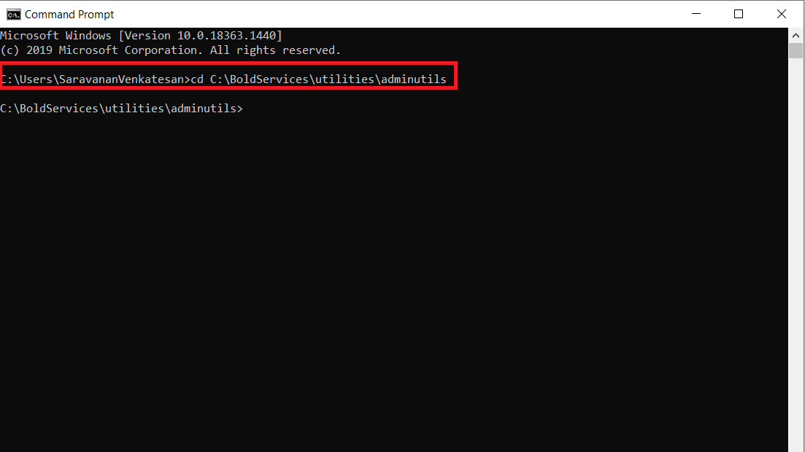

2. After changing the directory, please run the below command to reset password.

   ```sh
   Syncfusion.Server.Commands.Utility.exe reset -u 'user email or username here' -p 'new password here'
   ```

   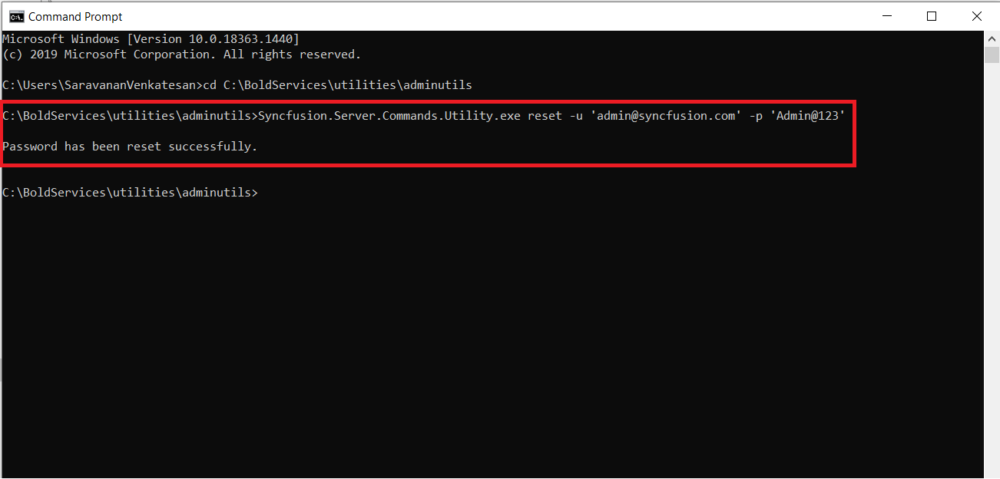

3. Once the password has been reset successfully, the user can login with the updated password.

## Linux

1. Change the directory to the admin utility location.

   ```sh
   cd /var/www/bold-services/application/utilities/adminutils/
   ```

   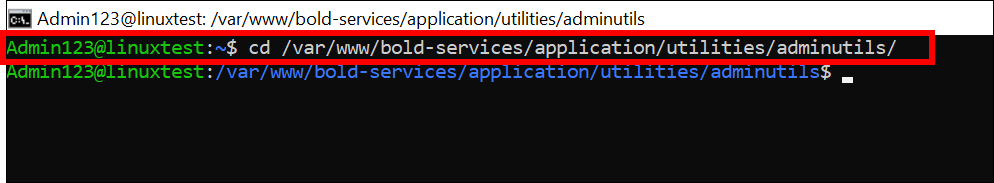

2. After changing the directory, please run the following command to reset the password:

   ```sh
   ../../../dotnet/dotnet Syncfusion.Server.Commands.Utility.dll reset -u 'user email or username here' -p 'new password here'
   ```

   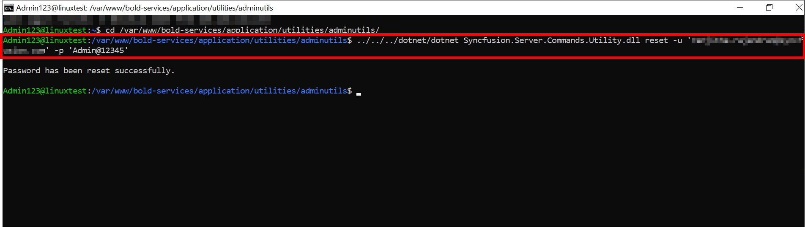

3. Once the password has been reset successfully, the user can log in with the updated password.

## Azure App Service

**Please follow the steps below to update the user password.**

1. Stop the created Azure App Service.

   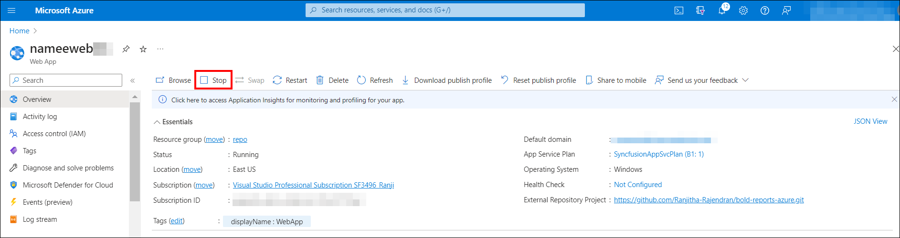

2. Navigate to your storage account, which was created during the deployment of Bold Reports in the Azure App Service, and proceed to the container section.

   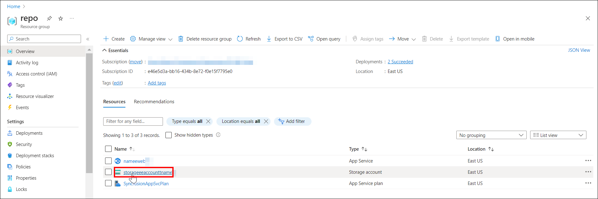
   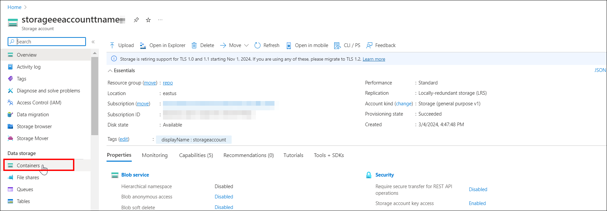

3. Go to the location: **boldreportscontainer/boldservices/app_data/configuration**

   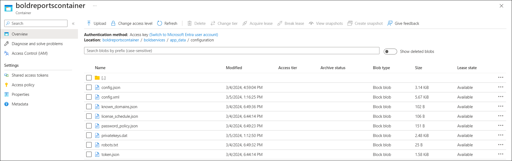

4. Download the **config.xml** and **privatekey.dat** files from the specified location.

   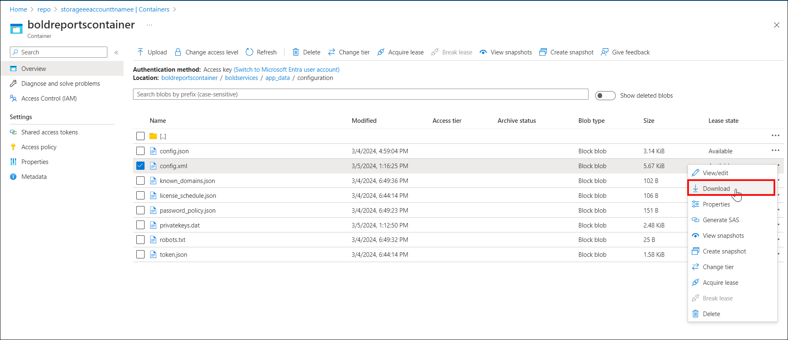

5. To reset the user password, please download the [Password Reset Utility](https://www.syncfusion.com/downloads/support/directtrac/general/ze/adminutils-1865244183).

6. Once downloaded, unzip the file to extract its contents.

7. Under the extracted **adminutils** folder, create a new folder named **app_data\configuration**, as illustrated in the screenshot below.

   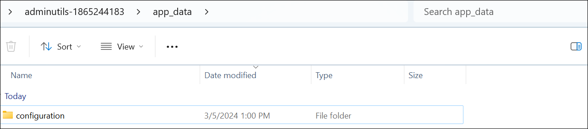

8. Copy the `config.xml` and `privatekeys.dat` files downloaded in step 4, and paste them into the **adminutils-1865244183\app_data\configuration** folder.

   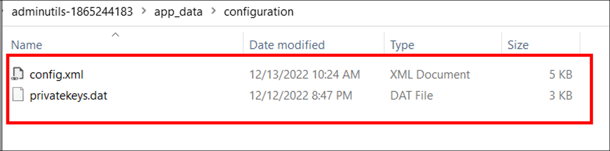

9. Open Windows PowerShell in Administrator mode and navigate to the utility directory as follows:

   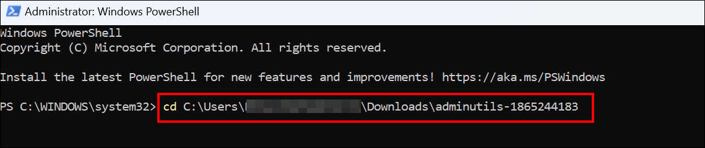

10. Reset the password by running the command below.

```sh
./Syncfusion.Server.Commands.Utility.exe  reset -u <username> -p <new password>
```

   **Command details:**

   username - provide your username or email address of the user.</br>
   new password - provide new password which you want to reset.
   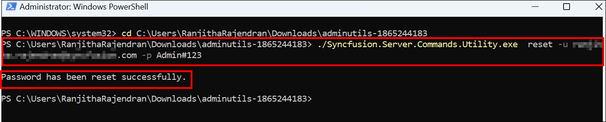
11. After successful execution, the password will be updated in the `config.xml` and `privatekeys.dat` files located in the **adminutils-1865244183\app_data\configuration** directory.</br>
12. Afterward, you need to upload the `config.xml` and `privatekeys.dat` files to the **storage account** associated with the Azure App Service. Navigate to your storage account, and go to the following location: **boldreportscontainer/boldservices/app_data/configuration**.

13. Before proceeding, please make a `backup` of the current **config.xml** and **privatekeys.dat** files, then delete them.
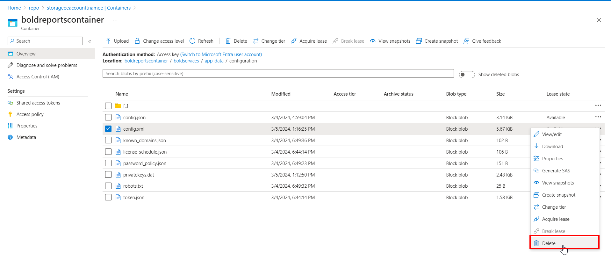
14. Click `Upload` and select the **config.xml** file from the location: `adminutils-1865244183\app_data\configuration` to upload it. Next, proceed to upload the **privatekeys.dat** file.
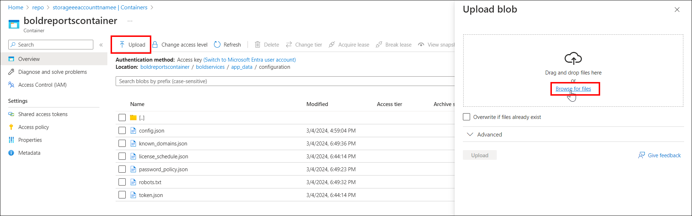
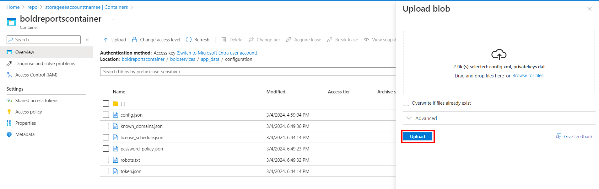
15. Start the Azure app service.
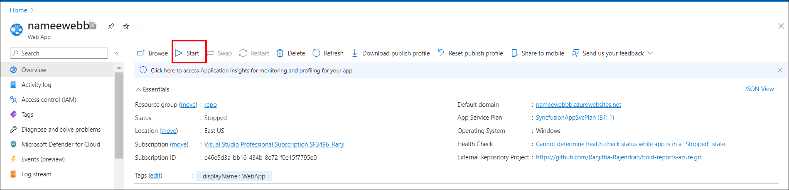
You can now access the application by using its URL.