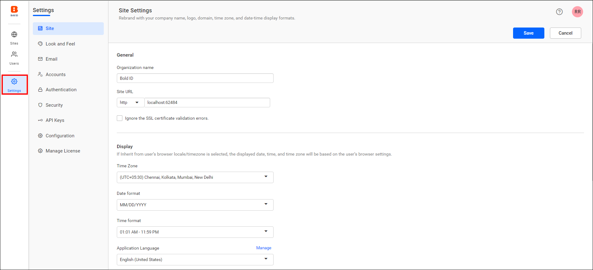
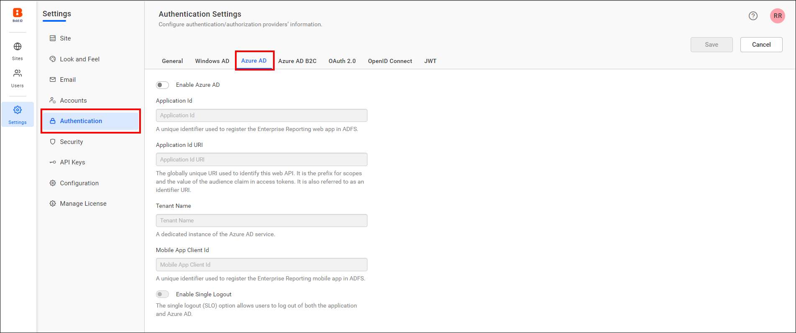
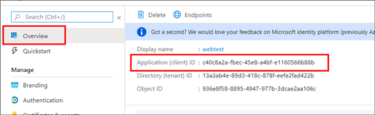
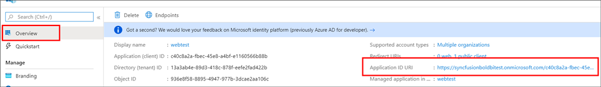
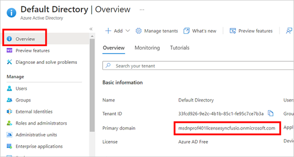
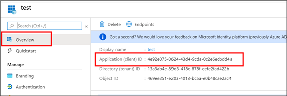

# How to set up Microsoft Entra ID (formerly Azure AD) for SSO authentication in Bold Reports®

To set up SSO with Microsoft Entra ID (formerly Azure AD), register Bold Reports® in the Azure portal and save its details in the Azure AD settings.

> **NOTE:** This configuration has to been done in the [Azure Portal](https://portal.azure.com/#home).

## What do I need before I set up Microsoft Entra ID SSO?

To set up Microsoft Entra ID SSO for Bold Reports®, you need the following:

* An Azure account with Active Directory support is required.
* Install the Bold Reports® application and log in using an administrator account.

## How do I set up Bold Reports® to use Microsoft Entra ID single sign-on?

You set up Microsoft Entra ID single sign-on in the Bold Reports® UMS **Authentication** settings. Follow these steps:

1. Log in to the URL `{Bold Reports URL}/ums/administration/sso?view=azure-ad-settings` using the admin credentials.

2. Click `Settings` in the left menu.

    

3. Click `Authentication`, then go to the `Azure AD` tab and save the following fields in UMS settings:

    

    > **NOTE:** To register the [Bold Reports® web application](https://help.boldreports.com/enterprise-reporting/administrator-guide/how-to/set-up-azure-active-directory/#steps-to-register-bold-reports-on-premise-application-in-azure-active-directory) and the [Bold Reports® mobile application](https://help.boldreports.com/enterprise-reporting/administrator-guide/how-to/set-up-azure-active-directory/#steps-to-register-bold-reports-on-premise-mobile-application-in-azure-active-directory) in Microsoft Entra ID, follow the linked steps.

    ***Application Id:** Go to the registered application, click `Overview`, and then copy the `Application Id` to paste it.

    

    ***Application Id URI:** Go to the registered application, click `Overview`, and then copy the `Application Id URI` to paste it.

    

    ***Tenant Name:** Go to the created `Azure Active Directory` and copy the domain name from the `Overview` section.

    

    ***Mobile App Client ID:** Go to the registered application for the Bold Reports® mobile application. Copy the `Application ID` and paste it.

    

4. Click `save`. After the values are saved, the application restarts to apply the settings.

## Frequently asked questions

### Where do I register Bold Reports® for Microsoft Entra ID SSO?

You register the Bold Reports® web and mobile applications in the Azure Portal. Then, you save the registered application details in the Azure AD settings of Bold Reports®.

### What happens after I save the Microsoft Entra ID settings?

After the values are saved, the Bold Reports® application restarts to apply the settings.

## See also

* [Single sign-on overview](./../overview/)
* [Office 365 authentication](./../office-365/)
* [Configure OpenID Connect single sign-on](./../openid-connect/)
