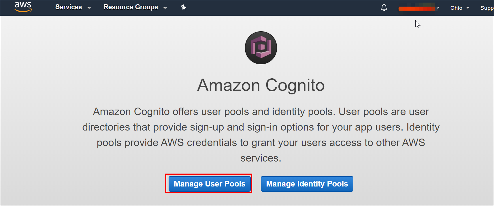
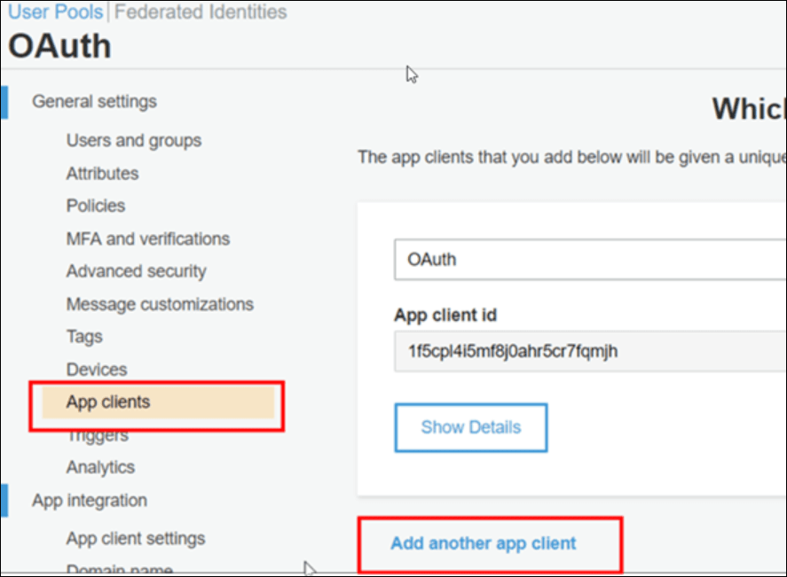
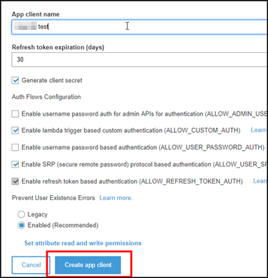
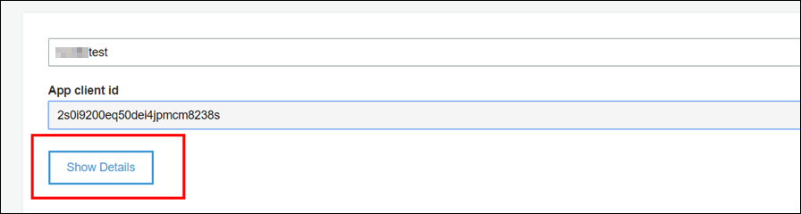
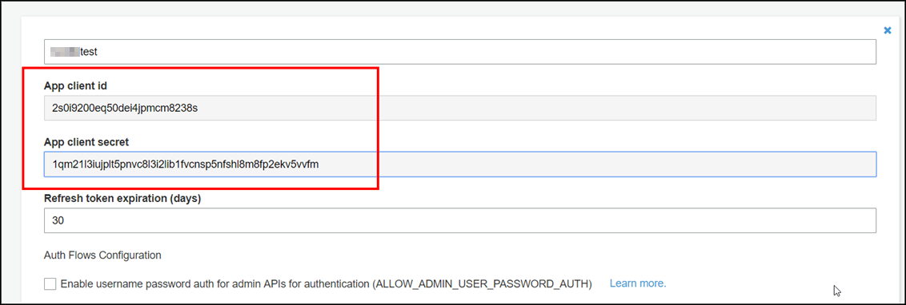
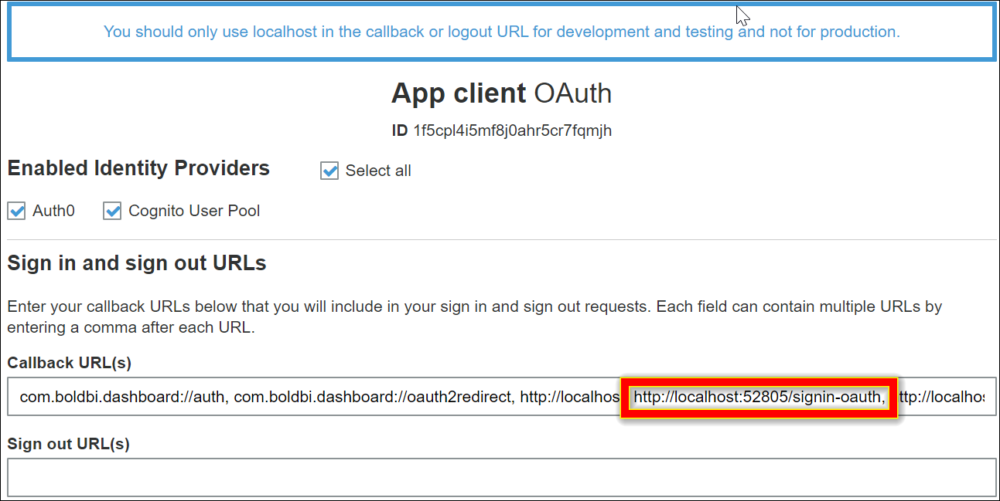
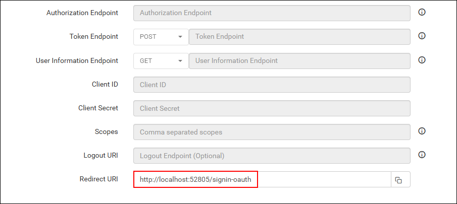
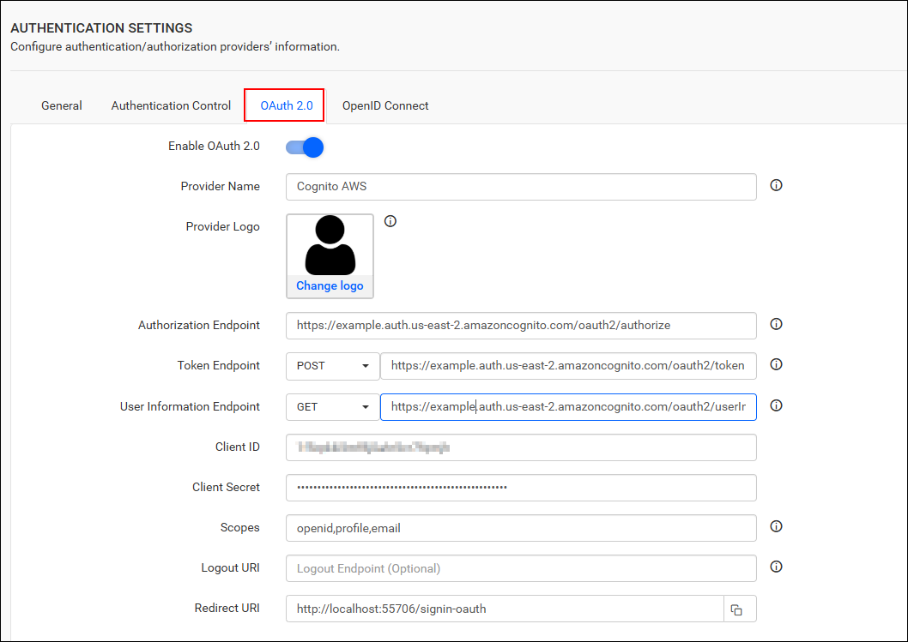

# Single Sign-On (SSO) with Amazon Cognito authentication in Bold Reports®

Bold Reports® lets you add users to the application with the Amazon Cognito provider over OAuth 2.0. After you import them, administrators can share reports and email exported reports to them.

## How to register the Bold Reports® application in Amazon Cognito

Register the Bold Reports® application in Amazon Cognito to let Amazon Cognito users sign in with single sign-on.

> **Note:** This configuration has to be done on the Amazon Cognito website.

## What do I need before I register Bold Reports® in Amazon Cognito?

To register Bold Reports® in Amazon Cognito, you need the following:

* An admin account in Amazon Cognito.
* A user pool in Amazon Cognito.
* Install the Bold Reports® application.

## How do I register the Bold Reports® application in Amazon Cognito?

You register the Bold Reports® application as an app client in an Amazon Cognito user pool. Follow these steps:

1. Log in to the `Amazon Cognito` website with an admin account, open the console, and then click `Manage User pool`.
    

2. Click `App Clients` under General Settings in the left-side menu, and then `add` the `application`.
    

3. Save the `App client name` and click `Create app client`.
    

4. Click `Show Details` to see the `Client Secret`.
    

5. Use the `App client id` and `App client secret`, as shown in the following screenshot.
    

6. Click `App client settings` under App integration in the left-side menu and add the `Callback URL(s)`.
    

7. Make sure the callback URL(s) match the URI in the settings of your Bold Reports® application, as shown in the following screenshot.
    

After successful registration in Amazon Cognito, save these settings in the Bold Reports® settings page to enable this authentication.

## Enable Amazon Cognito authentication in Bold Reports®

To enable Amazon Cognito authentication in Bold Reports®, configure the OAuth 2.0 settings as shown in the following screenshot.
    

## Which fields do I fill in for Amazon Cognito?

The following table explains the fields required to enable Amazon Cognito for authentication in Bold Reports®:

<table>
<tr>
    <td>
        Provider Name
    </td>
    <td>
        It represents the name of the authentication provider to be displayed on the login page.
    </td>
</tr>
<tr>
    <td>
        Provider Logo
    </td>
    <td>
        It represents the logo of the authentication provider to be displayed on the login page.
    </td>
</tr>
<tr>
    <td>
        Authorization Endpoint
    </td>
    <td>
        It should be in the format https://AUTH_DOMAIN/oauth2/authorize. For more details, see the <a href="https://docs.aws.amazon.com/cognito/latest/developerguide/authorization-endpoint.html">AWS Cognito Authorization Endpoint Guide</a>.
    </td>
</tr>
    <tr>
    <td>
        Token Endpoint Method
    </td>
    <td>
        POST
    </td>
</tr>
</tr>
    <tr>
    <td>
        Token Endpoint
    </td>
    <td>
        It should be in the format https://AUTH_DOMAIN/oauth2/token. For more details, see the <a href="https://docs.aws.amazon.com/cognito/latest/developerguide/token-endpoint.html">AWS Cognito Token Endpoint Guide</a>.
    </td>
</tr>
</tr>
    <tr>
    <td>
        User Information Endpoint Method
    </td>
    <td>
        GET
    </td>
</tr>
</tr>
    <tr>
    <td>
        User Information Endpoint
    </td>
    <td>
        It should be in the format https://AUTH_DOMAIN/oauth2/userinfo. For more details, see the <a href="https://docs.aws.amazon.com/cognito/latest/developerguide/userinfo-endpoint.html">AWS Cognito UserInfo Endpoint Guide</a>.
    </td>
</tr>
</tr>
    <tr>
    <td>
        Client ID
    </td>
    <td>
        The Client ID is obtained after registering the Bold Reports® application on the Amazon Cognito website.
    </td>
</tr>
</tr>
    <tr>
    <td>
        Client Secret
    </td>
    <td>
        The Client Secret is obtained after registering the Bold Reports® application on the Amazon Cognito website.
    </td>
</tr>
</tr>
    <tr>
    <td>
        Scopes
    </td>
    <td>
        openid, profile, email
    </td>
</tr>
</tr>
    <tr>
    <td>
        Logout URI
    </td>
    <td>
        It is an endpoint that logs out the third-party provider.
    </td>
</tr>
</tr>
    <tr>
    <td>
        Email
    </td>
    <td>
        This must be the email of an admin account on the Amazon Cognito website.
    </td>
</tr>
</table>

## Frequently asked questions

### Which scopes does Amazon Cognito need in Bold Reports®?

Use the scopes `openid, profile, email` in the Bold Reports® OAuth 2.0 settings for Amazon Cognito.

### Where do I get the Amazon Cognito Client ID and Client Secret?

You get the Client ID and Client Secret after you register the Bold Reports® application on the Amazon Cognito website. Click `Show Details` on the app client to see the secret.

## See also

* [Configure OAuth 2.0 single sign-on](./../)
* [Auth0 OAuth 2.0 single sign-on](./../auth0/)
* [Okta OAuth 2.0 single sign-on](./../okta/)
