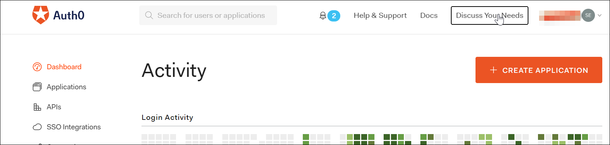
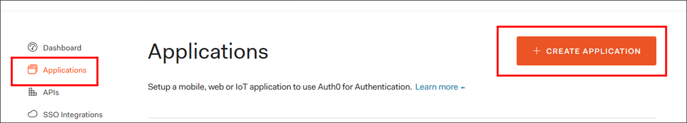
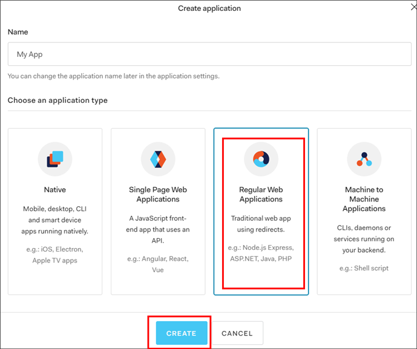
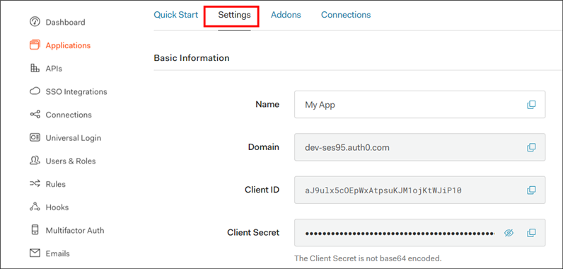
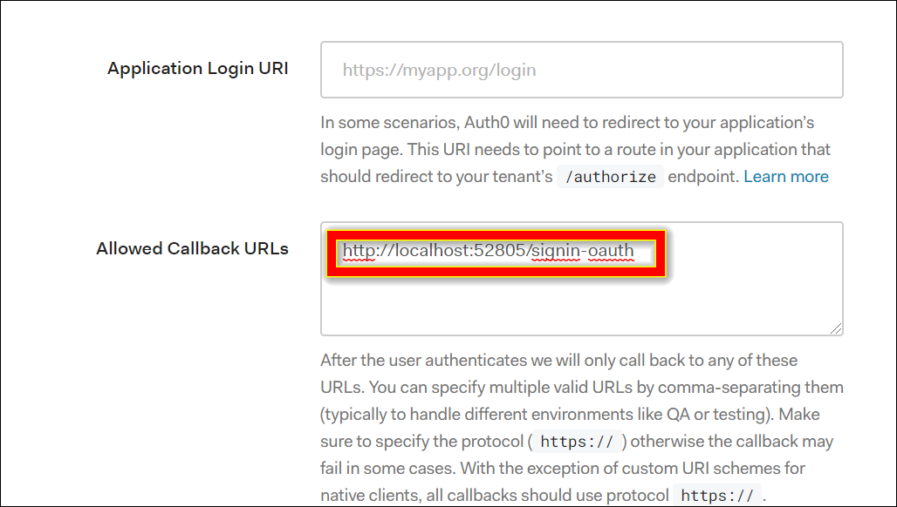
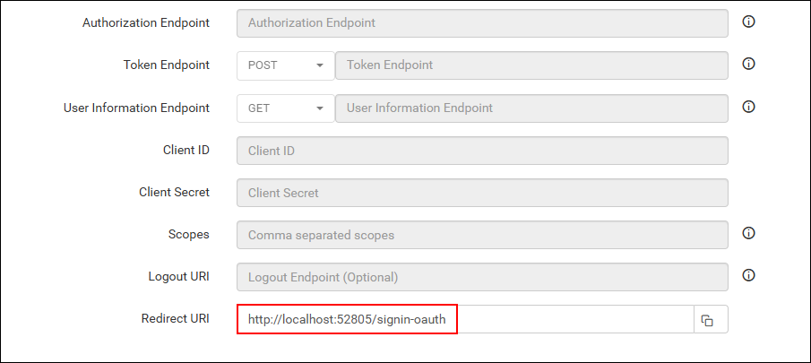
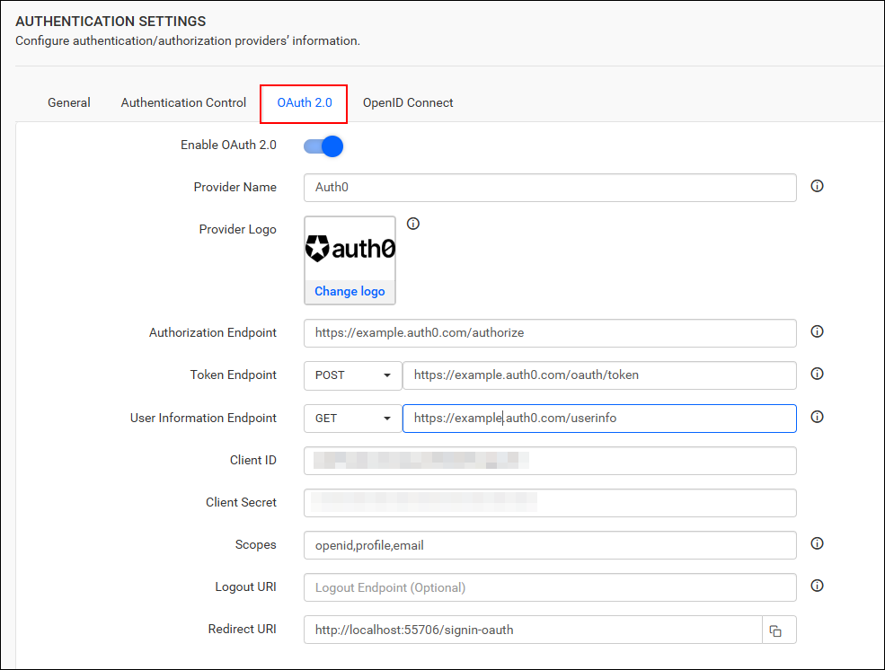

# Single Sign-On (SSO) with Auth0 authentication in Bold Reports®

Bold Reports® lets you add users to the application with the Auth0 provider over OAuth 2.0. After you import them, you can share reports and email exported reports with them.

## How to register the Bold Reports® application in Auth0

Register the Bold Reports® application in Auth0 to let Auth0 users sign in with single sign-on.

> **Note:** This configuration has to be done on the Auth0 website.

## What do I need before I register Bold Reports® in Auth0?

To register Bold Reports® in Auth0, you need the following:

* An admin account in Auth0.
* Install the Bold Reports® application.

## How do I register the Bold Reports® application in Auth0?

You register Bold Reports® in Auth0 as a Regular Web Application. Follow these steps:

1. Log in to the Auth0 website with an `admin` account.
    

2. Click `Applications` in the left menu, and then click the `CREATE APPLICATION` button.
    

3. Click `Regular Web Applications` and proceed to the next step.
    

4. Auth0 registers the application and opens the application details page. Use the `Client ID` and `Client Secret` in the Bold Reports® application.
    

5. Scroll down and save the `Allowed Callback URLs`.
    

6. Make sure this URL matches the redirect URI in the settings of your Bold Reports® application, as shown in the following screenshot.
    

7. Fill in the details and save the changes.

After successful registration in Auth0, save these settings in the Bold Reports® settings page to enable this authentication.

## Enable Auth0 authentication in Bold Reports®

To enable Auth0 authentication in Bold Reports®, configure the OAuth 2.0 settings as shown in the following screenshot.
    

## Which fields do I fill in for Auth0?

The following table explains the fields you save in Bold Reports® to enable Auth0 for authentication:

<table>
<tr>
    <td>
        Provider Name
    </td>
    <td>
        It represents the name of the authentication provider to be displayed on the login page.
    </td>
</tr>
<tr>
    <td>
        Provider Logo
    </td>
    <td>
        It represents the logo of the authentication provider to be displayed on the login page.
    </td>
</tr>
<tr>
    <td>
        Authorization Endpoint
    </td>
    <td>
        It should be in the format https://YOUR_DOMAIN/authorize. For more details, see the <a href="https://auth0.com/docs/flows/guides/auth-code/add-login-auth-code#authorize-the-user">Auth0 authorize the user guide</a>.
    </td>
</tr>
    <tr>
    <td>
        Token Endpoint Method
    </td>
    <td>
        POST
    </td>
</tr>
</tr>
    <tr>
    <td>
        Token Endpoint
    </td>
    <td>
        It should be in the format https://YOUR_DOMAIN/oauth/token. For more details, see the <a href="https://auth0.com/docs/flows/guides/auth-code/add-login-auth-code#request-tokens">Auth0 request tokens guide</a>.
    </td>
</tr>
</tr>
    <tr>
    <td>
        User Information Endpoint Method
    </td>
    <td>
        GET
    </td>
</tr>
</tr>
    <tr>
    <td>
        User Information Endpoint
    </td>
    <td>
        It should be in the format https://YOUR_DOMAIN/userinfo . For more details, see the <a href="https://auth0.com/docs/api/authentication?http#get-user-info">Auth0 get user info reference</a>.
    </td>
</tr>
</tr>
    <tr>
    <td>
        Client ID
    </td>
    <td>
        The Client ID is obtained after registering the Bold Reports® application on the Auth0 website.
    </td>
</tr>
</tr>
    <tr>
    <td>
        Client Secret
    </td>
    <td>
        The Client Secret is obtained after registering the Bold Reports® application on the Auth0 website.
    </td>
</tr>
</tr>
    <tr>
    <td>
        Scopes
    </td>
    <td>
        openid, profile, email
    </td>
</tr>
</tr>
    <tr>
    <td>
        Logout URI
    </td>
    <td>
        It is an endpoint that logs out the third-party provider.
    </td>
</tr>
</tr>
    <tr>
    <td>
        Email
    </td>
    <td>
        This must be the email of an admin account on the Auth0 website.
    </td>
</tr>
</table>

## Frequently asked questions

### Which Auth0 application type do I choose for Bold Reports®?

Choose `Regular Web Applications` when you create the Bold Reports® application in Auth0.

### Which scopes does Auth0 need in Bold Reports®?

Use the scopes `openid, profile, email` in the Bold Reports® OAuth 2.0 settings for Auth0.

## See also

* [Configure OAuth 2.0 single sign-on](./../)
* [Amazon Cognito OAuth 2.0 single sign-on](./../amazon-cognito/)
* [Auth0 OpenID Connect single sign-on](./../../openid-connect/auth0/)
