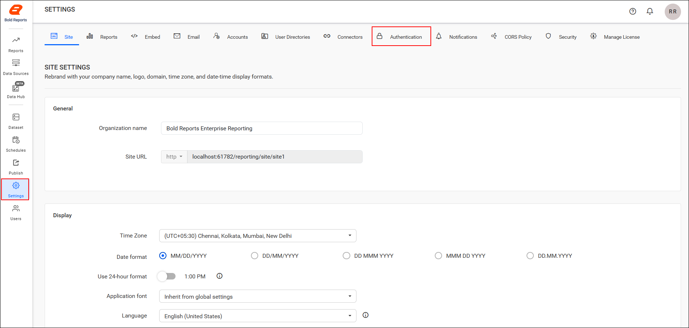
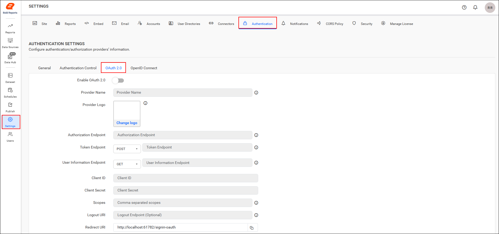
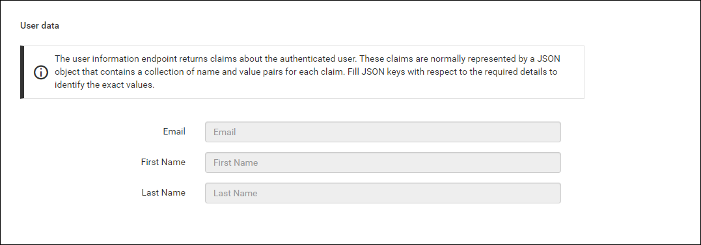
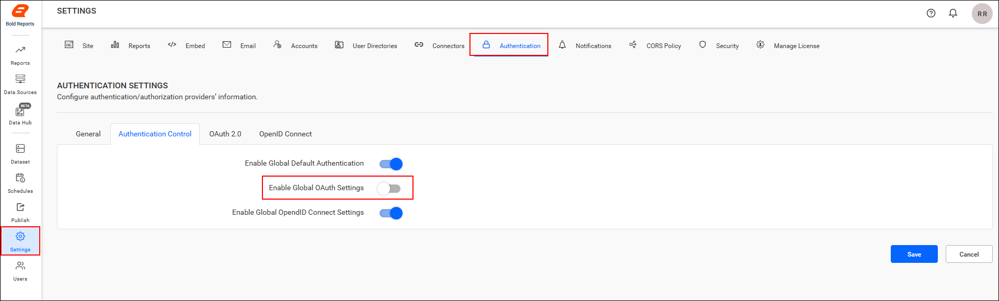
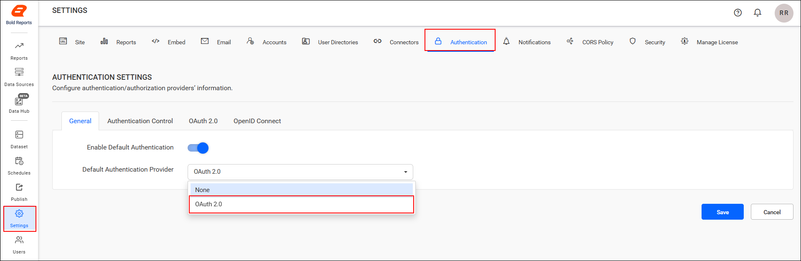
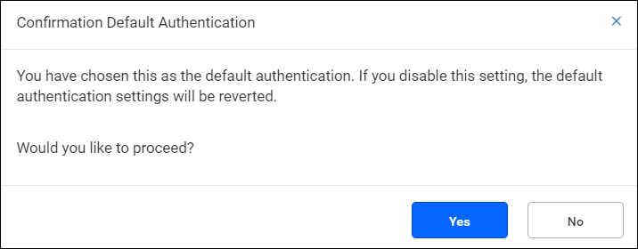

# Single Sign-On (SSO) with OAuth 2.0 authentication in Bold Reports®

Bold Reports® supports OAuth 2.0 for Single Sign-On (SSO), so users log in directly to the Bold Reports® application after they authenticate with OAuth 2.0.

## What do I need before I configure OAuth 2.0?

To configure OAuth 2.0 in Bold Reports®, you need the following:

1. An account with an OAuth 2.0 provider is required.

2. Register the Bold Reports® application with the OAuth 2.0 provider.

## Steps to configure OAuth 2.0 in Bold Reports®

You configure OAuth 2.0 in the Bold Reports® Report Server **Settings** page. Follow these steps:

1. Log in to Bold Reports® with the admin credentials and click the `Settings` option in the Bold Reports® Report Server left-side panel.

2. Go to the Authentication tab and select OAuth 2.0, as shown in the following images.
    

   

3. Provide the following details in the OAuth 2.0 settings of the Bold Reports® application:
<table>
<tr>
    <td>
        Provider Name
    </td>
    <td>
        It represents the name of the authentication provider to be displayed on the login page.
    </td>
</tr>
<tr>
    <td>
        Provider Logo
    </td>
    <td>
        It represents the logo of the authentication provider to be displayed on the login page.
    </td>
</tr>
<tr>
    <td>
        Authorization Endpoint
    </td>
    <td>
        This is the endpoint in the provider used to authorize the user.
    </td>
</tr>
    <tr>
    <td>
        Token Endpoint Method
    </td>
    <td>
        It represents the request type to access the token endpoint.
    </td>
</tr>
</tr>
    <tr>
    <td>
        Token Endpoint
    </td>
    <td>
        It is the endpoint in the provider responsible for generating the token.
    </td>
</tr>
</tr>
    <tr>
    <td>
        User Information Endpoint Method
    </td>
    <td>
        It is the endpoint in the provider used to retrieve the user details.
    </td>
</tr>
</tr>
    <tr>
    <td>
        User Information Endpoint
    </td>
    <td>
        It represents the request type used to access the user information endpoint.
    </td>
</tr>
</tr>
    <tr>
    <td>
        Client ID
    </td>
    <td>
        It is a unique identifier provided to each application during registration with the providers.
    </td>
</tr>
</tr>
    <tr>
    <td>
        Client Secret
    </td>
    <td>
        It is a secret key used to authorize the applications.
    </td>
</tr>
</tr>
    <tr>
    <td>
        Scopes
    </td>
    <td>
        It is a comma-separated list of identifiers that specifies the access privileges being requested from the provider.
    </td>
</tr>
</tr>
    <tr>
    <td>
        Logout URI
    </td>
    <td>
        It is an endpoint that logs out the third-party provider.
    </td>
</tr>
</tr>
    <tr>
    <td>
        Email
    </td>
    <td>
        This should be the email address of an admin account of the provider.
    </td>
</tr>
</table>

   The following screenshots show the OAuth 2.0 settings and the user data fields.

   
    

## How does group claims authentication work?

Group claims authentication in Bold Reports® maps users and groups automatically, based on the group claim received in the authentication token. The claims are typically a JSON object with key-value pairs for each claim. Provide the JSON key that identifies the group claim value.

<table>
    <tr>
        <td>Enable User and Group Mapping </td>
        <td>When enabled, the system fetches group claim values from the token and dynamically maps users to one or more groups during login.</td>
    </tr>
    <tr>
        <td>Un-map Existing Groups of User and map to New Group </td>
        <td>When enabled, all previously assigned groups for the user are removed, and the user is mapped only to the groups specified in the claim.</td>
    </tr>
    <tr>
        <td>Group Claim Name</td>
        <td>Enter the claim name that contains the group identifiers. Users will be mapped only if the group names in the claim match existing groups in the site.</td>
    </tr>
</table>

   

## How do I configure OAuth 2.0 in the User Management Server?

You configure OAuth 2.0 in the Bold Reports® User Management Server with the same steps. Log in to the URL `{Bold Reports URL}/ums/administration/authentication` with admin credentials.

## Which OAuth 2.0 providers can I connect to Bold Reports®?

The following guides explain how to connect several OAuth 2.0 providers to the Bold Reports® application:

* [Amazon Cognito](./../oauth-2.0/amazon-cognito/)
* [Auth0](./../oauth-2.0/auth0/)
* [Okta](./../oauth-2.0/okta/)
* [OneLogin](./../oauth-2.0/onelogin/)

## Can I turn off OAuth 2.0 for a single site?

Yes. OAuth 2.0 functionality is available in both Bold Reports® sites and the User Management Server. You can manage it for each site individually on the settings page by disabling the option, as the following screenshot shows.

## Set OAuth 2.0 as Default Authentication

Bold Reports® can use OAuth 2.0 as the default authentication method when the [OAuth 2.0 settings](#steps-to-configure-oauth-20-in-bold-reports) are enabled and saved. Follow these steps:

1. On the settings page, click the **Authentication** tab and select **General**.
2. Enable the option **Enable Default Authentication** and select **OAuth 2.0** as the default authentication provider, as shown in the following screenshot.
    

### What happens when I disable OAuth 2.0 settings?

When OAuth 2.0 is the default authentication and you try to disable the [OAuth 2.0 settings](#steps-to-configure-oauth-20-in-bold-reports), Bold Reports® displays the following pop-up. Click `Yes` to proceed and disable the [OAuth 2.0 default authentication](#set-oauth-20-as-default-authentication).

### How do I bypass OAuth 2.0 authentication?

To log in to Bold Reports® as a normal user who does not use OAuth, use the following custom login URL when [OAuth 2.0 default authentication](#set-oauth-20-as-default-authentication) is enabled:
>**`{Bold Reports URL}/reporting/site/{tenant-name}/login?use_default_authentication=false`**

## See also

* [Single sign-on overview](./../overview/)
* [Configure OpenID Connect single sign-on](./../openid-connect/)
* [Microsoft Entra ID single sign-on](./../azure-active-directory/)
