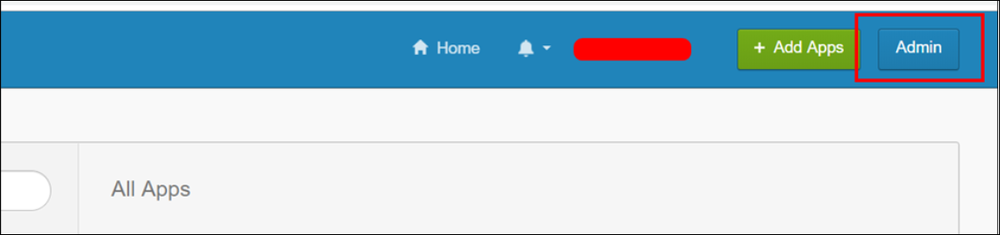
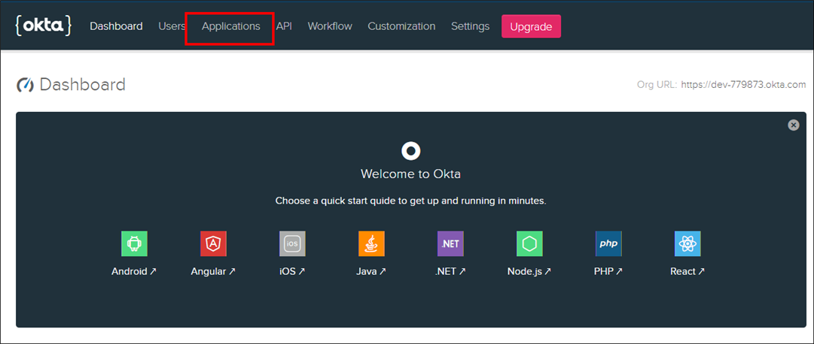
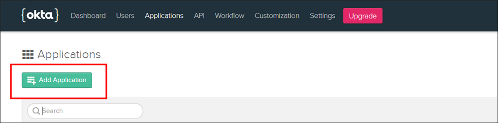
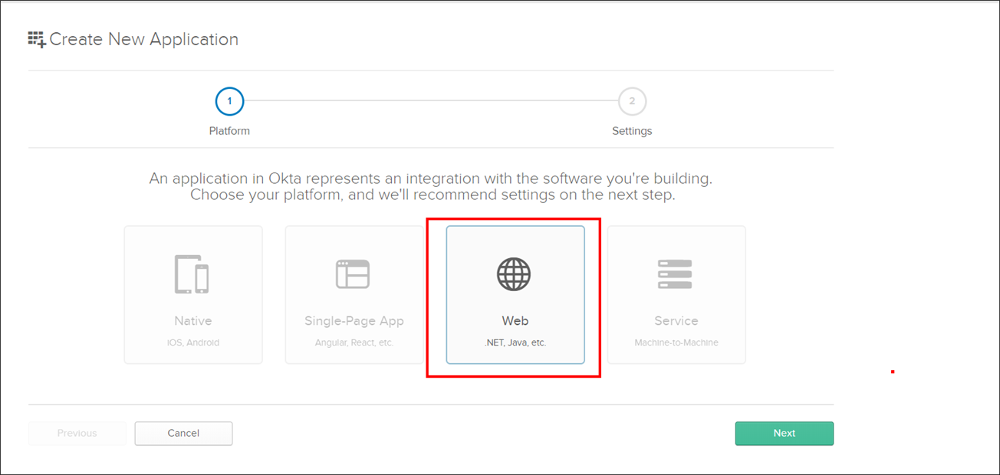
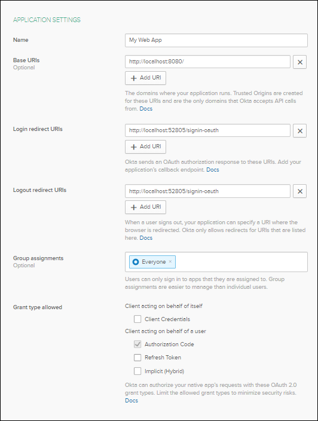
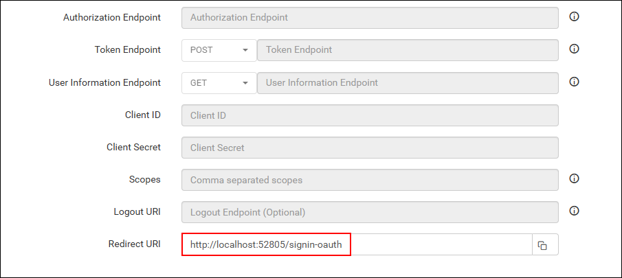
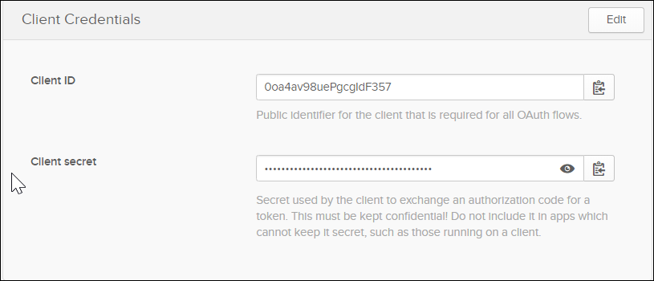
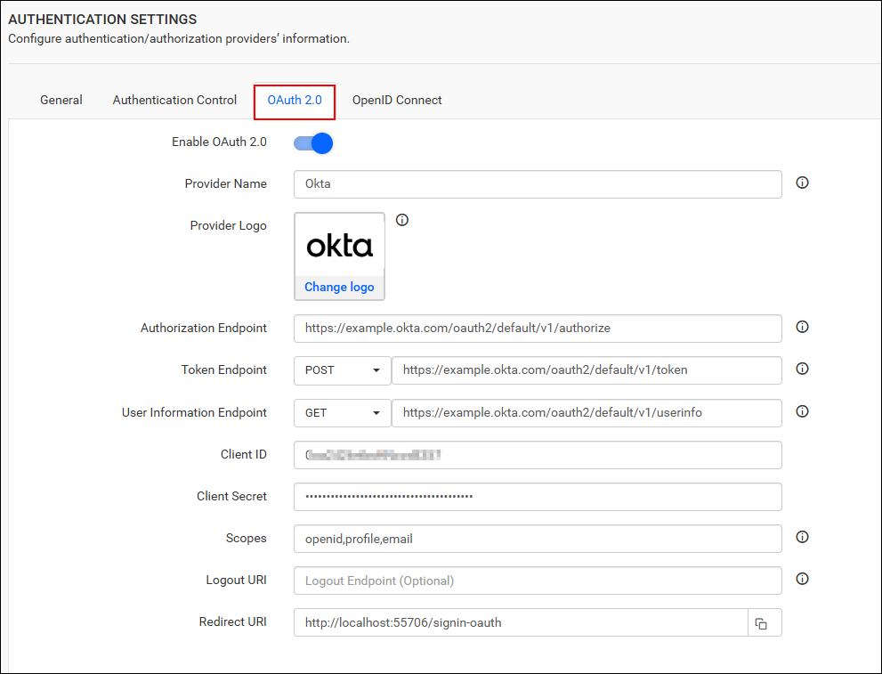

# Single Sign-On (SSO) with Okta authentication in Bold Reports®

Bold Reports® lets you add users to the application with the Okta provider over OAuth 2.0. After you import them, you can share reports and email exported reports to them.

## How to register the Bold Reports® application in Okta

Register the Bold Reports® application in Okta to let Okta users sign in with single sign-on.

> **Note:** This configuration needs to be done on Okta website.

## What do I need before I register Bold Reports® in Okta?

To register Bold Reports® in Okta, you need the following:

* An admin account in Okta.
* Install the Bold Reports® application.

## How do I register the Bold Reports® application in Okta?

You register Bold Reports® in Okta as a Web application. Follow these steps:

1. Log in to the Okta website with an `admin` account.
    

2. Click `Applications` in the header menu.
    

3. Click the `Add` Application button.
    

4. Click `Web` and proceed with `Next`.
    

5. Fill in the following application details on the next page and click `Done`.

    * Name
    * Login Redirect URIs
    * Logout Redirect URIs
    

6. Make sure the Login redirect URIs match the URI in the settings of your Bold Reports® application, as shown in the following screenshot.
    

7. On the next page, copy the `Client ID` and `Client Secret` at the bottom of the page. The page also shows the other details you filled in on the previous page.
    

After successful registration in Okta, save these settings in the Bold Reports® settings page to enable this authentication.

## Enable Okta Authentication in Bold Reports®

To enable Okta authentication in Bold Reports®, configure the OAuth 2.0 settings as shown in the following screenshot.
    

## Which fields do I fill in for Okta?

The following table explains the fields you save in Bold Reports® to enable Okta for authentication:
<table>
<tr>
    <td>
        Provider Name
    </td>
    <td>
        This represents the name of the authentication provider to be displayed on the login page.
    </td>
</tr>
<tr>
    <td>
        Provider Logo
    </td>
    <td>
        It represents the logo of the authentication provider to be displayed on the login page.
    </td>
</tr>
<tr>
    <td>
        Authorization Endpoint
    </td>
    <td>
        It should be in the format ${baseUrl}/v1/authorize. For more details, see the <a href="https://developer.okta.com/docs/reference/api/oidc/#authorize">Okta authorize endpoint reference</a>.
    </td>
</tr>
    <tr>
    <td>
        Token Endpoint Method
    </td>
    <td>
        POST
    </td>
</tr>
</tr>
    <tr>
    <td>
        Token Endpoint
    </td>
    <td>
        It should be in the format ${baseUrl}/v1/token. For more details, see the <a href="https://developer.okta.com/docs/reference/api/oidc/#token">Okta token endpoint reference</a>.
    </td>
</tr>
</tr>
    <tr>
    <td>
        User Information Endpoint Method
    </td>
    <td>
        POST
    </td>
</tr>
</tr>
    <tr>
    <td>
        User Information Endpoint
    </td>
    <td>
        It should be in the format ${baseUrl}/v1/token. For more details, see the <a href="https://developer.okta.com/docs/reference/api/oidc/#userinfo">Okta userinfo endpoint reference</a>.
    </td>
</tr>
</tr>
    <tr>
    <td>
        Client ID
    </td>
    <td>
        The Client ID you receive after registering the Bold Reports® application on the Okta website.
    </td>
</tr>
</tr>
    <tr>
    <td>
        Client Secret
    </td>
    <td>
        The Client Secret you receive after registering the Bold Reports® application on the Okta website.
    </td>
</tr>
</tr>
    <tr>
    <td>
        Scopes
    </td>
    <td>
        openid, profile, email
    </td>
</tr>
</tr>
    <tr>
    <td>
        Logout URI
    </td>
    <td>
        It is an endpoint that logs out the third-party provider.
    </td>
</tr>
</tr>
    <tr>
    <td>
        Email
    </td>
    <td>
        This must be the email of an admin account on the Okta website.
    </td>
</tr>
</table>

## Frequently asked questions

### Which Okta application platform do I choose for Bold Reports®?

Choose `Web` when you add the Bold Reports® application in Okta.

### Where do I find the Okta Client ID and Client Secret?

Okta shows the `Client ID` and `Client Secret` at the bottom of the page after you click `Done` on the application details. Use them in the Bold Reports® OAuth 2.0 settings.

## See also

* [Configure OAuth 2.0 single sign-on](./../)
* [OneLogin OAuth 2.0 single sign-on](./../onelogin/)
* [Okta OpenID Connect single sign-on](./../../openid-connect/okta/)
