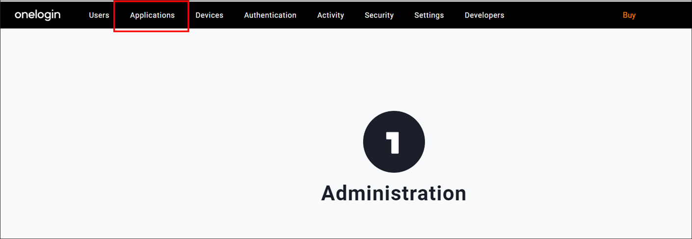
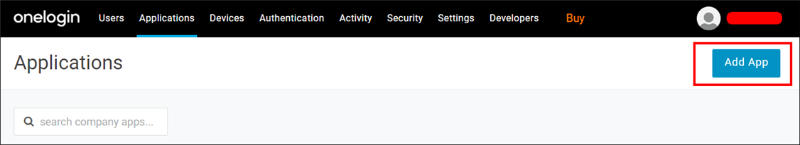
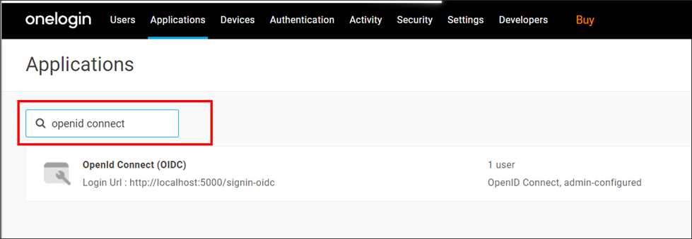
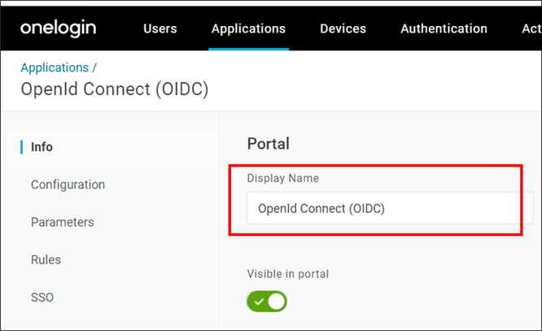
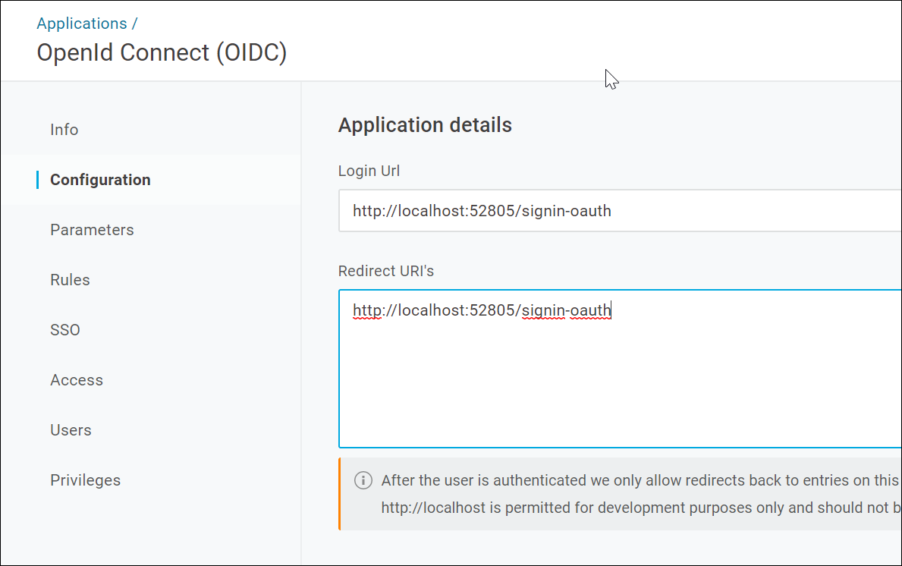
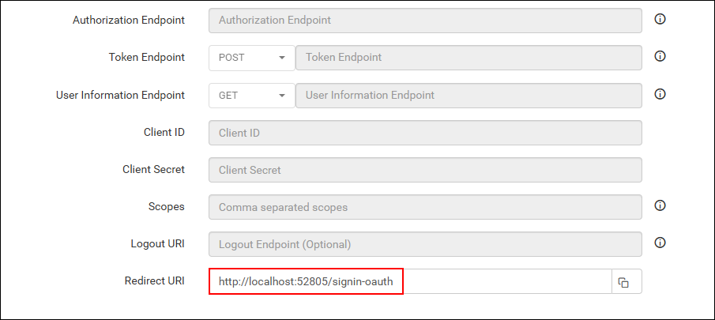
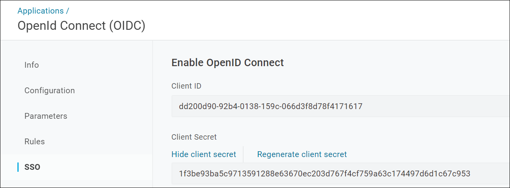
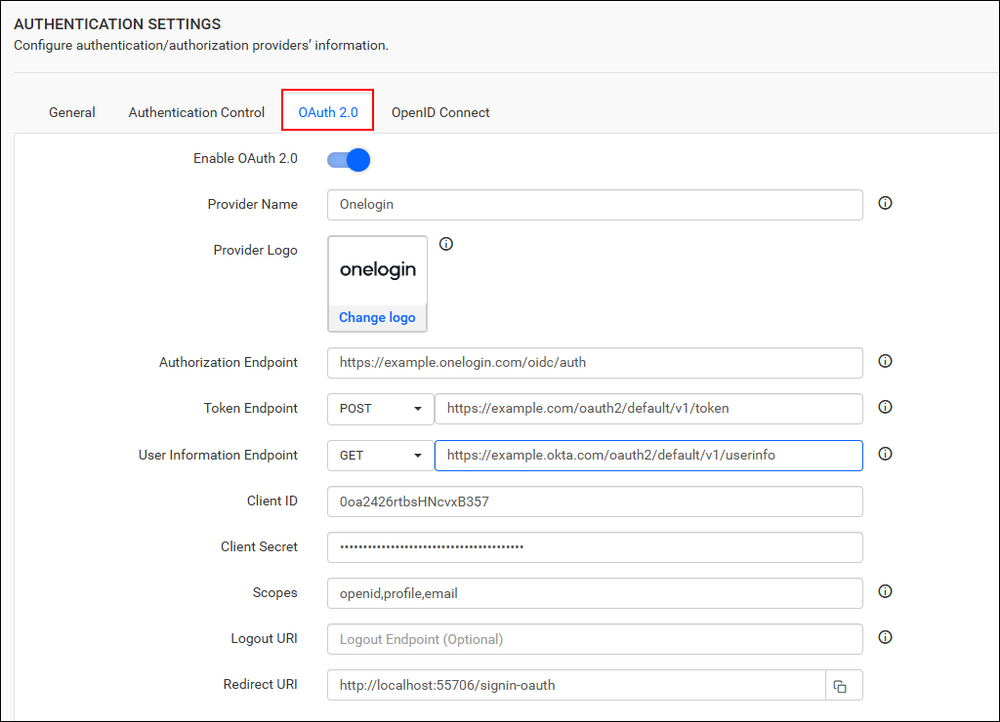

# Single Sign-On (SSO) with OneLogin authentication in Bold Reports®

Bold Reports® lets you add users to the application with the OneLogin provider over OAuth 2.0. After you import them, you can share reports and email exported reports with them.

## How to register the Bold Reports® application in OneLogin

Register the Bold Reports® application in OneLogin to let OneLogin users sign in with single sign-on (SSO).

>**Note:** This configuration must be done on the OneLogin website.

### What do I need before I register Bold Reports® in OneLogin?

To register Bold Reports® in OneLogin, you need the following:

* An admin account in OneLogin is required.

* Install the Bold Reports® application.

#### How do I register the Bold Reports® application in OneLogin?

You register Bold Reports® in OneLogin as an OpenId Connect app. Follow these steps:

1. Log in to the OneLogin website with the admin account.

2. Click `Applications` in the header menu.

   

3. Click the `Add App` button.
   

4. Type `OpenId Connect`or `oidc` in the search box and click the result.

    

5. Enter the application name and click `Add App`.

6. Save the application name in the `Display Name` field.

   

7. Click the `Configuration` tab and save the `Redirect URI's` and `Login Url`.

   

8. Find the `Redirect URI` and `Login URL` under the `OpenID Connect` settings of your Bold Reports® application, as shown in the following screenshot.

   

9. Click the `SSO` tab to locate the `Client ID` and `Client Secret`, then use them in the Bold Reports® application.

   

After successful registration in OneLogin, save these settings on the Bold Reports® settings page to enable this authentication.

## Enable OneLogin authentication in Bold Reports®

To enable OneLogin authentication in Bold Reports®, configure the OAuth 2.0 settings as shown in the following screenshot.

  

## Which fields do I fill in for OneLogin?

The following table explains the fields you save in Bold Reports® to enable OneLogin for authentication:

<table>

<tr>
<td>Provider Name</td>
<td>It represents the name of the authentication provider to be displayed in the login page.</td>
</tr>

<tr>
<td>Provider Logo</td>
<td>It represents the logo of the authentication provider to be displayed in the login page.</td>
</tr>

<tr>
<td>Authorization Endpoint</td>
<td>The format should be as follows: https://subdomain.onelogin.com/oidc/auth. For more details, see the <a href="https://developers.onelogin.com/openid-connect/api/authorization-code">OneLogin Authorization Code API Guide</a>.
</td>
</tr>

<tr>
<td>Token Endpoint Method</td>
<td>POST</td>
</tr>

<tr>
<td>Token Endpoint</td>
<td>The format should be as follows: https://subdomain.onelogin.com/oidc/token. For more details, see the <a href="https://developers.onelogin.com/openid-connect/api/authorization-code-grant">OneLogin Authorization Code Grant Guide.</a></td>
</tr>

<tr>
<td>User Information Endpoint Method</td>
<td>GET</td>
</tr>

<tr>
<td>User Information Endpoint</td>
<td>The format should be as follows: https://subdomain.onelogin.com/oidc/me. For more details, see the <a href="https://developers.onelogin.com/openid-connect/api/user-info">OneLogin User Info API Guide</a>.
</tr>

<tr>
<td>Client ID</td>
<td>The Client ID is obtained after registering the Bold Reports® application on the OneLogin website.</td>
</tr>

<tr>
<td>Client Secret</td>
<td>The Client Secret is obtained after registering the Bold Reports® application on the OneLogin website.</td>
</tr>

<tr>
<td>Scopes</td>
<td>openid, profile, email</td>
</tr>

<tr>
<td>Logout URI</td>
<td>It is an endpoint that logs out the third-party provider.</td>
</tr>

<tr>
<td>Email</td>
<td>This must be the email of an admin account on the OneLogin website.</td>
</tr>

</table>

## Frequently asked questions

### Which OneLogin app do I add for Bold Reports®?

Search for `OpenId Connect` or `oidc` when you add the app in OneLogin, and select the result.

### Where do I find the OneLogin Client ID and Client Secret?

Click the `SSO` tab of the OneLogin application to find the `Client ID` and `Client Secret`. Use them in the Bold Reports® OAuth 2.0 settings.

## See also

* [Configure OAuth 2.0 single sign-on](./../)
* [Okta OAuth 2.0 single sign-on](./../okta/)
* [OneLogin OpenID Connect single sign-on](./../../openid-connect/onelogin/)
