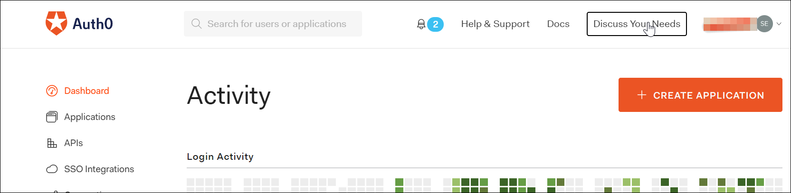
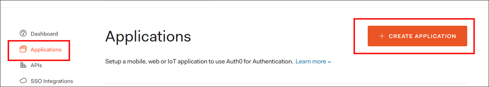
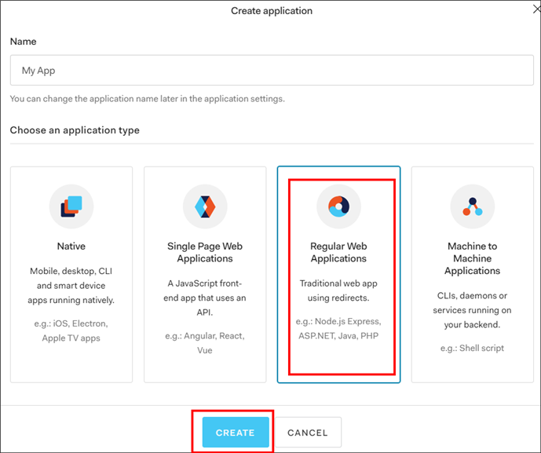
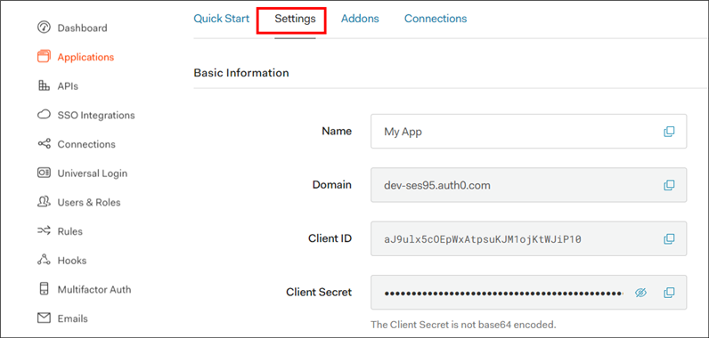
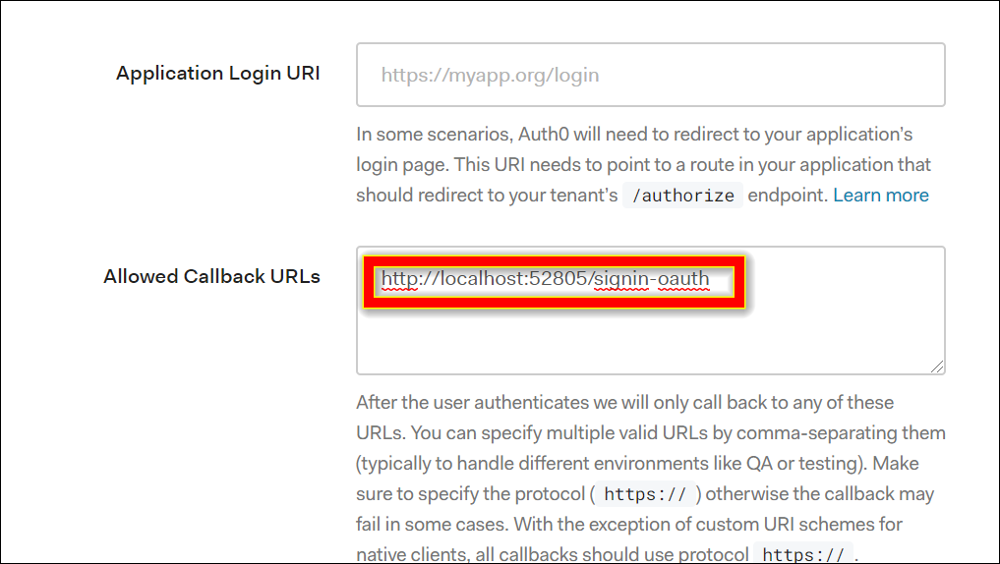
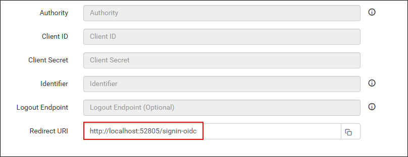
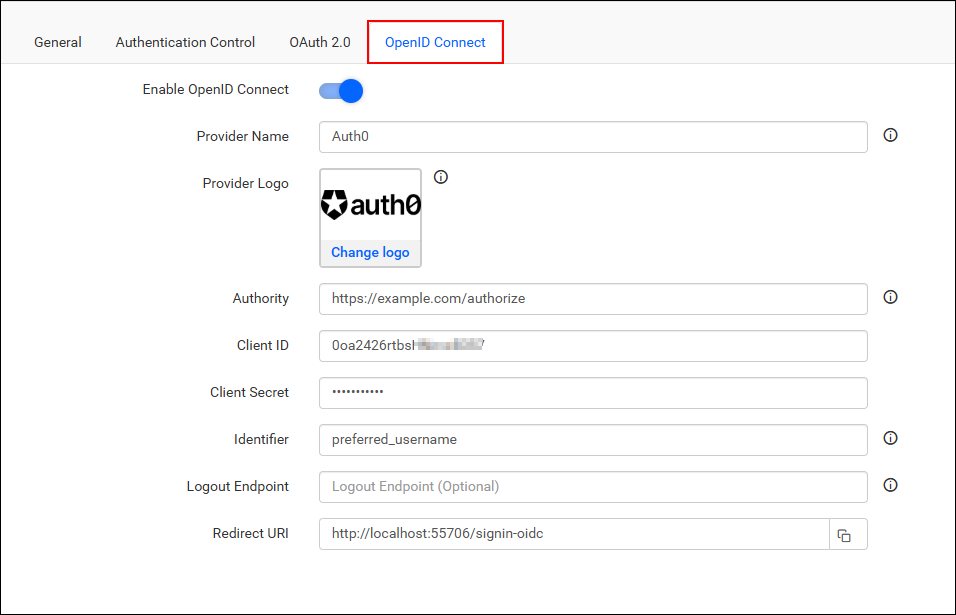

# Single Sign-On (SSO) with Auth0 authentication in Bold Reports®

Bold Reports® lets you add users to the application with the Auth0 provider over OpenID Connect. After you import them, you can share reports and email exported reports with them.

## How to register the Bold Reports® application in Auth0

Register the Bold Reports® application in Auth0 to set up single sign-on for Auth0 users.

> **Note:** This configuration has to be done on the Auth0 website.

## What do I need before I register Bold Reports® in Auth0?

To register Bold Reports® in Auth0 for OpenID Connect, you need the following:

* An admin account in Auth0.
* Install the Bold Reports® application.

## How do I register the Bold Reports® application in Auth0?

You register Bold Reports® in Auth0 as a Regular Web Application. Follow these steps:

1. Log in to the Auth0 website with an `admin` account.
    

2. Click `Applications` in the left menu, and then click the `CREATE APPLICATION` button.
    

3. Click `Regular Web Applications` and proceed with Next.
    

4. Auth0 registers the application and opens the application details page. Use the `Client ID` and `Client Secret` in the Bold Reports® application.
    

5. Scroll down and save the allowed `Callback URLs`.
    

6. Make sure this URL matches the redirect URI in the settings of your Bold Reports® application, as shown in the following screenshot.
    

7. Fill in the details and save the changes.

After successful registration in Auth0, save these settings in the Bold Reports® settings page to enable this authentication.

## Enable Auth0 authentication in Bold Reports®

To enable Auth0 authentication in Bold Reports®, configure the OpenID Connect settings as shown in the following screenshot.
    

## Which fields do I fill in for Auth0?

The following table explains the fields you save in Bold Reports® to enable Auth0 for authentication:
<table>
<tr>
    <td>
        Provider Name
    </td>
    <td>
        It represents the name of the authentication provider to be displayed on the login page.
    </td>
</tr>
<tr>
    <td>
        Provider Logo
    </td>
    <td>
        It represents the logo of the authentication provider to be displayed on the login page.
    </td>
</tr>
<tr>
    <td>
        Authority
    </td>
    <td>
        The format is https://instancename.auth0.com.  It must be the URL of your Auth0 instance.
    </td>
</tr>
<tr>
    <td>
        Client ID
    </td>
    <td>
        The Client ID you receive after registering the Bold Reports® application on the Auth0 website.
    </td>
</tr>
<tr>
    <td>
        Client Secret
    </td>
    <td>
        The Client Secret you get after registering the Bold Reports® application on the Auth0 website.
    </td>
</tr>
<tr>
    <td>
        Identifier
    </td>
    <td>
        email
    </td>
</tr>
<tr>
    <td>
        Logout Endpoint
    </td>
    <td>
        It is an endpoint that logs out the third-party provider.
    </td>
</tr>
</table>

## Frequently asked questions

### What is the Authority value for Auth0 in Bold Reports®?

The Authority is the URL of your Auth0 instance, in the format `https://instancename.auth0.com`.

### Which Identifier do I use for Auth0 in Bold Reports®?

Use `email` as the Identifier in the Bold Reports® OpenID Connect settings for Auth0.

## See also

* [Configure OpenID Connect single sign-on](./../)
* [Okta OpenID Connect single sign-on](./../okta/)
* [Auth0 OAuth 2.0 single sign-on](./../../oauth-2.0/auth0/)
