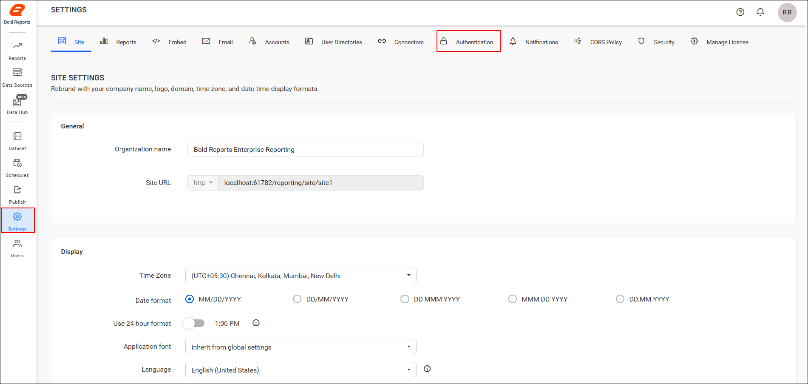
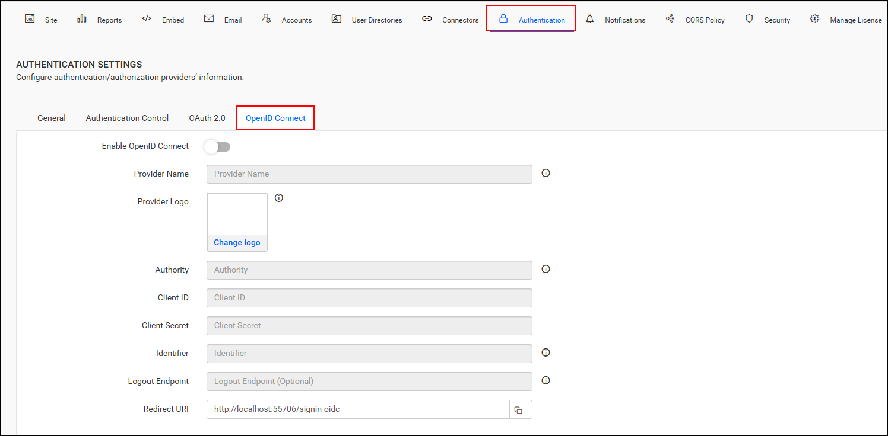
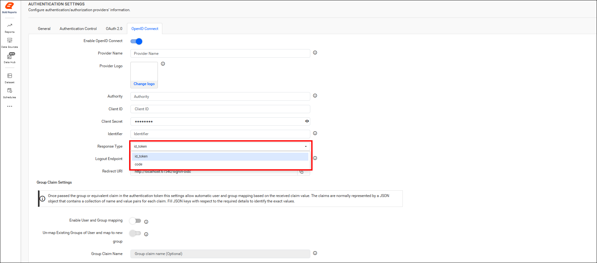
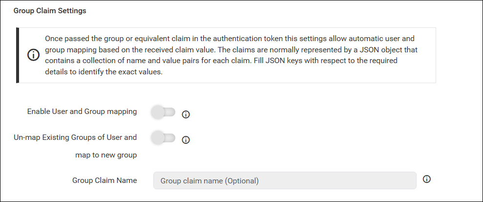
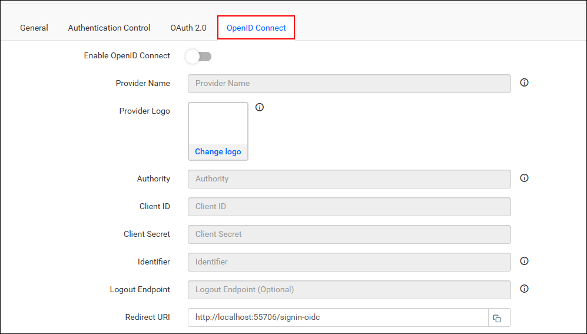
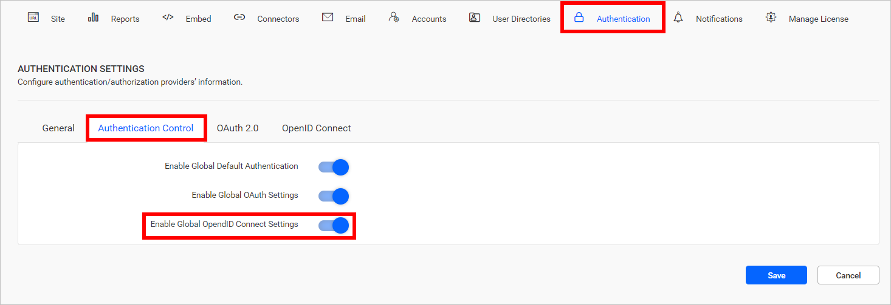
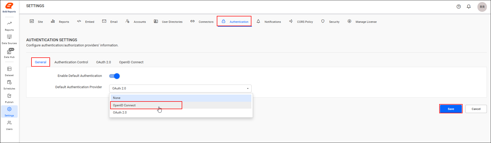
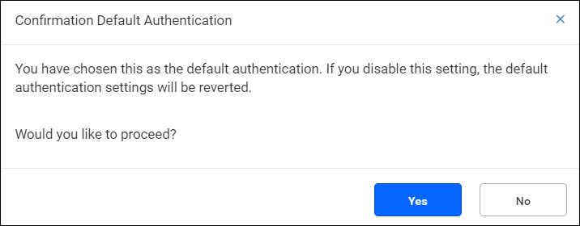

# Single Sign-On (SSO) with OpenID Connect authentication in Bold Reports®

Bold Reports® supports OpenID Connect for Single Sign-On (SSO), so users log in directly to the Bold Reports® application after they authenticate with OpenID Connect.

## What do I need before I configure OpenID Connect?

To configure OpenID Connect in Bold Reports®, you need the following:

1. An account with an OpenID Connect provider.

2. Register the Bold Reports® application with the OpenID Connect provider.

## Steps to configure OpenID Connect in Bold Reports®

You configure OpenID Connect in the Bold Reports® Report Server settings. Follow these steps:

1. Log in to Bold Reports® with an admin credential.

2. Click the settings in the Bold Reports® Report Server left-side menu.

3. Go to the Authentication tab and select OpenID Connect, as shown in the following images.

    
    

4. Provide the following details in the `OpenID Connect` settings of the Bold Reports® application:
<table>
<tr>
    <td>
        Provider Name
    </td>
    <td>
        It represents the name of the authentication provider to be displayed on the login page.
    </td>
</tr>
<tr>
    <td>
        Provider Logo
    </td>
    <td>
        It represents the logo of the authentication provider to be displayed on the login page.
    </td>
</tr>
<tr>
    <td>
        Authority
    </td>
    <td>
        It is the instance created within the provider for the user.
    </td>
</tr>
<tr>
    <td>
        Client ID
    </td>
    <td>
        It is a unique identifier provided to each of the applications while registering with the providers.
    </td>
</tr>
<tr>
    <td>
        Client Secret
    </td>
    <td>
        It is a secret key used to authorize the applications.
    </td>
</tr>
<tr>
    <td>
        Identifier
    </td>
    <td>
        It is the property name that stores the email address of the user in the deserialized ID token.
    </td>
</tr>
<tr>
    <td>
        Logout Endpoint
    </td>
    <td>
        It is an endpoint that logs out the third-party provider.
    </td>
</tr>
</table>

>Note: While configuring OpenID Connect, you need to choose the appropriate **Response Type** either `token-id` or `code` for the Group Claims settings.

The following screenshot shows the **Response Type** option for the Group Claims settings.

## How does group claims authentication work?

Group claims authentication in Bold Reports® maps users and groups automatically, based on the group claim received in the authentication token. The claims are typically a JSON object with key-value pairs for each claim. Provide the JSON key that identifies the group claim value.

<table>
    <tr>
        <td>Enable User and Group Mapping </td>
        <td>When enabled, the system fetches group claim values from the token and dynamically maps users to one or more groups during login.</td>
    </tr>
    <tr>
        <td>Un-map Existing Groups of User and map to New Group </td>
        <td>When enabled, all previously assigned groups for the user are removed, and the user is mapped only to the groups specified in the claim.</td>
    </tr>
    <tr>
        <td>Group Claim Name</td>
        <td>Enter the claim name that contains the group identifiers. Users will be mapped only if the group names in the claim match existing groups in the site.</td>
    </tr>
</table>

   

   

## How do I configure OpenID Connect in the User Management Server?

You configure OpenID Connect in the Bold Reports® User Management Server with the same steps. Log in to the URL `{Bold Reports URL}/ums/administration/sso?view=openid-settings` with an admin credential.

## Which OpenID Connect providers can I connect to Bold Reports®?

The following guides explain how to connect several OpenID Connect providers to the Bold Reports® application:

* [Auth0](./../openid-connect/auth0/)
* [Okta](./../openid-connect/okta/)
* [OneLogin](./../openid-connect/onelogin/)
* [keycloak](./../openid-connect/keycloak/)

## Can I turn off OpenID Connect for a single site?

Yes. OpenID Connect is provided on both the Bold Reports® sites and the User Management Server. You can manage it individually for each site on the settings page by disabling the option, as the following screenshot shows.

## Set OpenID Connect as Default Authentication

Bold Reports® can use OpenID Connect as the default authentication when the [OpenID Connect settings](#steps-to-configure-openid-connect-in-bold-reports) are enabled and saved. Follow these steps:

1. On the settings page, click the **Authentication** tab and select **General**.
2. Enable the option **Enable Default Authentication** and select **OpenID Connect** as the default authentication provider, as shown in the following screenshot.

### What happens when I disable OpenID Connect settings?

When OpenID Connect is the default authentication and you try to disable the [OpenID Connect settings](#steps-to-configure-openid-connect-in-bold-reports), Bold Reports® displays the following pop-up. Click `Yes` to proceed and disable the [OpenID Connect default authentication](#set-openid-connect-as-default-authentication).

### How do I bypass OpenID Connect authentication?

To log in to Bold Reports® as a normal user who is not from OAuth, use the following custom login URL when [OpenID Connect default authentication](#set-openid-connect-as-default-authentication) is enabled:
>**`{Bold Reports URL}/reporting/site/{tenant-name}/login?use_default_authentication=false`**

## See also

* [Single sign-on overview](./../overview/)
* [Configure OAuth 2.0 single sign-on](./../oauth-2.0/)
* [Microsoft Entra ID single sign-on](./../azure-active-directory/)
