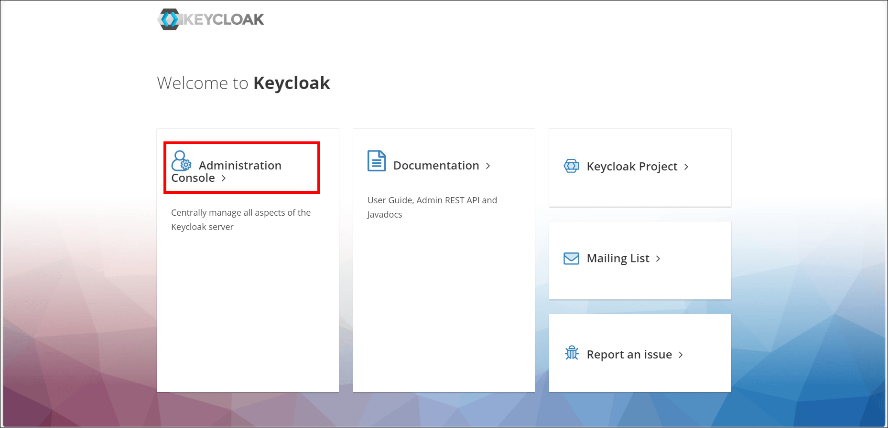
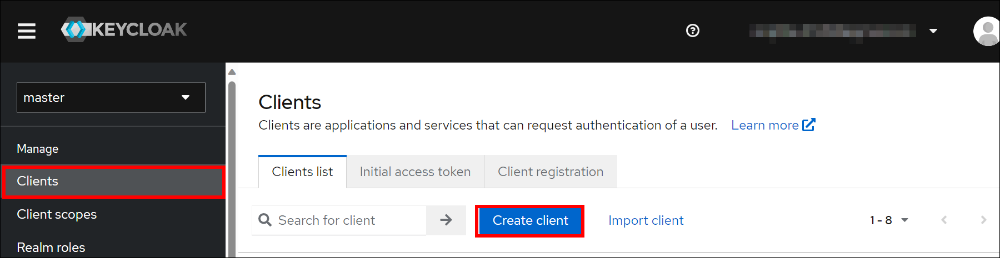
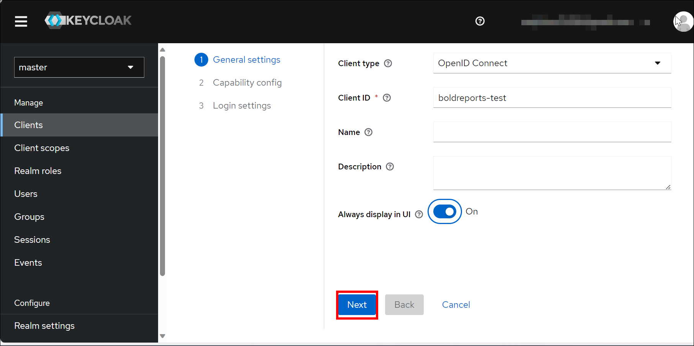
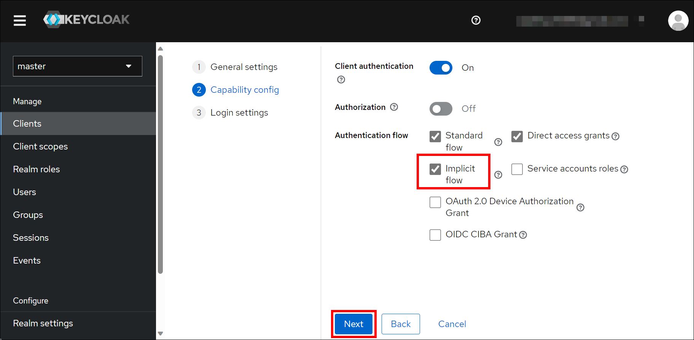
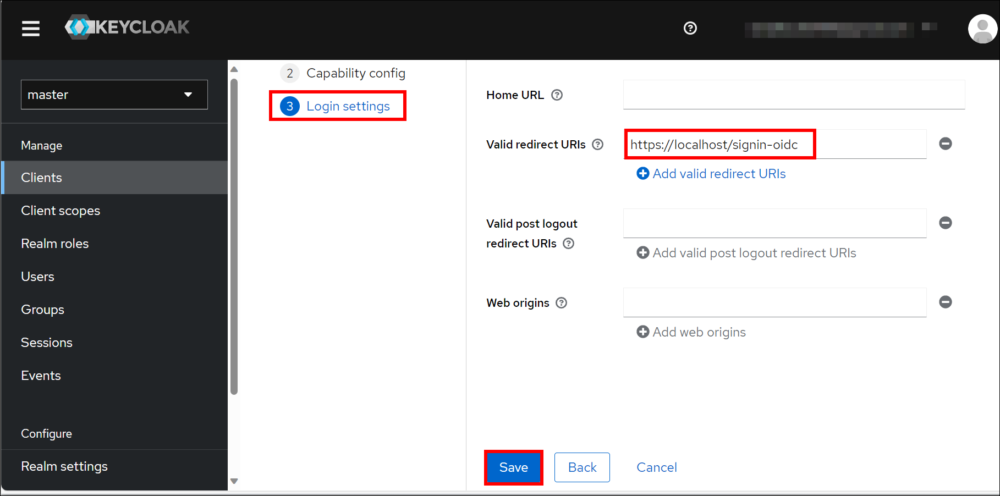
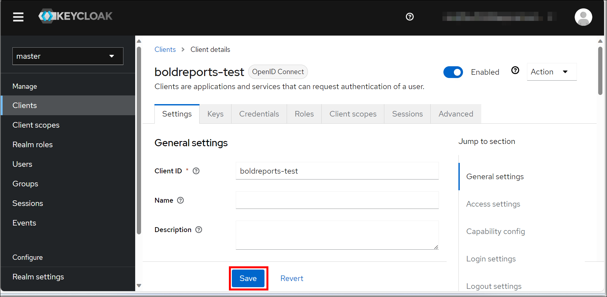
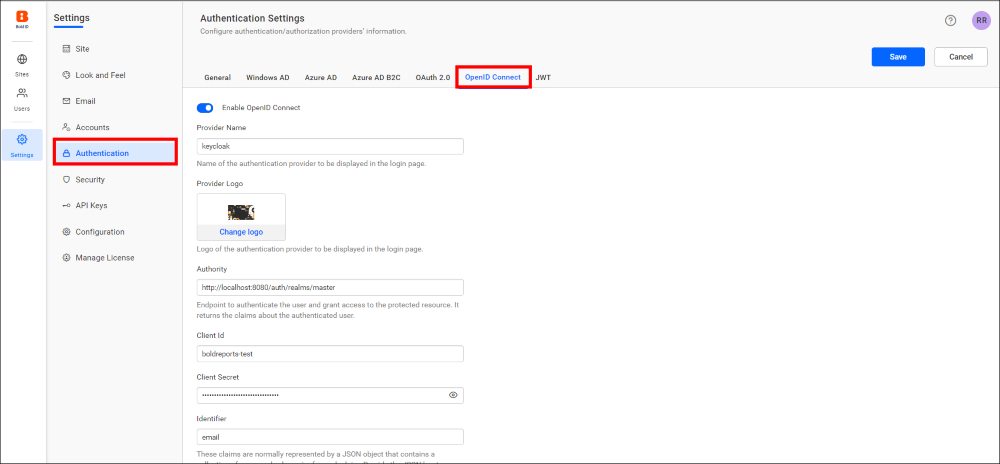
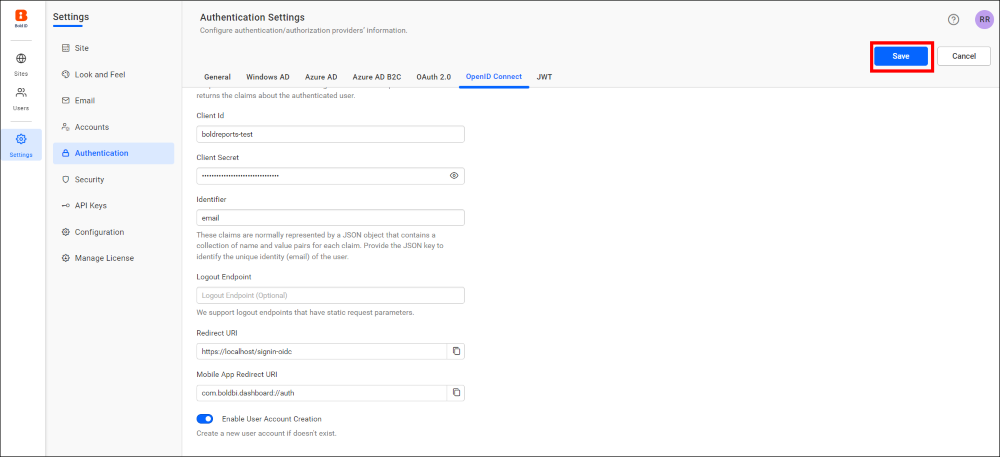
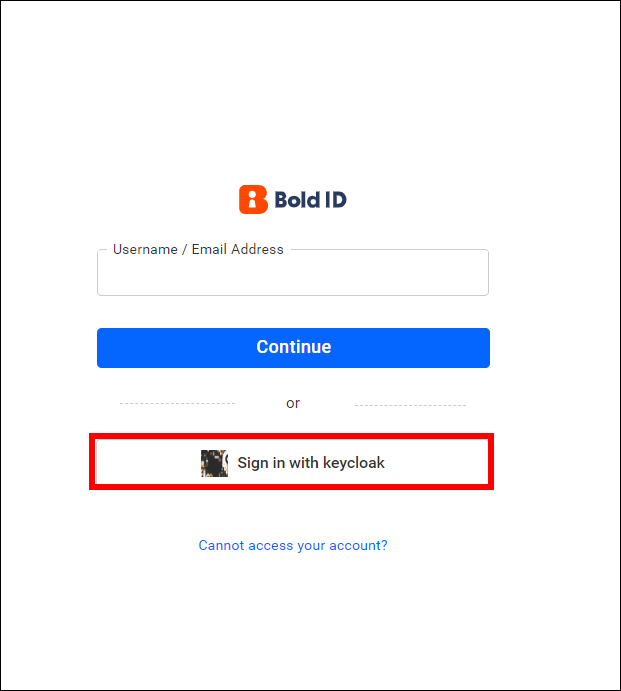
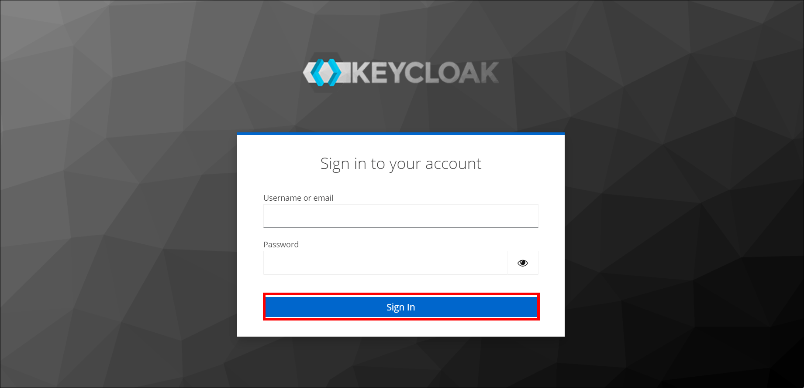

# Keycloak support for SSO authentication in Bold Reports®

You can let Keycloak users sign in to Bold Reports® with single sign-on by registering Bold Reports® as an OpenID Connect client in Keycloak.

The following steps show how to register Bold Reports® in Keycloak and connect it through OpenID Connect.

## How to register the Bold Reports® application in Keycloak

You register the Bold Reports® application as an `openid-connect` client in Keycloak.

> **NOTE:** This configuration has to be done on the Keycloak website.

## What do I need before I register Bold Reports® in Keycloak?

To register Bold Reports® in Keycloak, you need the following:

* An admin account in Keycloak.
* Install the Bold Reports® application.

### How do I register the Bold Reports® application in Keycloak?

You create a Keycloak client for Bold Reports® from the Security admin console. Follow these steps:

1. Log in to the Keycloak website with an admin account.

    

2. Go to the Security admin console, then to the Clients page, and select the Create client option.

    

3. On the `Create Client` page, enter the client ID and select `openid-connect` as the client protocol. Then, configure the required settings as shown in the following images and save the changes:

    

    

    

4. After the client is created, you can make updates in the settings section.

    

The following table lists the Keycloak client settings to use for Bold Reports®:

<table>
<tr>
    <td>
        Implicit Flow Enabled
    </td>
    <td>
        On
    </td>
</tr>
<tr>
    <td>
        Valid redirect URIs
    </td>
    <td>
        <b>URL Format:</b> https://{domain}/signin-oidc  
        <b>Example:</b> https://example.com/signin-oidc  
        <b>Note:</b> The Redirect URI is found under the OpenID Connect settings of your Bold Reports® application, as in the following screenshot.
    </td>
</tr>
</table>

> **Note:** When configuring the access type, you can set it to `confidential`.
> After successful registration with Keycloak, save these settings in the Bold Reports® settings page to enable this authentication.

### Enable Keycloak authentication support in Bold Reports®

To enable Keycloak authentication in Bold Reports®, configure the OpenID Connect settings as shown in the following screenshots.

The following table explains the fields you save in Bold Reports® to enable Keycloak for authentication:

<table>
<tr>
    <td>
        Enable Open ID Connect
    </td>
    <td>
        Enabled
    </td>
</tr>
<tr>
    <td>
        Provider Name
    </td>
    <td>
        It represents the name of the authentication provider to be displayed on the login page.
    </td>
</tr>
<tr>
    <td>
        Provider Logo
    </td>
    <td>
        It represents the logo of the authentication provider to be displayed on the login page.
    </td>
</tr>
<tr>
    <td>
        Authority
    </td>
    <td>
        It must be the URL of your Keycloak instance.  
        URL format: https://{host}/auth/realms/{realm}  
        <b>Note:</b>The Authority URL only accepts HTTPS, and Keycloak should be configured in HTTPS.
    </td>
</tr>
<tr>
    <td>
        Client ID
    </td>
    <td>
        The client ID is the one you get after registering the Bold Reports® application on the Keycloak website.  
        <b>Note:</b> Client IDs are available on the Clients page of the Keycloak website.
    </td>
</tr>
<tr>
    <td>
        Client Secret
    </td>
    <td>
        The client secret is the one you get after registering the Bold Reports® application on the Keycloak website.  
        <b>Note:</b> Client secrets are available in the Credentials section of the Client Details page.
    </td>
</tr>
<tr>
    <td>
        Identifier
    </td>
    <td>
        The Bold Reports® application requires an email address to log in to the application.  
        So, set the identifier as the email.  
        <b>Note:</b> All accounts in Keycloak should have a valid email address.
    </td>
</tr>
<tr>
    <td>
        Logout Endpoint
    </td>
    <td>
        It is the endpoint on the Keycloak website that signs the user out.
    </td>
</tr>
</table>

### How do I log in to Bold Reports® with Keycloak?

You log in to Bold Reports® with Keycloak from the Bold Reports® login page. Follow these steps:

1. Go to the login page and select the Keycloak option to log in.

    

2. Fill in the username and password on the Keycloak login screen and sign in.

    

## Frequently asked questions

### Does the Keycloak Authority URL support HTTP?

No. The Authority URL in Bold Reports® only accepts HTTPS, and Keycloak should be configured in HTTPS.

### Which Identifier do I use for Keycloak in Bold Reports®?

Set the identifier as the email, because Bold Reports® requires an email address to log in. All accounts in Keycloak should have a valid email address.

## See also

* [Configure OpenID Connect single sign-on](./../)
* [Okta OpenID Connect single sign-on](./../okta/)
* [OneLogin OpenID Connect single sign-on](./../onelogin/)
