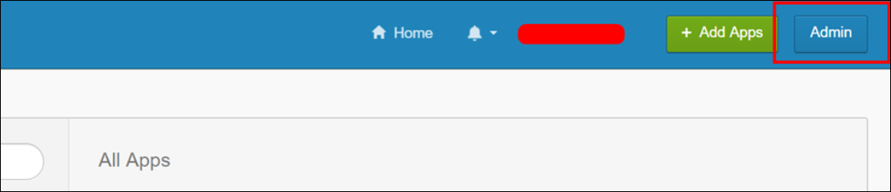
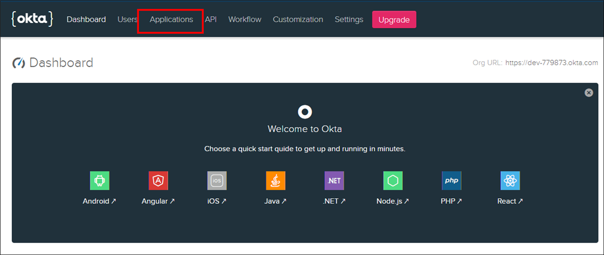
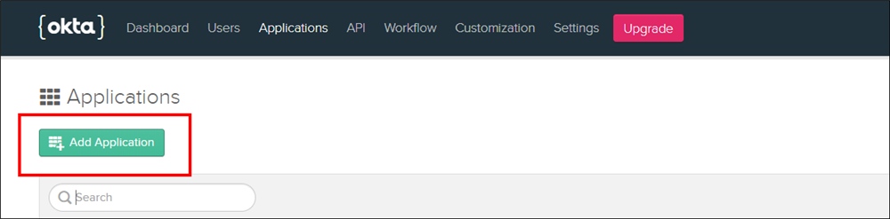
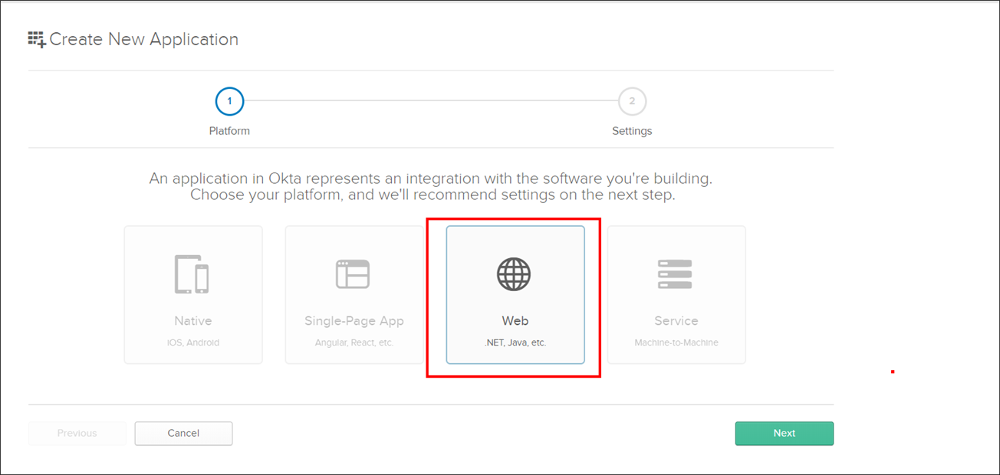
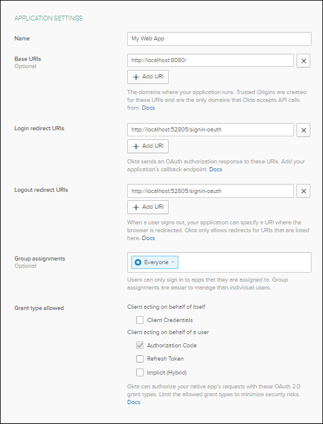
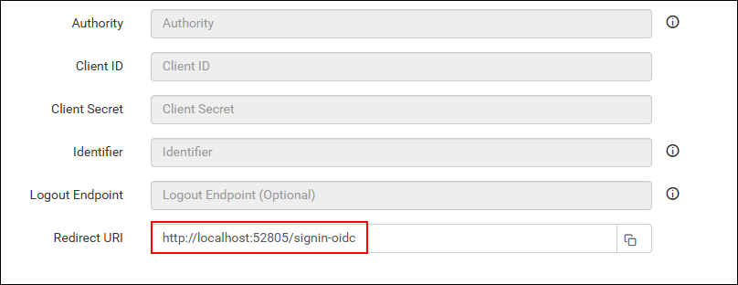
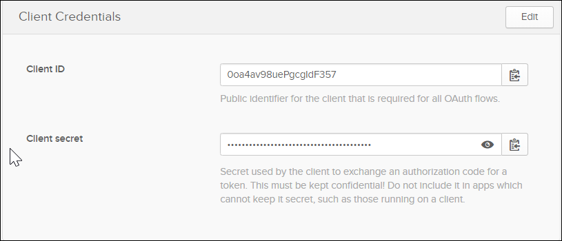
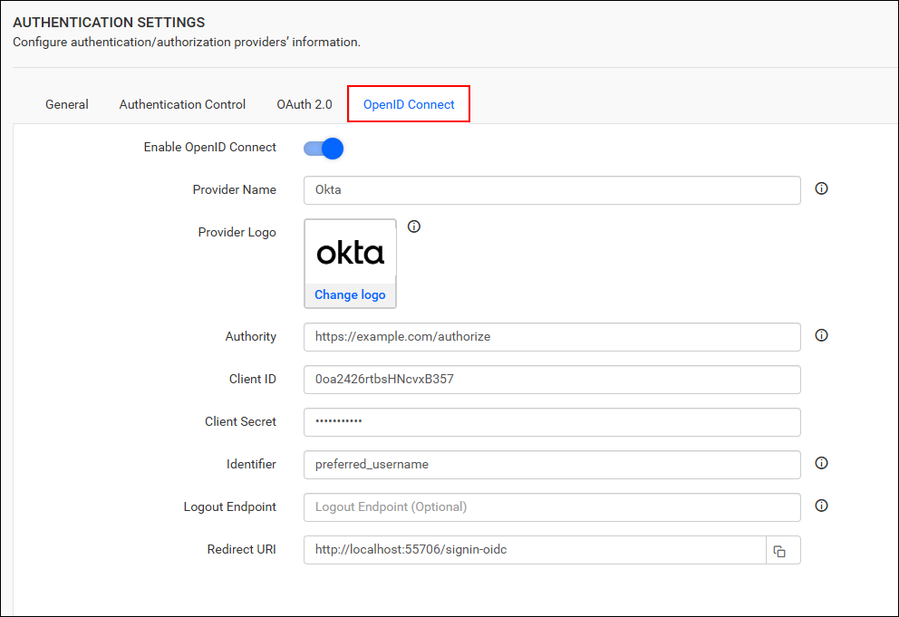

# Single Sign-On (SSO) with Okta authentication in Bold Reports®

Bold Reports® lets you add users to the application with the Okta provider over OpenID Connect. After you import them, you can share reports and email exported reports with them.

## How to register the Bold Reports® application in Okta

Register the Bold Reports® application in Okta to set up single sign-on for Okta users.

> **Note:** This configuration needs to be done on the Okta website.

## What do I need before I register Bold Reports® in Okta?

To register Bold Reports® in Okta for OpenID Connect, you need the following:

* An admin account in Okta.
* Install the Bold Reports® application.

## How do I register the Bold Reports® application in Okta?

You register Bold Reports® in Okta as a Web application. Follow these steps:

1. Log in to the Okta website with an `admin` account.
    

2. Click `Applications` in the header menu.
    

3. Click the `Add Application` button.
    

4. Click `Web` and proceed with `Next`.
    

5. Fill in the following application details on the next page, then click `Done`.

    * Name
    * Login Redirect URIs
    * Logout Redirect URIs
    

6. Make sure the login redirect URIs match the URI in the settings of your Bold Reports® application, as shown in the following screenshot.
    

7. On the next page, copy the `Client ID` and `Client Secret` at the bottom of the page. The page also shows the other details you filled in on the previous page.
    

After successful registration in Okta, save these settings in the Bold Reports® settings page to enable this authentication.

## Enable Okta support for authentication in Bold Reports®

To enable Okta authentication in Bold Reports®, configure the OpenID Connect settings as shown in the following screenshot.
    

## Which fields do I fill in for Okta?

The following table explains the fields you save in Bold Reports® to enable Okta for authentication:
<table>
<tr>
    <td>
        Provider Name
    </td>
    <td>
        It represents the name of the authentication provider to be displayed on the login page.
    </td>
</tr>
<tr>
    <td>
        Provider Logo
    </td>
    <td>
        It represents the logo of the authentication provider to be displayed on the login page.
    </td>
</tr>
<tr>
    <td>
        Authority
    </td>
    <td>
        The format is https://instancename.okta.com. It must be the URL of your Okta instance.
    </td>
</tr>
<tr>
    <td>
        Client ID
    </td>
    <td>
        The Client ID you receive after registering the Bold Reports® application on the Okta website.
    </td>
</tr>
<tr>
    <td>
        Client Secret
    </td>
    <td>
        The Client Secret you receive after registering the Bold Reports® application on the Okta website.
    </td>
</tr>
<tr>
    <td>
        Identifier
    </td>
    <td>
        preferred_username
    </td>
</tr>
<tr>
    <td>
        Logout Endpoint
    </td>
    <td>
        It is an endpoint that logs out the third-party provider.
    </td>
</tr>
</table>

## Frequently asked questions

### What is the Authority value for Okta in Bold Reports®?

The Authority is the URL of your Okta instance, in the format `https://instancename.okta.com`.

### Which Identifier do I use for Okta in Bold Reports®?

Use `preferred_username` as the Identifier in the Bold Reports® OpenID Connect settings for Okta.

## See also

* [Configure OpenID Connect single sign-on](./../)
* [Auth0 OpenID Connect single sign-on](./../auth0/)
* [Okta OAuth 2.0 single sign-on](./../../oauth-2.0/okta/)
