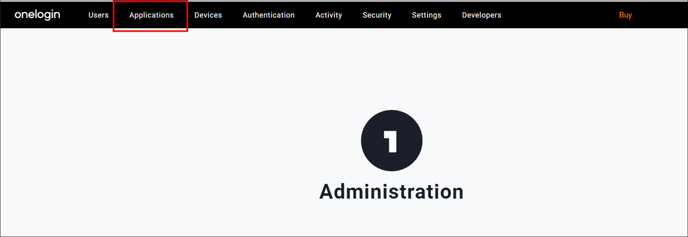
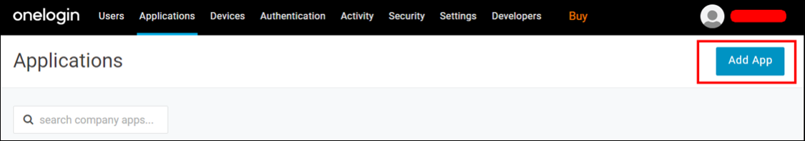
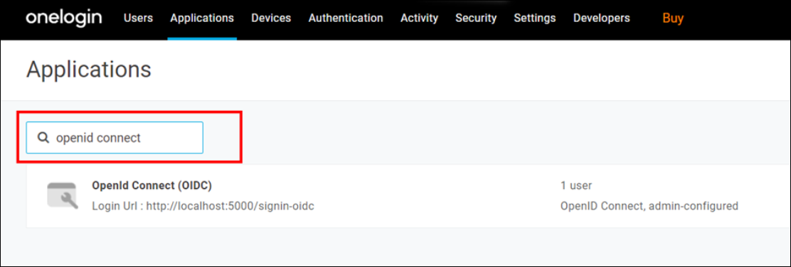
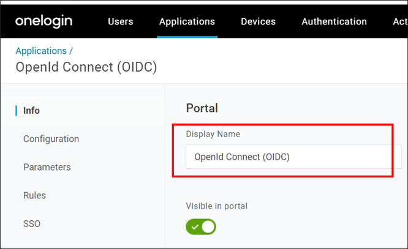
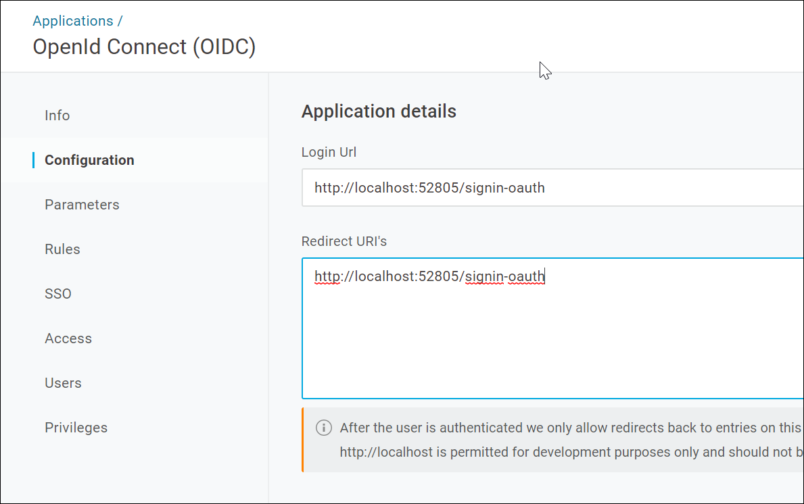
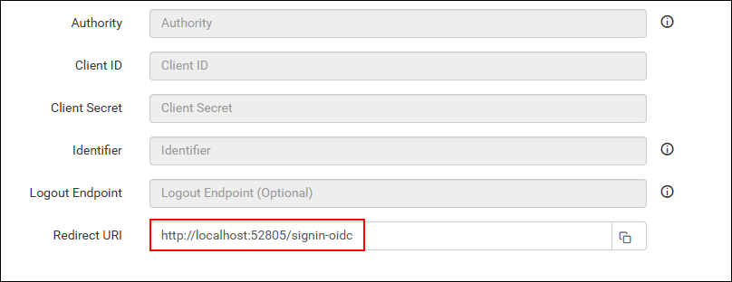
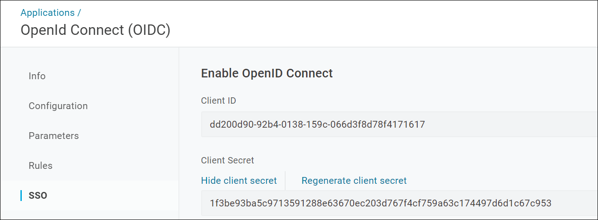
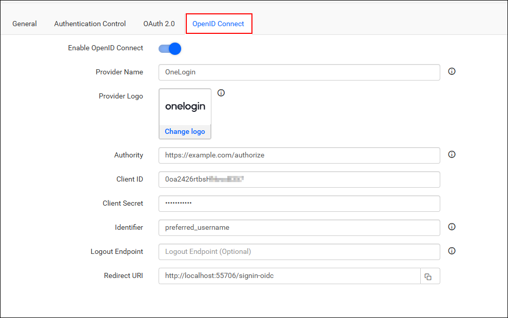

# Single Sign-On (SSO) with OneLogin authentication in Bold Reports®

Bold Reports® lets you add users to the application with the OneLogin provider over OpenID Connect. After you import them, you can share reports and email exported reports with them.

## How to register the Bold Reports® application in OneLogin

Register the Bold Reports® application in OneLogin to set up single sign-on for OneLogin users.

> **Note:** This configuration has to be done on the OneLogin website.

## What do I need before I register Bold Reports® in OneLogin?

To register Bold Reports® in OneLogin for OpenID Connect, you need the following:

* An admin account in OneLogin.
* Install the Bold Reports® application.

## How do I register the Bold Reports® application in OneLogin?

You register Bold Reports® in OneLogin as an OpenID Connect app. Follow these steps:

1. Log in to the OneLogin website with the `admin` account.

2. Click `Applications` in the header menu.
    

3. Click the `Add App` button.
    

4. Type `OpenID Connect`, or `oidc`, in the search box and click the result.
    

5. Type the application name and click `Add App`.

6. Save the application name in the `Display Name`.
    

7. Click the Configuration tab and save the `Redirect URI's` and `Login URL`.
    

8. Find the redirect URI and Login URL under the OpenID Connect settings of your Bold Reports® application, as shown in the following screenshot.
    

9. Click the `SSO tab` to find the `Client ID` and `Client Secret`, and use them in the Bold Reports® application.
    

After successful registration in OneLogin, save these settings in the Bold Reports® settings page to enable this authentication.

## Enable OneLogin support for authentication in Bold Reports®

To enable OneLogin authentication in Bold Reports®, configure the OpenID Connect settings as shown in the following screenshot.
    

## Which fields do I fill in for OneLogin?

The following table lists the fields you save in Bold Reports® to enable OneLogin for authentication:
<table>
<tr>
    <td>
        Provider Name
    </td>
    <td>
        It represents the name of the authentication provider to be displayed on the login page.
    </td>
</tr>
<tr>
    <td>
        Provider Logo
    </td>
    <td>
        It represents the logo of the authentication provider to be displayed on the login page.
    </td>
</tr>
<tr>
    <td>
        Authority
    </td>
    <td>
        It must be in the form of https://subdomain.onelogin.com/oidc. The sub domain represents the OneLogin instance.
    </td>
</tr>
<tr>
    <td>
        Client ID
    </td>
    <td>
        The Client ID you receive after registering the Bold Reports® application on the OneLogin website.
    </td>
</tr>
<tr>
    <td>
        Client Secret
    </td>
    <td>
        The Client Secret you receive after registering the Bold Reports® application on the OneLogin website.
    </td>
</tr>
<tr>
    <td>
        Identifier
    </td>
    <td>
        preferred_username
    </td>
</tr>
<tr>
    <td>
        Logout Endpoint
    </td>
    <td>
        It is an endpoint that logs out the third-party provider.
    </td>
</tr>
</table>

## Frequently asked questions

### What is the Authority value for OneLogin in Bold Reports®?

The Authority must be in the form `https://subdomain.onelogin.com/oidc`, where the sub domain represents the OneLogin instance.

### Which Identifier do I use for OneLogin in Bold Reports®?

Use `preferred_username` as the Identifier in the Bold Reports® OpenID Connect settings for OneLogin.

## See also

* [Configure OpenID Connect single sign-on](./../)
* [Keycloak OpenID Connect single sign-on](./../keycloak/)
* [OneLogin OAuth 2.0 single sign-on](./../../oauth-2.0/onelogin/)
