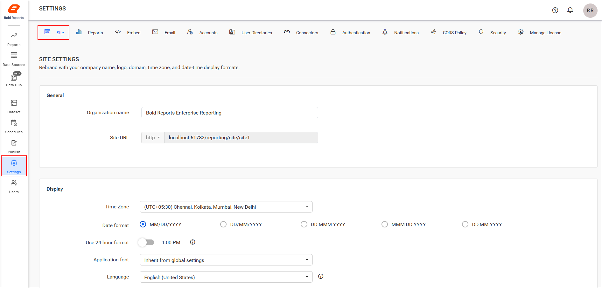

# Custom rebranding in Bold Reports® Report Server

You can rebrand the Bold Reports® Report Server by changing the organization name, site URL, login screen logo, welcome text, header logo, favorite icon, email logo, favicon, time zone, and date time format.

## How do I open the rebranding settings?

You rebrand the Report Server from the **Site** tab of its **Settings** page. Click the **Settings** option in the Report Server left side panel and go to the **Site** tab, as shown in the following image.

## Organization name

The Report Server Organization name is the name displayed on the title bar of the browser. To modify the browser title, change the `Organization name` field of the Report Server.

## Site URL

Modify the Report Server `Site URL` field to change the Report Server URL in the Server Settings page. To make sure this change is reflected, configure the same URL in IIS. To add a binding in IIS and change the site URL, see [how to change the binding in Bold Reports® Enterprise Reporting](./../../deployment/deploy-on-windows/installation-and-deployment/#how-to-change-the-binding-in-the-bold-reports-enterprise-reporting).

## Login screen

You can change the following items on the Report Server login screen:

* For the login page logo, the preferred image size is `200x40` pixels. By default, the Bold Reports® logo is displayed.
* In the welcome note, the maximum characters allowed is 70. The default welcome text is **Welcome to Bold Reports® On-Premise**.

## Header

You can change the Report Server header logo image, with the preferred image size being `40x40` pixels. The Report Server will have the Bold Reports® logo as the default main screen logo.

## Favicon

You can change the Report Server favicon, and the preferred image size is `40x40` pixels. By default, the Report Server will have the Bold Reports® favicon.

## Email

You can change the Report Server email logo, and the preferred image size is `40x40` pixels. By default, the Report Server will display the Bold Reports® email logo.

## Display

The Report Server Display settings control the time zone, date format, time format, and footer items.

### Time zone

By default, the Report Server sets the time zone of the system where it is installed. You can change the time zone for the Report Server based on the requirement.

### Date format

The Report Server will have `MM/dd/yyyy` as the default date format. You can modify the date format based on your culture.

### Time format

You can change the time format of the Report Server, and the default time format is 12 hours.

### Powered by Syncfusion®

Show or hide `Powered by Syncfusion` in the footer of the Report Server. By default, this will be shown.

### Copyright information

Show or hide `Copyright Information` in the footer of the Report Server. By default, this will be shown.

## Frequently asked questions

### What image size should I use for the Report Server logos?

Use `200x40` pixels for the login page logo. Use `40x40` pixels for the header logo, favicon, and email logo.

### How many characters can the login welcome note have?

The Report Server login welcome note allows a maximum of 70 characters.

## See also

* [Manage sites](./../manage-sites/)
* [Manage application settings](./../manage-app-settings/)
* [User profile](./../user-profile/)
