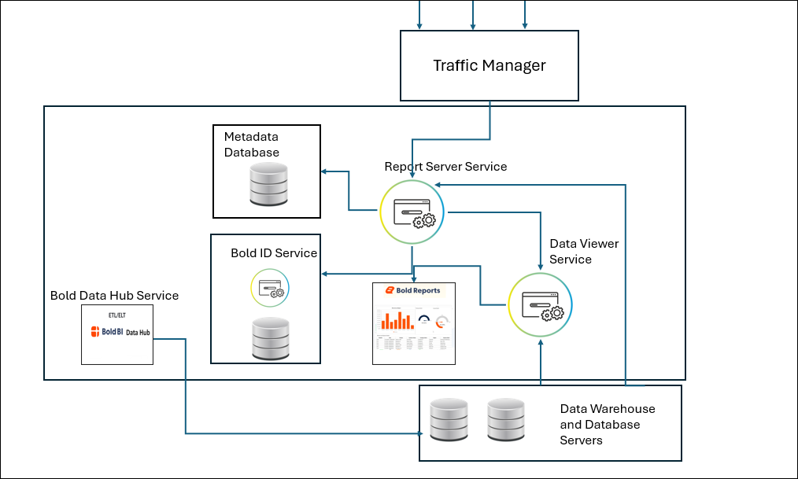
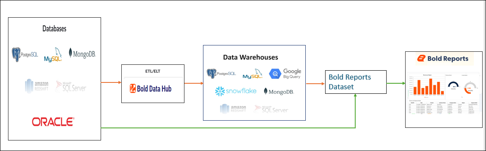

# Architecture Diagram for Bold Reports®

Bold Reports® On-Premises Edition uses a multi-tenant architecture in which the Bold ID application handles identity and the Report Server manages reports and permissions.

## What is Bold Reports®?

Bold Reports® is an online solution for analyzing data on the web using interactive reports with key metrics, making it easy to track your business.

Bold Reports® is an end-to-end solution for creating, managing, and sharing interactive business reports, including a report designer for easy composition.

## How is Bold Reports® architected?

The Bold Reports® architecture description below is for users who support Bold Reports® in their organization.

In a multi-tenant architecture, multiple instances of an application operate in a shared environment. The instances (sites) are logically isolated but physically integrated.

In the context of databases, multiple sites share the same database, but each site has its own set of tables that are distinguished by schema and prefix. This allows for efficient resource utilization while ensuring data isolation and security for each site.

The following diagram shows the components of a Bold Reports® server and how Bold Reports® works on the server.

Bold Reports® is provided with a single installation process. After you install Bold Reports® on a server, you have access to all of its functionality.

The Bold Reports® application has two types of functional systems:

* Bold ID: It manages user identities and sites.
* Bold Reports® Server: It manages reports, data sources, datasets, schedules, and user permissions.

## Storage Options

Bold Reports® stores identity data in the Bold ID application and reporting resources in the Bold Reports® application.

### What does the Bold ID application do?

The Bold ID application is an identity provider for Bold Platform products. The [site](./../../manage-sites/) details and user details are maintained in the Bold ID application. This application handles the login and logout processes. The Bold ID application is a core application of the multi-tenant solution that manages the site and its user identity.

Site and user details are stored in the Site Catalog, which is called the User Management Server (UMS). The identity service handles the login processes. All these features are carried out under the application called Bold ID.

Bold ID supports login methods such as SSO, OAuth, Open ID, JWT token access, and Windows authentication. For details, see [authentication settings](./../../authentication/).

When you access the Bold Reports® site directly, the Bold Reports® application redirects the request to Bold ID to authenticate. If the user is valid and authorized, access to the site is granted. Otherwise, it results in an authentication error.

### What does the Bold Reports® application do?

Bold Reports® Server is a reporting application where you maintain resources like reports, data sources, datasets, schedules, users, groups, and permissions separately, irrespective of other sites.

Both admin and non-admin users can perform CRUD operations on reporting items based on a set of privileges provided to them. For permission management, see [manage permissions](./../../manage-permissions/).

The Data Viewer Service (Web Report Designer) is one of the applications of the Report Server. You use it to design the report with a live connection to retrieve data, and to create and view the report.
To create a new report, see [design an RDL report in the Web Report Designer](../../../designer-guide/report-designer/design-rdl-report-in-web-report-designer/).

The **Report** service (Report viewer) is an engine that is integrated by default into the data viewer service and report server to render and view the report.

> Bold Reports® supports embedding the report viewer and report designer in your application. For more details, see [embed in your application](../../../developer-guide/embed-in-application/).

### Bold Reports® Data Architecture

The Bold Reports® data architecture connects databases, Bold Data Hub, data warehouses, datasets, and visualizations.

#### Overview

The Bold Reports® architecture is designed to streamline data integration, transformation, and visualization processes, enabling users to create insightful reports with ease. This architecture leverages Bold Reports® capabilities to work seamlessly with databases, data warehouses, and datasets.

The following image shows the Bold Reports® data architecture.

#### Which databases does Bold Reports® connect to?

* Bold Reports® integrates with various databases such as PostgreSQL, MySQL, Microsoft SQL Server, and Oracle.
* Data can be connected to Bold Reports® through the following modes:
    * Live Connections: Directly connects to databases to fetch real-time data.
    * Extract Connections: Data is processed and extracted for optimized performance.

#### How does Bold Data Hub handle ETL and ELT?

* The Bold Data Hub serves as the core for ETL (Extract, Transform, Load) and ELT (Extract, Load, Transform) operations.
* Bold Data Hub ensures data is cleaned, transformed, and optimized before being transferred to data warehouses or datasets, providing a reliable foundation for creating accurate reports.

#### Which data warehouses does Bold Reports® connect to?

* Bold Reports® connects seamlessly with modern data warehouses such as Google BigQuery, Snowflake, Amazon Redshift, and other analytics-optimized systems.
* These data warehouses act as centralized repositories, storing structured and semi-structured data and preparing it for analytical workloads.

#### What is a Bold Reports® dataset?

* Datasets in Bold Reports® are created to provide structured data for report generation.
* Users can define queries, apply filters, and shape the data to fit specific reporting requirements.

#### Which visualizations does Bold Reports® provide?

* Bold Reports® provides dynamic and interactive visualizations, including reports, charts, and tabular reports.
* These visualizations are built to support a variety of business needs, offering customizable layouts and styling options to suit specific user preferences.

#### Key Features of the Architecture

The Bold Reports® architecture offers the following key features:

* Flexible Data Connectivity
* Scalability
* Seamless Integration

## See also

* [Does Bold Reports® support scaling?](./../does-bold-reports-support-scaling/)
* [Where does the data reside in Bold Reports®?](./../where-does-the-data-resides-in-bold-reports/)
* [Manage permissions](./../../manage-permissions/)
