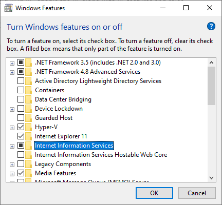
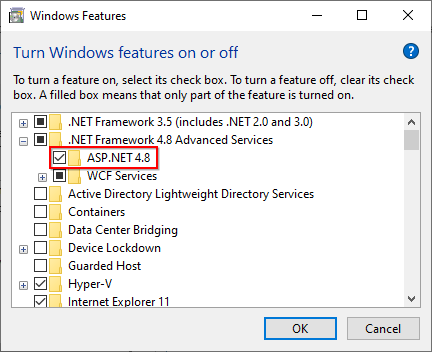
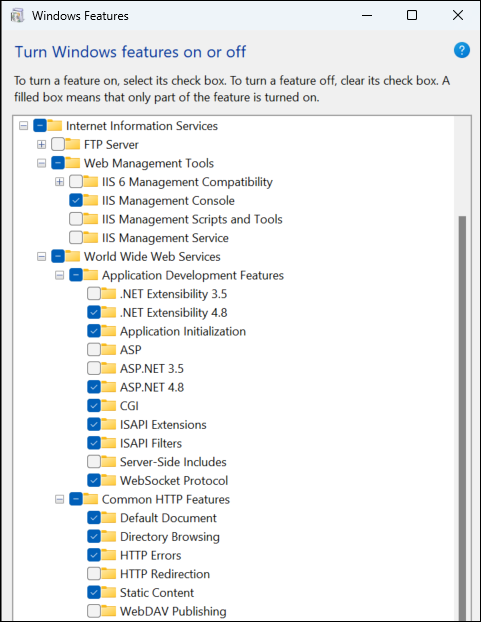
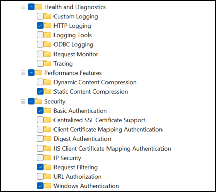

# What features need to be enabled in IIS to run the Bold Reports® Application on Windows Client OS?

The Bold Reports® On-Premises Edition can be hosted on both IIS Express and IIS. To run Bold Reports® on IIS, make sure that IIS is enabled and configured with the necessary features and roles.

## How do I enable IIS for Bold Reports® Report Server on Windows Client OS?

You enable IIS and its features for the Bold Reports® Report Server from **Turn Windows features on or off** in the Control Panel. Follow these steps:

1. Open `Control Panel` and click `Programs and Features > Turn Windows features on or off`.  

2. Enable `Internet Information Services`.

     

3. Expand the `.NET Framework 4.8 Advanced Services` and enable the ASP.NET 4.8 feature.

   > **Note:** You should use Microsoft .NET Framework 4.5 or higher version. Learn more in the [Windows prerequisites](./../../../deployment/getting-started/#prerequisites-for-windows).  

   

4. Expand the `Internet Information Services` feature and make sure that all the [required web server components](./../features-needed-to-enable-in-iis-to-run-bold-reports-in-win-client-os/#required-web-server-components) are selected. Then, click `OK`.

   
   

## Required web server components

The following IIS components satisfy the minimum requirements to run Bold Reports®. If other IIS components are enabled, you do not need to remove them.

<table>
  <thead>
    <tr>
      <th scope="col" bgcolor="#416187">Section</th>
      <th scope="col" bgcolor="#416187">IIS Components</th>
    </tr>
  </thead>
  <tbody>
    <tr>
        <td rowspan="5">World Wide Web Services</td>
        <td>Common HTTP Features
             - Default Document  
             - Directory Browsing
             - HTTP Errors
             - Static Content  
        </td>
    </tr>
    <tr>
        <td>Health and Diagnostics
             - HTTP Logging
        </td>
    </tr>
    <tr>
        <td>Performance Features
             - Static Content Compression</td>
    </tr>
    <tr>
        <td>Security
             - Request Filtering
             - Windows Authentication</td>
    </tr>
    <tr>
        <td>Application Development  
             - .NET Extensibility 4.8
             - Application Initialization
             - ASP.NET 4.8
             - ISAPI Extensions  
             - ISAPI Filters
             - WebSocket Protocol</td>
    </tr>
    <tr>
        <td>Web Management Tools</td>
        <td>IIS Management Console</td>
    </tr>
  </tbody>
</table>

## Frequently asked questions

### Can Bold Reports® run on IIS Express?

Yes. The Bold Reports® On-Premises Edition can be hosted on both IIS Express and IIS.

### Do I need to remove other IIS components?

No. If other IIS components are enabled, you do not need to remove them to run Bold Reports®.

### See Also

* [What are the features needed to be enabled in IIS to run Bold Reports® Application on the Windows Server OS?](../../faq/features-needed-to-enable-in-iis-to-run-bold-reports-in-win-server-os/)
* [How to restart the Bold Reports® application](./../how-to-restart-the-bold-reports-enterprise-application/)
