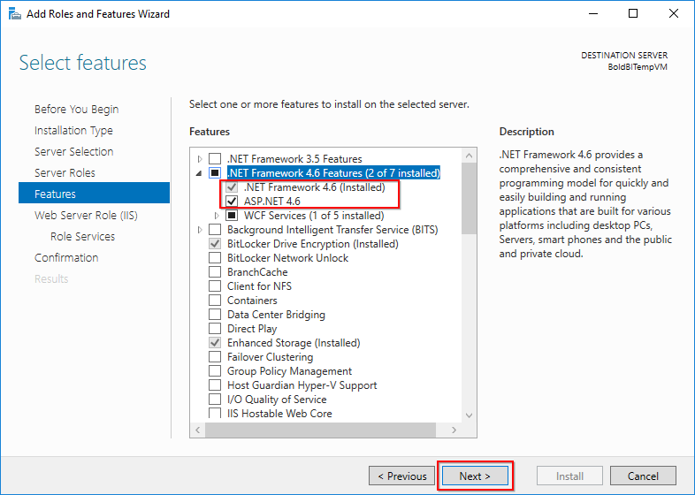
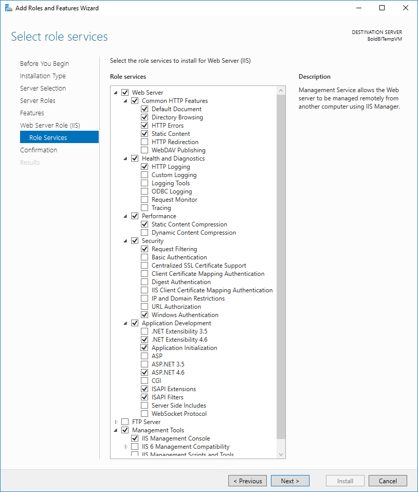

# What features need to be enabled in IIS to run the Bold Reports® Application on Windows Server OS?

The Bold Reports® On-Premises Edition can be hosted in both IIS Express and IIS. To run Bold Reports® in IIS, enable IIS along with the required IIS features and roles.

> NOTE: A pre-installed Bold Reports® Enterprise Edition and IIS configured Azure VM is available in the [Bold Reports® Enterprise listing on Azure Marketplace](https://azuremarketplace.microsoft.com/en-us/marketplace/apps/syncfusion.bold-reports-enterprise-multi-tenant).

## How do I enable IIS for Bold Reports® Report Server on Windows Server OS?

You enable IIS and its features for the Bold Reports® Server with the **Add Roles and Features** wizard in Server Manager. Follow these steps:

1. Open `Server Manager` and click `Manage > Add Roles and Features`. Click Next.

2. Select `Role-based or feature-based installation` and click `Next`.

3. Choose `Select a server from the server pool`, select the server in the Server Pool section, and then click `Next`.

4. On `Server Roles`, enable the `Web Server (IIS)` in the Roles section.  

5. On `Features`, enable the following .NET Framework features and click `Next`.

   > **Note:** You should use Microsoft .NET Framework 4.5 or higher version. Learn more in the [Windows prerequisites](./../../../deployment/getting-started/#prerequisites-for-windows).

   

6. On the `Web Server Role (IIS)` dialog box, click Next.

7. On the `Select role services` dialog box, verify that the [required web server components](./../features-needed-to-enable-in-iis-to-run-bold-reports-in-win-server-os/#required-web-server-components) are enabled. Then, click `Next`.

   

8. Verify that your settings are correct and click `Install`.

9. When the installation completes, click `Close` to exit the wizard.  

## Required web server components

The following IIS components satisfy the minimum requirements to run Bold Reports®. If other IIS components are enabled, you do not need to remove them.  

<table>
  <thead>
    <tr>
      <th scope="col" bgcolor="#416187">Section</th>
      <th scope="col" bgcolor="#416187">IIS Components</th>
    </tr>
  </thead>
  <tbody>
    <tr>
        <td rowspan="5">Web Server</td>
        <td>Common HTTP Features
             - Default Document  
             - Directory Browsing  
             - HTTP Errors
             - Static Content  
        </td>
    </tr>
    <tr>
        <td>Health and Diagnostics
             - HTTP Logging
        </td>
    </tr>
    <tr>
        <td>Performance Features
             - Static Content Compression</td>
    </tr>
    <tr>
        <td>Security
             - Request Filtering  
             - Windows Authentication</td>
    </tr>
    <tr>
        <td>Application Development  
             - .NET Extensibility 4.6
             - Application Initialization
             - ASP.NET 4.6
             - ISAPI Extensions  
             - ISAPI Filters</td>
    </tr>
    <tr>
        <td>Management Tools</td>
        <td>IIS Management Console</td>
    </tr>
  </tbody>
</table>

## Frequently asked questions

### Is there a pre-configured Azure VM for Bold Reports®?

Yes. A pre-installed Bold Reports® Enterprise Edition and IIS configured Azure VM is available on Azure Marketplace.

### Do I need to remove other IIS components?

No. If other IIS components are enabled, you do not need to remove them to run Bold Reports®.

## See also

* [Features needed in IIS on Windows Client OS](./../features-needed-to-enable-in-iis-to-run-bold-reports-in-win-client-os/)
* [How to restart the Bold Reports® application](./../how-to-restart-the-bold-reports-enterprise-application/)
* [How to resolve login failed for user in Windows authentication mode](./../how-to-resolve-login-failed-for-user-in-windows-authentication-mode/)
