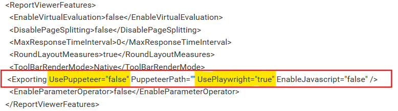

# Playwright deployment in Bold Reports®

By default, the Bold Reports® build for Azure ARM64 Linux does not install Playwright driver nodes. To enable data visualization export, manually ship the required Playwright driver binaries by following this guide.

Playwright uses Chromium/Chrome, Firefox, and WebKit to render charts, maps, and gauges.

## How do I configure Playwright for exporting?

To enable Playwright for Bold Reports® data visualization exports, update the configuration file as follows:

Open the config.xml file at the location `{deployment_location}\app_data\reporting\configuration\config.xml`, add the node, and then save the file.

`<Exporting UsePlaywright="true" PuppeteerPath="" />`

The following image shows the Playwright node in the config file.

## Which Playwright driver nodes do I download for my Linux architecture?

Download the Bold Reports® Playwright driver binaries that match your Linux architecture:

Operating System | Download Link
--- | ---
`Linux (linux-arm64)` | [linux armx64.zip](https://www.syncfusion.com/downloads/support/directtrac/general/ze/linux-arm64)
`Linux (linux-x64)` | [linux x64.zip](https://www.syncfusion.com/downloads/support/directtrac/general/ze/linux-x64)

After you extract the downloaded archive, move the Playwright binaries to the following directories:

{Install Root}\application\reporting\api\.playwright\node\
{Install Root}\application\reporting\jobs\.playwright\node\
{Install Root}\application\reporting\web\.playwright\node\

> **Tip:** If the `.playwright\node` directory does not exist, create it manually.

## How do I set file permissions for Playwright?

To execute the Playwright driver nodes, enable executable permissions for the Bold Reports® jobs, api, and web services as shown:

Commands | Details
--- | ---
`sudo chmod -R 777 /var/www/bold-services/application/reporting/*` | Grant read, write, and execute permissions to all reporting applications under the reporting directory. Use with caution in production.
`sudo chmod -R 777 /var/www/bold-services/application/reporting/web` | Grant permissions for the web application only.
`sudo chmod -R 777 /var/www/bold-services/application/reporting/jobs` | Grant permissions for the jobs application only.
`sudo chmod -R 777 /var/www/bold-services/application/reporting/api` | Grant permissions for the api application only.

Note:
* The 777 permission is broad and suitable for quick verification. For production environments, use more restrictive permissions based on your service user and group.

## Frequently asked questions

### Does Bold Reports® install Playwright on Azure ARM64 Linux by default?

No. By default, the Bold Reports® build for Azure ARM64 Linux does not install Playwright driver nodes. You ship them manually.

### What does Playwright render in Bold Reports® exports?

Playwright uses Chromium/Chrome, Firefox, and WebKit to render charts, maps, and gauges.

## See also

* [How to install Chromium packages](./../how-to-install-chromium-packages/)
* [How to install PhantomJS manually](./../how-to-install-phantomjs-manually/)
* [How to restart the Bold Reports® application](./../how-to-restart-the-bold-reports-enterprise-application/)
