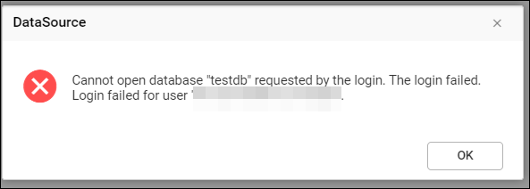
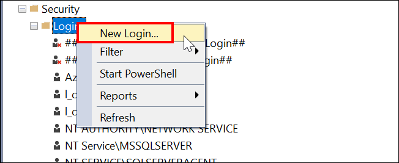
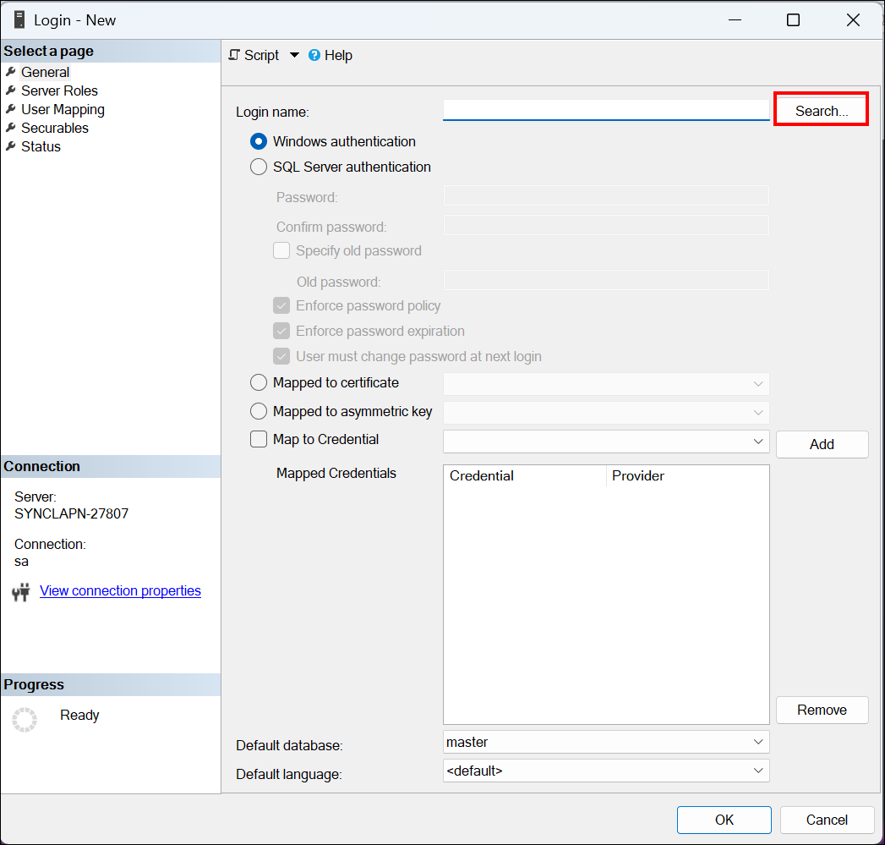
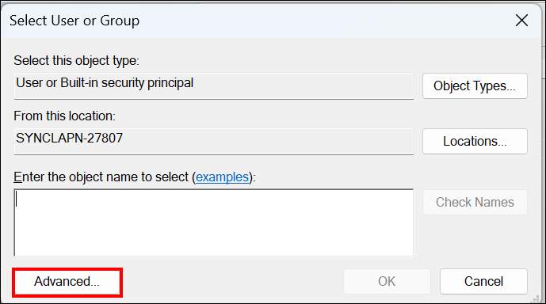
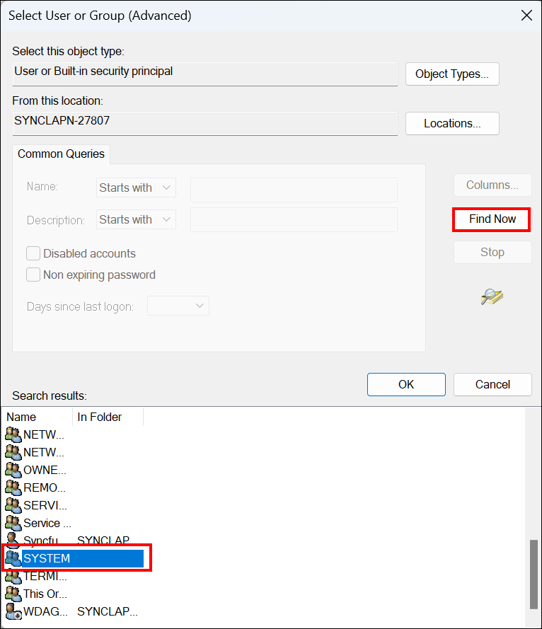

# Login failed for the user in Windows authentication mode in Bold Reports®

When Bold Reports® connects to SQL Server in Windows authentication mode, it can throw the following login failed error:

## Why does the login failed error occur?

The Bold Reports® login failed error occurs because `DOMAIN\MACHINENAME$` is not added in IIS/IIS Express to access SQL Server in Windows Authentication mode.

* DOMAIN: refers to your Active Directory domain.
* MACHINENAME: refers to the name of the server where IIS is running.

## How do I resolve the login failed error?

To resolve the Bold Reports® login failed error, add a valid SQL Server login for the IIS machine:

* Add **DOMAIN\MACHINENAME$** as a valid login in SQL Server with the necessary permissions.
* Map this login to the database you want to access and assign it a role that has the necessary permissions.

> **Note:** When you're dealing with a `remote server` (where IIS and SQL Server are on different machines), you need to use **DOMAIN\MACHINENAME$**. If IIS and SQL Server are on the `same machine`, you can use **NT Authority\System**.

### How do I add `NT AUTHORITY\SYSTEM` as a valid SQL Server login for IIS or IIS EXPRESS?

You add `NT AUTHORITY\SYSTEM` as a login in Microsoft SQL Server Management Studio. Do the following on the server:

1. Right-click **Login** and select `New Login` to add the respective login to SQL Server.

    

2. Click the **Search** button, then select `Advanced -> Find Now -> System` in the newly opened windows.

    

    

    

3. Click **OK** to add the login **NT AUTHORITY\SYSTEM**. After it is added, you can access Windows authentication mode in Bold Reports®.

## Frequently asked questions

### Which login do I use when IIS and SQL Server are on the same machine?

If IIS and SQL Server are on the same machine, you can use **NT Authority\System**. For a remote server, use **DOMAIN\MACHINENAME$**.

## See also

* [What are the database permissions required to set up Bold Reports®?](./../what-are-the-database-permissions-required-to-set-up-bold-reports/)
* [Where can I find the error and debug log files?](./../where-can-i-find-the-error-and-debug-log-files/)
