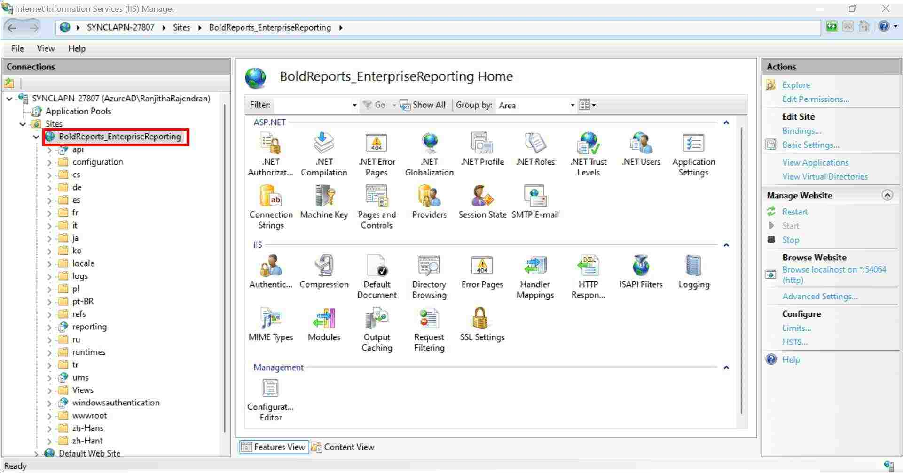
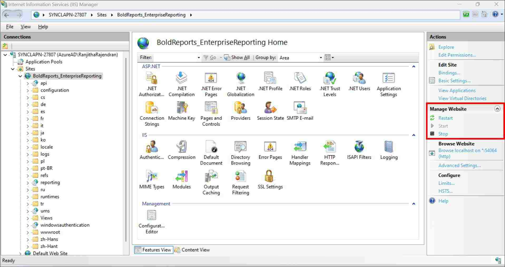
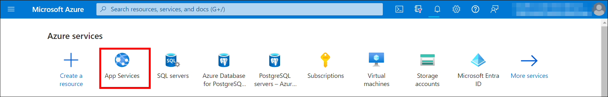
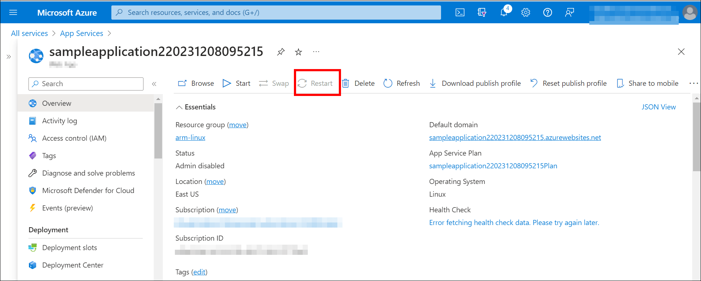

# Restart the Bold Reports<sup>®</sup> Enterprise application

To restart the Bold Reports<sup>®</sup> Enterprise application, follow the steps for your hosting environment: Windows, Linux, Kubernetes, Docker, or Azure App Service.

* [Windows](#windows)
* [Linux](#linux)
* [Kubernetes](#kubernetes)
* [Docker](#docker)
* [Azure App Service](#azure-app-service)

## Windows

On Windows, you restart the Bold Reports<sup>®</sup> Enterprise application from IIS Manager.

1. Open the IIS Manager and use the site’s dropdown to find the Bold Reports<sup>®</sup> Enterprise app.

    

2. In Manage Website in the IIS Manager, restart the application.

    

    > **Note**: If the Bold Reports<sup>®</sup> Enterprise and Bold BI Embedded apps are installed with a common login, the site name will be `BoldAppsEnterpriseEdition`.

## Linux

On Linux, you restart the Bold Reports<sup>®</sup> services with `systemctl`.

1. Run the following command to restart all the Bold Reports<sup>®</sup> services:

   ```sh
   sudo systemctl restart bold-*
   ```

2. Run the following command to restart a specific service in Bold Reports<sup>®</sup>:

   ```sh
   sudo systemctl restart bold-id-web.service - IDP Web service
   ```

   ```sh
   sudo systemctl restart bold-id-api.service - IDP API service
   ```

   ```sh
   sudo systemctl restart bold-ums-web.service - UMS Web service
   ```

   ```sh
   sudo systemctl restart bold-reports-web.service - Reports Web service
   ```

   ```sh
   sudo systemctl restart bold-reports-api.service - Reports API service
   ```

   ```sh
   sudo systemctl restart bold-reports-jobs.service - Reports Web job service
   ```

   ```sh
   sudo systemctl restart bold-reports-service.service - Reports service
   ```

   ```sh
   sudo systemctl restart bold-reports-viewer.service - Reports Viewer service
   ```

## Kubernetes

On Kubernetes, you restart the Bold Reports<sup>®</sup> deployments with `kubectl rollout restart`.

1. Run the following command to restart all the Bold Reports<sup>®</sup> services:

   ```sh
   kubectl rollout restart deploy -n {namespace}
   ```

2. Run the following command to restart a specific service in Bold Reports<sup>®</sup>:

   ```sh
   kubectl rollout restart deployment/id-web-deployment -n {namespace} - IDP Web service
   ```

   ```sh
   kubectl rollout restart deployment/id-api-deployment -n {namespace} - IDP API service
   ```

   ```sh
   kubectl rollout restart deployment/id-ums-deployment -n {namespace} - UMS Web service
   ```

   ```sh
   kubectl rollout restart deployment/reports-web-deployment -n {namespace} - Reports Web service
   ```

   ```sh
   kubectl rollout restart deployment/reports-api-deployment -n {namespace} - Reports API service
   ```

   ```sh
   kubectl rollout restart deployment/reports-jobs-deployment -n {namespace} - Reports Web job service
   ```

   ```sh
   kubectl rollout restart deployment/reports-reportservice-deployment -n {namespace} - Reports service
   ```

   ```sh
   kubectl rollout restart deployment/reports-viewer-deployment -n {namespace} - Reports Viewer service
   ```

## Docker

On Docker, you restart the Bold Reports<sup>®</sup> container with `docker restart`.

1. Run the following command to restart all the Bold Reports<sup>®</sup> services:

   ```sh
   docker restart {container name}
   ```

## Azure App Service

On Azure App Service, you restart the Bold Reports<sup>®</sup> Enterprise application from the Azure Portal.

1. Go to the Azure Portal home page and choose App Services.

    

2. Select the hosted Bold Reports<sup>®</sup> Enterprise application and click `Restart`, as shown in the following image.

    

## Frequently asked questions

### What is the IIS site name when Bold Reports<sup>®</sup> shares a common login with Bold BI?

If the Bold Reports<sup>®</sup> Enterprise and Bold BI Embedded apps are installed with a common login, the site name is `BoldAppsEnterpriseEdition`.

## See also

* [Where can I find the error and debug log files?](./../where-can-i-find-the-error-and-debug-log-files/)
* [How to install Chromium packages](./../how-to-install-chromium-packages/)
* [Does Bold Reports<sup>®</sup> support scaling?](./../does-bold-reports-support-scaling/)
