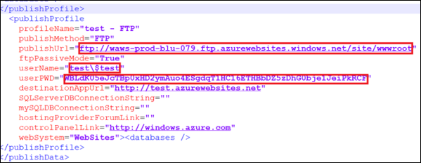
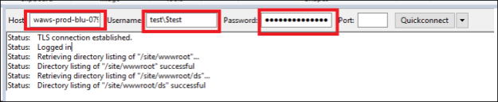
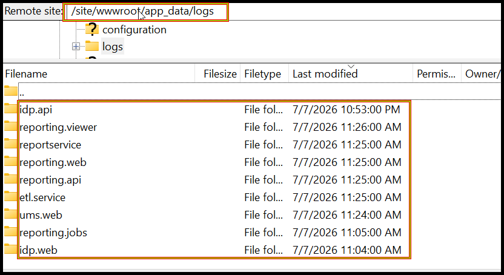

# Where can I find the error and debug log files of Bold Reports® Azure App Service?

Bold Reports® Azure App Service writes its error and debug log files to the `/site/wwwroot/app_data/logs` location.

## What are error logs?

Bold Reports® generates error log files when an exception occurs while configuring or interacting with the Bold Reports® application.

## What are debug logs?

Bold Reports® event log files record the complete user interaction details one after the other when users interact with the Bold Reports® application.

## Where are the log directories?

For any configurations made in Bold Reports®, log files are generated in the `/site/wwwroot/app_data/logs` location.

> By default, the Bold Reports® Azure App Service will be deployed in `/site/wwwroot/` location.

### How do I get the log files from Bold Reports® Azure App Service?

You download the Bold Reports® Azure App Service logs over FTP with the publish profile values. Follow these steps:

1. Log in to the [Azure portal](https://portal.azure.com/).
2. Select the Bold Reports® Azure App Service.
3. Stop the Bold Reports® Azure App Service, and then click **Get publish profile**.
4. Save the `<App service name>`, PublishSettings file and open it. The file contains three `<publishProfile>` sections for Web Deploy, FTP, and ReadOnly-FTP.
5. From the FTP `<publishProfile>` section, copy the following values:

    `publishUrl`

    `userName`

    `userPWD`
    
6. Download and install the FileZilla client application.
7. After installing the application, set the values obtained from the PublishSettings file:

    **Host**: Give the `publishUrl` value.

    **Username**: Give the `userName` value.

    **Password**: Give the `userPWD` value.
8. After entering these values as shown in the following image, click `Quickconnect`.
   
9. Find the Bold Reports® Azure App Service logs, as shown in the following image.
   

## Frequently asked questions

### Where is Bold Reports® Azure App Service deployed by default?

By default, the Bold Reports® Azure App Service is deployed in the `/site/wwwroot/` location.

### Which publish profile section has the FTP values?

Copy `publishUrl`, `userName`, and `userPWD` from the FTP `<publishProfile>` section of the PublishSettings file.

## See also

* [Where can I find the error and debug log files?](./../where-can-i-find-the-error-and-debug-log-files/)
* [Error and debug log files in Docker](./../where-can-i-find-the-error-and-debug-log-files-of-bold-reports-in-docker/)
* [Error and debug log files in Kubernetes](./../where-can-i-find-the-error-and-debug-log-files-of-bold-reports-in-kubernetes/)
