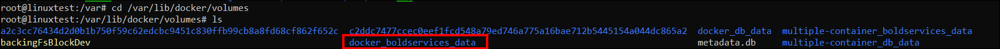
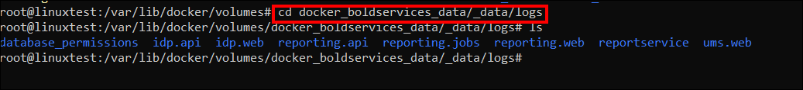
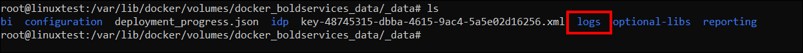
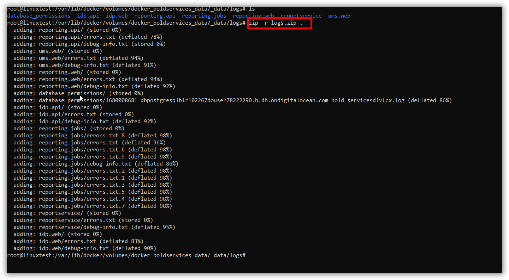
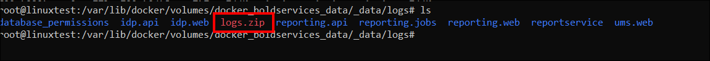
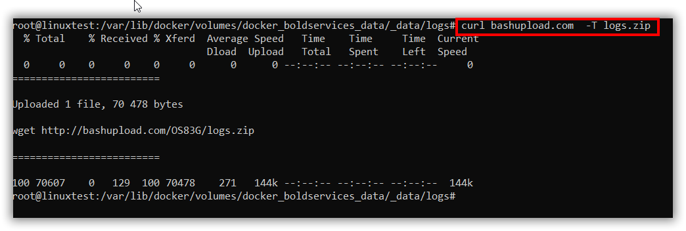
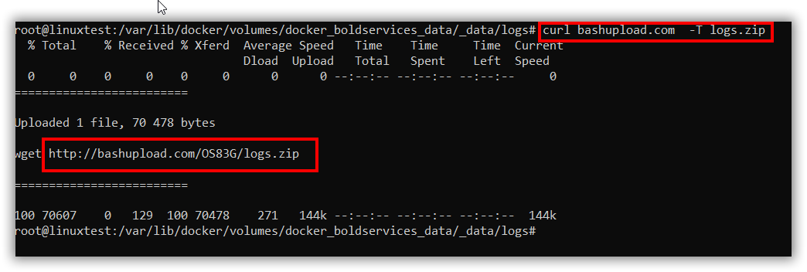

# Where can I find the error and debug log files of Bold Reports® in Docker?

Bold Reports® in Docker writes its log files under the Docker volumes in `/var/lib/docker/volumes`, in the `_data/logs` folder of the Bold services volume.

## What are error logs?

Bold Reports® generates error log files when an exception occurs while configuring or interacting with the Bold Reports® application.

## What are debug logs?

Bold Reports® event log files record the complete user interaction details one after the other when users interact with the Bold Reports® application.

## Where are the log directories?

For any configurations made in Bold Reports®, log files are generated in deployed locations under the various modules.

### How do I get the log files from Docker using Command Prompt or PowerShell?

You find, zip, and upload the Bold Reports® Docker logs from the command line. Follow these steps:

1. In the root directory, type the following command:

   **cd /var/lib/docker/volumes**

2. Run the **ls** command.

3. To go to the logs directory, type the following command:

   **cd {foldername}\_boldservices\_data/_data/logs**

   

   

   >Note: {foldername} is the folder which contains docker-compose.yml and docker.conf files.

4. Run the **ls** command.

5. Find the logs folder in the _data location.

   

6. Run the following commands to install the zip and curl command-line tools:

   **apt-get install zip**

   **apt-get install curl**

7. Run the following command to zip the logs folder:

   **zip -r {folder.zip} .**

   

8. Run the **ls** command to find the zip file.

   

9. Upload the zip file through the bashupload.com site with the following command:

   **curl bashupload.com  -T {zipped folder Name}**

   

10. Copy and browse the link in the browser. Download the zip file and share it with the Bold Reports® support team.

    

## Basic Commands

The following basic commands help you move through the Bold Reports® log directories:

| Command          | Used For|
|------------------     |------------------------------------------------------------  |
| cd    |    Change the directory.               |
| pwd        |  Find the full path of current directory.     |
| ls or ls -l        | Used to list the files and folders of the current directory.|
| cat filename       | Open the file in the powershell.|
| nano filename       | Edit the file in the powershell.|

## Frequently asked questions

### What is {foldername} in the Docker logs path?

{foldername} is the folder that contains the docker-compose.yml and docker.conf files.

### How do I share Docker logs with Bold Reports® support?

Zip the logs folder, upload it with curl to bashupload.com, then download the zip file from the link and share it with the Bold Reports® support team.

## See also

* [Where can I find the error and debug log files?](./../where-can-i-find-the-error-and-debug-log-files/)
* [Error and debug log files in Kubernetes](./../where-can-i-find-the-error-and-debug-log-files-of-bold-reports-in-kubernetes/)
* [How to restart the Bold Reports® application](./../how-to-restart-the-bold-reports-enterprise-application/)
