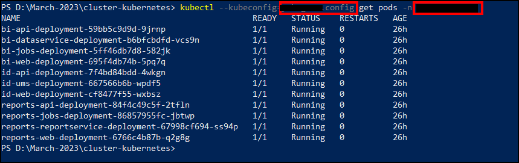
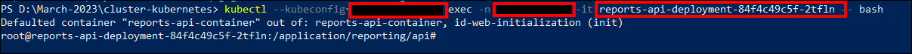
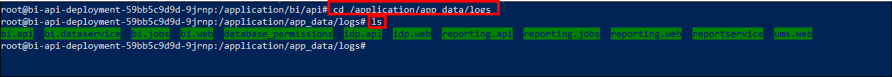
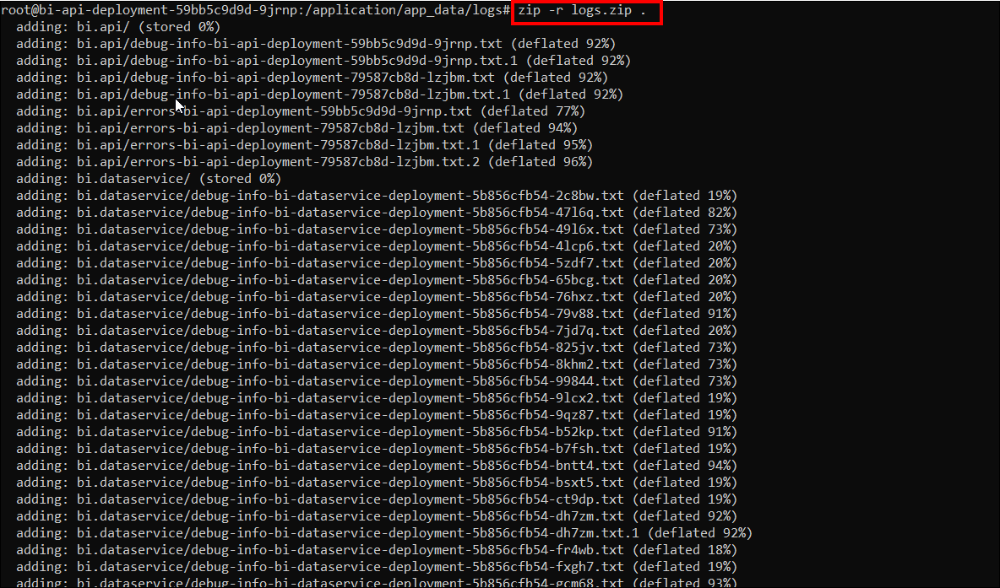
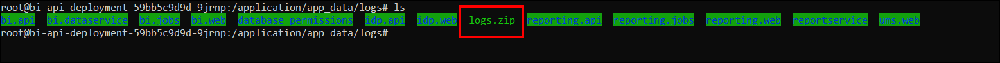
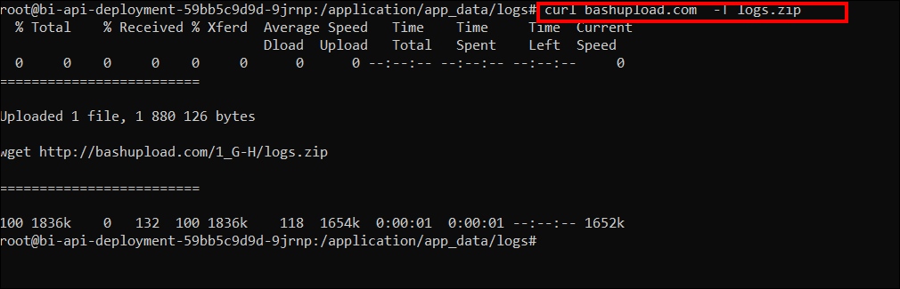
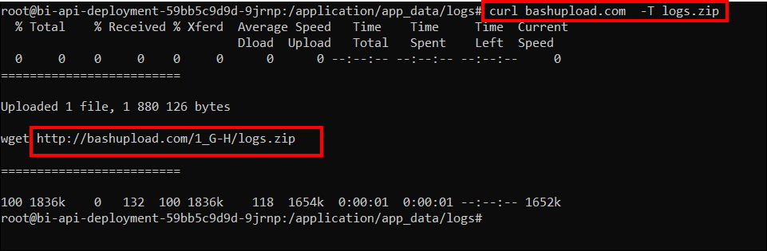

# Where can I find the error and debug log files of Bold Reports® in Kubernetes?

Bold Reports® in Kubernetes writes its log files inside each pod, in the `/application/app_data/logs` directory.

## What are error logs?

Bold Reports® generates error log files when an exception occurs while configuring or interacting with the Bold Reports® application.

## What are debug logs?

Bold Reports® event log files record the complete user interaction details one after the other when users interact with the Bold Reports® application.

## Where are the log directories?

For any configurations made in Bold Reports®, log files are generated in deployed locations under the various modules.

### How do I get the log files from Kubernetes using PowerShell or Command Prompt?

You find, zip, and upload the Bold Reports® Kubernetes logs with `kubectl`. Follow these steps:

1. Type the following command to get all the pods available in the cluster:

   **kubectl -\-kubeconfig=filename.config get pods -n namespace**

   

2. To go to the application directory, open a bash shell in any of the pods.

   **kubectl -\-kubeconfig=filename.config exec -n namespace -it podname -\- bash**

   

3. Go to the logs directory with **cd /application/app_data/logs** and list the files with the **ls** command.

   

4. Find the logs folder in the app_data location.

5. Run the following commands to install the zip and curl command-line tools:

   **apt-get install zip**

   **apt-get install curl**

6. Run the following command to zip the logs folder:

   **zip -r {folder.zip} .**

   

7. Run the **ls** command to find the zip file.

   

8. Upload the zip file through the bashupload.com site with the following command:

   **curl bashupload.com  -T {zipped folder Name}**

   

9. Copy and browse the link in the browser. Download the zip file and share it with the Bold Reports® support team.

    

>Note: Replace namespace with your namespace.
Replace filename.config with your config file name.
Replace podname with the name of the pod you need logs from.

## Basic Commands

The following basic commands help you move through the Bold Reports® log directories:

| Command          | Used For|
|------------------     |------------------------------------------------------------  |
| cd    |    Change the directory.               |
| pwd        |  Find the full path of current directory.     |
| ls or ls -l        | Used to list the files and folders of the current directory.|
| cat filename       | Open the file in the powershell.|
| nano filename       | Edit the file in the powershell.|

## Frequently asked questions

### Where are the Bold Reports® logs inside a Kubernetes pod?

The logs are in the `/application/app_data/logs` directory of the pod.

### How do I share Kubernetes logs with Bold Reports® support?

Zip the logs folder, upload it with curl to bashupload.com, then download the zip file from the link and share it with the Bold Reports® support team.

## See also

* [Where can I find the error and debug log files?](./../where-can-i-find-the-error-and-debug-log-files/)
* [Error and debug log files in Docker](./../where-can-i-find-the-error-and-debug-log-files-of-bold-reports-in-docker/)
* [Does Bold Reports® support scaling?](./../does-bold-reports-support-scaling/)
