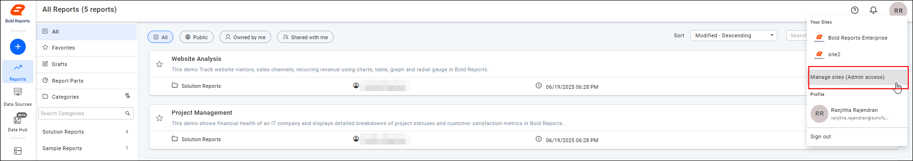
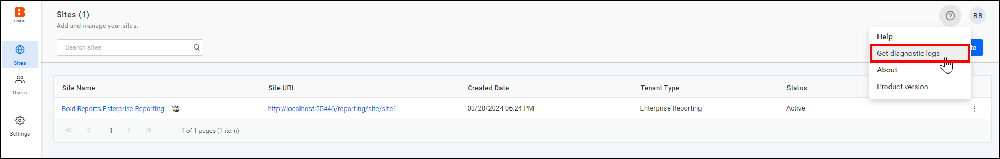
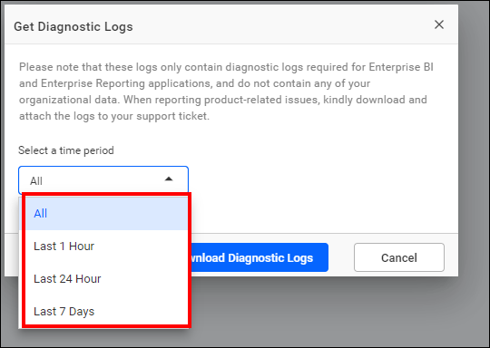
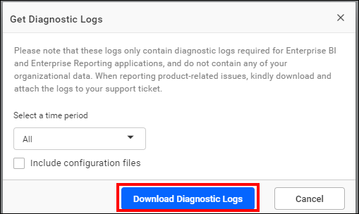
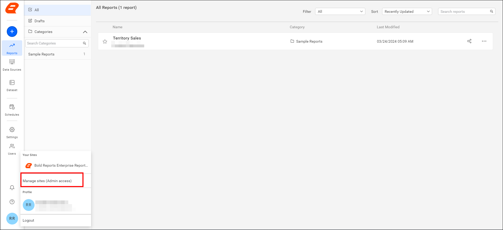
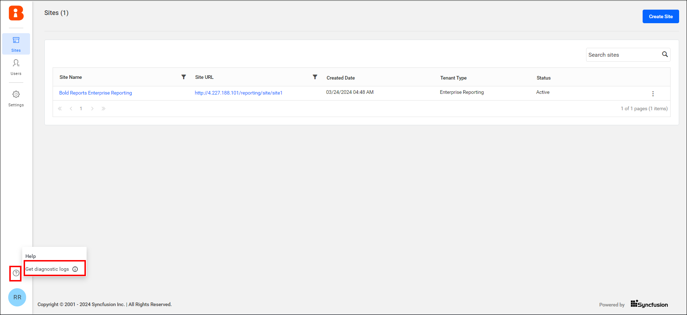
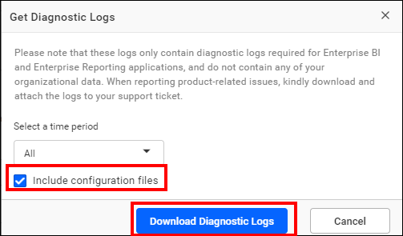
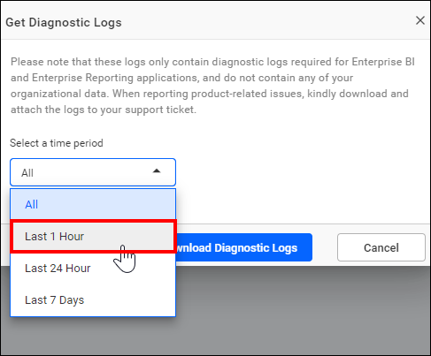

# Where can I find the error and debug log files in Bold Reports®?

Bold Reports® On-Premises Edition stores error and debug log files in the `app_data\logs` folder of the deployed location. From version 3.1.31, you can also download diagnostic logs from the UMS.

## What are error logs?

Bold Reports® generates error log files when an exception occurs while configuring or interacting with the Bold Reports® application.

## What are debug logs?

Bold Reports® event log files record the complete user interaction details one after the other when users interact with the Bold Reports® application.

## Where are the log directories?

For any configurations made in Bold Reports®, log files are generated in deployed locations under the various modules listed in the following tables, based on the nature of the error or event.

## How do I get the diagnostic logs?

You download the Bold Reports® diagnostic logs from the UMS. The steps depend on your Bold Reports® version, as explained in the following sections.

## Bold Reports® version 5.4.20 or later

In Bold Reports® version 5.4.20 or later, you select a time period and download the diagnostic logs from the UMS.

1. Click the Profile icon and choose `Manage sites (Admin access)`. The **UMS sites page** opens in a new tab.
    

    > NOTE: This option will be shown for the UMS Admin user only.

2. Go to the UMS site and click the help icon at the top right, near the profile icon. Then, choose the **Get diagnostic logs** option.
    

3. In the Get diagnostic logs dialog, select the period option from the dropdown menu `(Last 1 hour, Last 24 hours, Last seven days, or All)`, and then click **Download diagnostic logs**. The logs are downloaded.
    
    

## Bold Reports® version 3.1.31 or later

In Bold Reports® version 3.1.31 or later, you download the diagnostic logs from the UMS help menu.

1. Click the Profile icon and choose **Manage sites (Admin access)**. The **UMS sites page** opens in a new tab.

    > NOTE: This option will be shown for the UMS Admin user only.

    

2. On the UMS site, click the help icon and choose the **Get diagnostic logs** option. The logs are downloaded.

    

You can also manually retrieve the log file from the following location for Bold Reports® version 3.1.31 or later:

> By default, Bold Reports® is deployed in `C:\BoldServices` for Windows and `/var/www/bold-services/application` for Linux.

| Hosted Environment    | Log location                                                  |
|------------------     |------------------------------------------------------------   |
| Windows               |  **`{Deployed Location}`**\app_data\logs                      |
| Linux                 |   **`{Deployed Location}`**/app_data/logs            |

## Bold Reports® version below 3.1.31

Bold Reports® versions below 3.1.31 do not support retrieving logs directly from the application. Get them from the deployment location as follows:

> By default, Bold Reports® is deployed in `C:\Bold Reports`.

| Application           | Log location                                                  |
|------------------     |------------------------------------------------------------   |
| Identity Provider     | **`{Deployed Location}`**\IDP\App_Data\Logs                   |
| Report Server         | **`{Deployed Location}`**\Report Server\App_Data\Logs         |

### How do I get configuration files?

You download Bold Reports® configuration files along with the logs from the **Get diagnostic logs** dialog.

1. The option to download the configuration files along with the logs is available from Bold Reports® version 5.4.20 or later.

    >**Note:** Enable the checkbox only if the Bold Reports® support team has requested the configuration files.

2. Click the Profile icon and choose **Manage sites (Admin access)**. The UMS sites page opens in a new tab.
    

3. Click the help icon and choose the **Get diagnostic logs** option.
    

4. In the `Get diagnostic logs` dialog, enable the **Include configuration files** checkbox, then click `Download diagnostic logs` to download both the logs and configuration files.
    

   > NOTE: If you only need the configuration files, you can select the `Last 1 hour` option instead of `All` from the **Select time period** dropdown menu.

    

## Frequently asked questions

### Who can download diagnostic logs in Bold Reports®?

The **Manage sites (Admin access)** option is shown for the UMS Admin user only.

### Where is Bold Reports® deployed by default?

By default, Bold Reports® is deployed in `C:\BoldServices` for Windows and `/var/www/bold-services/application` for Linux.

## See also

* [Error and debug log files in Azure App Service](./../where-can-i-find-the-error-and-debug-log-files-of-bold-reports-azure-app-service/)
* [Error and debug log files in Docker](./../where-can-i-find-the-error-and-debug-log-files-of-bold-reports-in-docker/)
* [Error and debug log files in Kubernetes](./../where-can-i-find-the-error-and-debug-log-files-of-bold-reports-in-kubernetes/)
