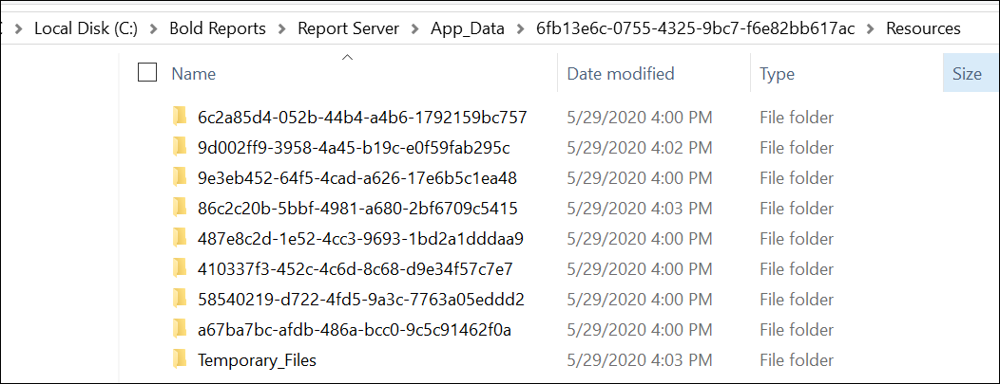

# Where does the data reside in Bold Reports®?

Bold Reports® keeps report details in the database you provided when you configured the [Bold Reports® application](./../../../application-startup/). It keeps the report, dataset, and data source files in File Storage or Azure Blob Storage.

## Which details does Bold Reports® store in the database?

Bold Reports® maintains the following details in the database:

* Information of reports.
* Information of shared data sources.
* Information of shared data sets.
* Categories.
* Schedules definitions.
* Permissions settings associated for report, data source, data set, categories, and schedules.
* Bold Reports® Report Server configurations.

## Where does Bold Reports® store reports, datasets, and data sources?

Bold Reports® Server keeps the reports, datasets, and data sources you add in a location based on the storage type you chose while configuring the Bold Reports® Server application.

For the `File Storage` type, reports, datasets, and data sources are maintained in the following location:

For the `Azure Blob Storage` type, reports, datasets, and data sources are maintained in the `Azure Blob Container` that you provided when configuring the Bold Reports® Server application.

## See also

* [Does Report Server store reports execution data to server database](./../does-report-server-store-reports-execution-data-to-server-database/)
* [Bold Reports® architecture](./../bold-reports-architecture/)
* [What are the database permissions required to set up Bold Reports®?](./../what-are-the-database-permissions-required-to-set-up-bold-reports/)
