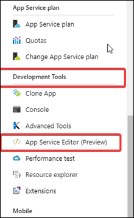

# Where should I replace the Bold Reports® license key in Bold Reports® Azure App Service?

You replace the Bold Reports® license key in the `boldlicense.txt` file of the Bold Reports® Azure App Service, using the App Service editor.

## Why do I need to replace the license key?

By default, the Bold Reports® Azure App Service has an expired license key. Replace it with your Bold Reports® license key.

## How do I replace the license key in Azure App Service?

You replace the Bold Reports® license key from the Azure Portal. Follow these steps:

1. Log in to your [Azure Portal](https://portal.azure.com/).
2. Press the Stop option to stop the Bold Reports® Azure App Service.
3. Choose the `App Service editor` under the Development tool in the options, as shown in the following image.
   
4. The editor displays the deployed files.
5. Go to the location `/site/wwwroot/app_data/reporting/configuration/boldlicense.txt` and replace your license key.
6. Start the Bold Reports® Azure App Service.

## Frequently asked questions

### Where is the license key file in Bold Reports® Azure App Service?

The license key file is at `/site/wwwroot/app_data/reporting/configuration/boldlicense.txt`.

### Do I need to stop the App Service before replacing the license key?

Yes. Stop the Bold Reports® Azure App Service, replace the key, and then start the App Service again.

## See also

* [Create Bold Reports® Azure App Service using ARM template](./../../../deployment/azure-app-service/)

* [Upgrade Bold Reports® Azure App Service from v1.x to a newer version](./../../../deployment/upgrade/azure/upgrade-v1.x/)

* [Upgrade Syncfusion® Report Server Azure App Service from v4.x to a newer version](./../../../deployment/upgrade/azure/upgrade-v1.x/)
