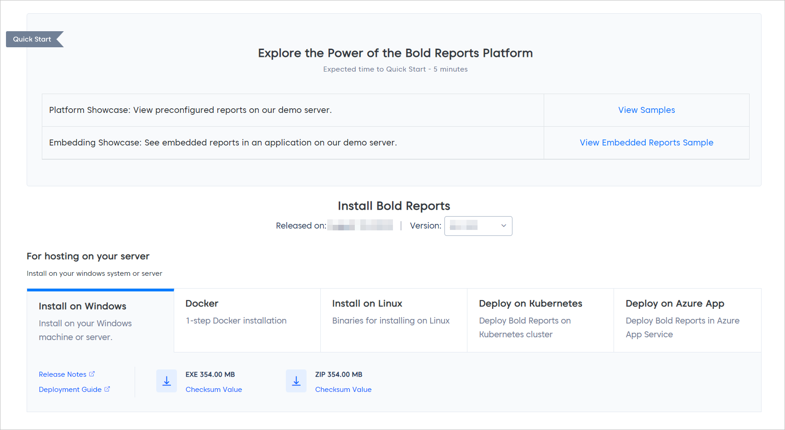

# Will Syncfusion® charge for Bold Reports® Azure App Service?

No, Syncfusion® will not charge for Bold Reports® Azure App Service.

## Which subscription do I need to use Report Server on Azure App Service?

To use the Bold Reports® Report Server with Azure App Service, you need an active or trial Enterprise or Embedded subscription with Bold Reports®.

The following image shows the subscriptions in a Bold Reports® account.

## See also

* [Deploy Bold Reports® on Azure App Service](./../../../deployment/azure-app-service/)
* [Replace the license key in Bold Reports® Azure App Service](./../where-should-i-replace-the-bold-reports-license-key-in-bold-reports-azure-app-service/)
* [Find the error and debug log files of Bold Reports® Azure App Service](./../where-can-i-find-the-error-and-debug-log-files-of-bold-reports-azure-app-service/)
