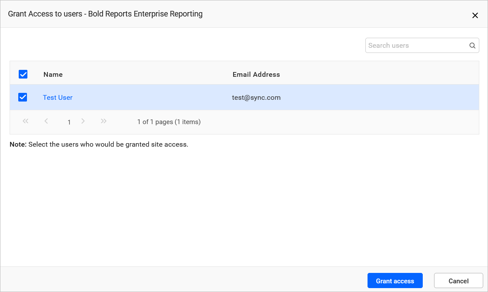
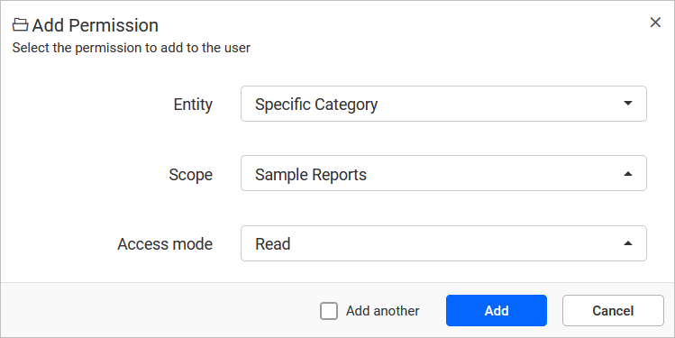

# Will the OpenID user have access to site2 if the user is imported from OpenID Connect under site1?

No. In Bold Reports®, a user imported from OpenID Connect on site1 does not have access to site2. The user can get access if the admin grants access to site2 for the imported user in UMS.

## How do I grant an imported OpenID user access to site2?

You grant site2 access to the imported user in the Bold Reports® UMS. To learn more, see [grant access](https://help.boldreports.com/enterprise-reporting/administrator-guide/manage-sites/manage-sites/#grant-access).

The following image shows the grant access permission for the new user.

## What permissions does the user get on site2?

After the admin grants access in UMS, the user can access site2 with limited reporting permission in the Bold Reports® Report Server. You can also give the user additional permission with manage permission. The following image shows how to add permission for the user.

To learn more, see [manage permissions](https://help.boldreports.com/enterprise-reporting/administrator-guide/manage-permissions/).

## Can the user access site2 without the admin granting access?

Yes. The admin does not need to grant access to site2. When the same OpenID settings are configured on site2, Bold Reports® automatically imports the user and logs the user into site2.

## See also

* [Configure OpenID Connect single sign-on](./../../authentication/single-sign-on/openid-connect/)
* [Manage sites](./../../manage-sites/)
