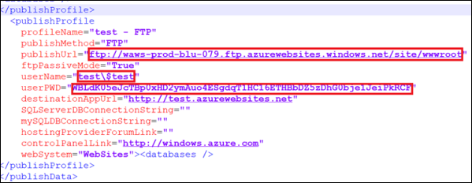
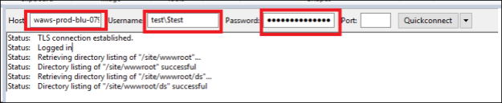
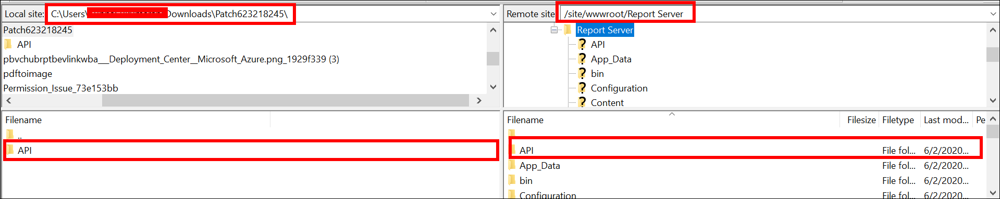
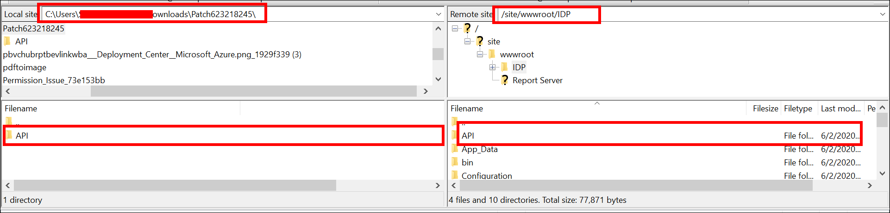

# How to apply the patches to Bold Reports® Multi-tenant Azure App Service

To apply support team patch files to the Bold Reports® Multi-tenant Azure App Service, connect over FTP with FileZilla and move the patch folders to the hosted location.

## How do I apply patches in Bold Reports® Multi-tenant Azure App Service?

You apply Bold Reports® patches by stopping the App Service, connecting over FTP, and copying the patch folders. Follow these steps:

1. Log in to the [Azure portal](https://portal.azure.com/).
2. Select the Bold Reports® Azure App Service.
3. Stop the Bold Reports® Azure App Service, and then click **Get publish profile**.
4. Save the `<App service name>`, PublishSettings file and open it. The file contains three `<publishProfile>` sections for Web Deploy, FTP, and ReadOnly-FTP.
5. From the FTP `<publishProfile>` section, copy the following values:

    `publishUrl`

    `userName`

    `userPWD`
    
6. Download and install the FileZilla client application.
7. After installing the application, set the values obtained from the PublishSettings file:

    **Host**: Give the `publishUrl` value.

    **Username**: Give the `userName` value.

    **Password**: Give the `userPWD` value.
8. After entering these values as shown in the following image, click `Quickconnect`.
   
9. Download and extract the files provided in the support incident.
10. Move the folders to the hosted location of the Bold Reports® Report Server `/site/wwwroot/Report Server/`, as shown in the following image.
  
     >If the patch was provided for IDP, then move the folders to the hosted location of the IDP `/site/wwwroot/IDP/`.
     >
11. Start the Bold Reports® Azure App Service.

## Frequently asked questions

### Where do I copy an IDP patch in Azure App Service?

If the patch was provided for IDP, move the folders to the hosted location of the IDP `/site/wwwroot/IDP/`.

### Do I need to stop the App Service before applying a patch?

Yes. Stop the Bold Reports® Azure App Service before you get the publish profile, and start it again after you move the patch folders.

## See also

* [How to apply patches to Bold Reports® Enterprise Reporting](./../apply-patches-to-bold-reports/)
* [Where should I replace the license key in Azure App Service?](./../../faq/where-should-i-replace-the-bold-reports-license-key-in-bold-reports-azure-app-service/)
* [Find error and debug logs in Azure App Service](./../../faq/where-can-i-find-the-error-and-debug-log-files-of-bold-reports-azure-app-service/)
