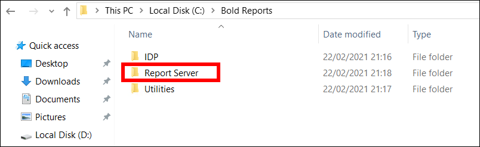
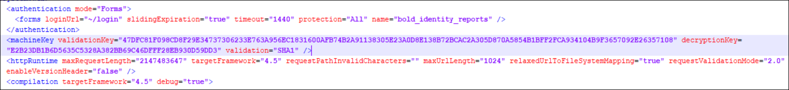
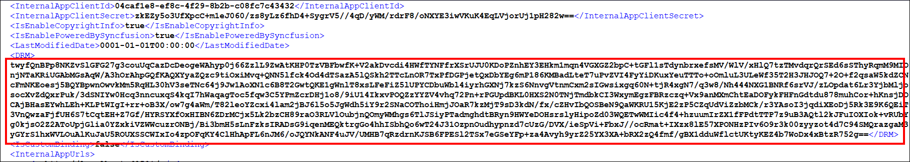

# How to apply the common login patches to Bold Reports® Enterprise Reporting

Bold Reports® common login patches fix the common login break that occurs when you upgrade or install the Bold BI application version 4.1 with Bold Reports®.

## What causes the common login issue?

Upgrading or installing the Bold BI application version 4.1 with Bold Reports® breaks the common login. The Bold Reports® team provides the fix as a patch that contains assemblies and files. The following sections explain how to apply the patch to Bold Reports® Enterprise Reporting.

## Which patch do I download for my version?

Download the Bold Reports® patch for your installed version from the following table:

<table>
<tr>
<th>
Version
</th>
<th>
Download Patch
</th>
</tr>
<tr>
<td>
2.4.10
</td>
<td>

Download the [2.4.10 patch](https://www.syncfusion.com/downloads/support/directtrac/general/ze/Bold_Report_Server_Patch1751976179)

</td>
</tr>
<tr>
<td>
2.4.19
</td>
<td>

Download the [2.4.19 patch](https://www.syncfusion.com/downloads/support/directtrac/general/ze/Bold_Report_Server_Patch2046299657)

</td>
</tr>
</table>

> Contact our support team for patches for other Bold Reports® versions.

## Which files do I back up before applying the patch?

Before you apply the Bold Reports® patch, copy the `bin` folders and `web.config` files from the following locations:

<table>
<tr>
<th>
Folders / Files to take backup
</th>
<th>
Bold Reports® Location
</th>
</tr>
<tr>
<td>

`bin`

`Web.config`

</td>
<td>

`C:\Bold Reports\Report Server\`

</td>
</tr>
<tr>
<td>

`bin`

`Web.config`

</td>
<td>

`C:\Bold Reports\Report Server\api\`

</td>
</tr>
<tr>
<td>

`bin`

`Web.config`

</td>
<td>

`C:\Bold Reports\Report Server\jobs\`

</td>
</tr>
<tr>
<td>

`Web.config`

</td>
<td>

`C:\Bold Reports\Report Server\reportservice\`

</td>
</tr>
</table>

## How do I apply the common login patch?

You apply the Bold Reports® common login patch by replacing the Report Server folder and updating the machine key and DRM values. Follow these steps:

1. After you download the patch, extract the zip file, copy the `Report Server` folder, and replace it in the Bold Reports® Report Server location `C:\Bold Reports\`, as shown in the following image. By default, Bold Reports® will be deployed in `C:\Bold Reports` location.
  

2. Go to your backup location, edit any one of the `web.config` files, and copy the entire machine key node.
  

3. Replace the copied machine key node in the following `web.config` files:

    * `C:\Bold Reports\Report Server\web.config`

    * `C:\Bold Reports\Report Server\api\web.config`

    * `C:\Bold Reports\Report Server\jobs\web.config`

    * `C:\Bold Reports\Report Server\reportservice\web.config`

4. Go to `C:\BoldServices\app_data\configuration\`, edit the Config.xml file, copy the value of the DRM node, and paste the value in the DRM of the following Config.xml files: `C:\Bold Reports\Report Server\App_Data\Configuration\Config.xml` and `C:\Bold Reports\Report Server\Configuration\Config.xml`.

5. Start the Bold Reports® application by using the desktop shortcut IIS/IIS Express.

## Frequently asked questions

### What if my Bold Reports® version is not in the patch table?

Contact the Bold Reports® support team for patches for other Bold Reports® versions.

### Which web.config files need the copied machine key node?

Replace the machine key node in the `web.config` files of the Report Server, `api`, `jobs`, and `reportservice` folders under `C:\Bold Reports\Report Server\`.

## See also

* [How to apply patches to Bold Reports® Enterprise Reporting](./../apply-patches-to-bold-reports/)
* [How to apply patches to Bold Reports® Azure App Service](./../apply-patches-to-bold-reports-azure-app-service/)
