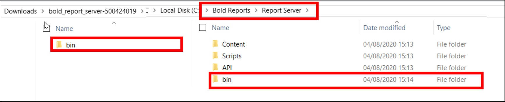
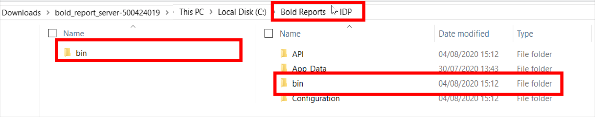

# How to apply the patches to Bold Reports® Enterprise Reporting

The Bold Reports® support team provides fixes for reported issues as patches that contain assemblies or files. You apply a patch to Bold Reports® Enterprise Reporting by replacing those assemblies or files and restarting the application.

## How do I get the patch?

Download and extract the Bold Reports® patch provided in the support incident.

## How do I apply a patch that contains only assemblies?

If the extracted Bold Reports® patch contains only assemblies, apply it in the Report Server and IDP locations as follows.

> Support team will mention and provide separate patch assemblies for Report Server and IDP.

Replace the provided assemblies in the respective Bold Reports® location shown in the following tables. After you replace the assemblies, start the Bold Reports® application by using the desktop shortcut IIS/IIS Express.

<table>
<tr>
<th>
Assemblies
</th>
<th>
Bold Reports® location
</th>
</tr>
<tr>
<td>

`BoldReports.Web`

`Syncfusion.XlsIO.Base`

`Syncfusion.Pdf.Base`

`Syncfusion.DocIO.Base`

`Syncfusion.OfficeChart.Base`

`Syncfusion.Compression.Base`

`Syncfusion.Presentation.Base`

`BoldReports.Base.Logger`

`Bold.Licensing`

`BoldReports.DataExtensions.MySQL`

`BoldReports.DataExtensions.PostgreSQL`

`BoldReports.DataExtensions.SSAS`

`BoldReports.DataExtensions.WebAPI`

`BoldReports.Extensions.BarcodeCRI`

`Syncfusion.SfBarcode.WPF`

</td>
<td>

**`C:\Bold Reports\Report Server\bin`**

**`C:\Bold Reports\Report Server\API\bin`**

**`C:\Bold Reports\Report Server\ReportService\bin`**

**`C:\Bold Reports\Report Server\Jobs\bin`**

</td>
</tr>
<tr>
<td>

`Syncfusion.Server.Base.Scheduler`

`Syncfusion.Server.Base`

`Syncfusion.Server.Base.IdPDirectory`

`Syncfusion.Server.Base.Item`

`Syncfusion.Server.Base.Resources.Storage`

`Syncfusion.Server.Base.Data`

`Syncfusion.Server.Base.DataClasses`

`Syncfusion.Server.ActiveDirectory.Base`

`Syncfusion.Server.Base.MarkdownSharp`

`Syncfusion.Server.Base.Encryption`

`Syncfusion.Server.Base.Logger`

</td>
<td>

**`C:\Bold Reports\Report Server\bin`**

**`C:\Bold Reports\Report Server\API\bin`**

**`C:\Bold Reports\Report Server\Jobs\bin`**

</td>
</tr>
<tr>
<td>

`Syncfusion.Server.Jobs`

</td>
<td>

**`C:\Bold Reports\Report Server\Jobs\bin`**

</td>
</tr>
<tr>
<td>

`Syncfusion.Server.Reports`

</td>
<td>

**`C:\Bold Reports\Report Server\bin`**

</td>
</tr>
<tr>
<td>

`Syncfusion.Server.API`

</td>
<td>

**`C:\Bold Reports\Report Server\API\bin`**

</td>
</tr>
<tr>
<td>

`Syncfusion.Server.API.Base`

`Syncfusion.Server.Base.Notification`

`Syncfusion.Server.Base.Collaboration`

</td>
<td>

**`C:\Bold Reports\Report Server\bin`**

**`C:\Bold Reports\Report Server\API\bin`**

</td>
</tr>
<tr>
<td>

`BoldReports.Server.Services`

</td>
<td>

**`C:\Bold Reports\Report Server\ReportService\bin`**

</td>
</tr>
</table>

<table>
<tr>
<th>
Assemblies
</th>
<th>
IDP location
</th>
</tr>
<tr>
<td>

`Syncfusion.Server.IdentityProvider.API`

</td>
<td>

**`C:\Bold Reports\IDP\bin`**

**`C:\Bold Reports\IDP\API\bin`**

</td>
</tr>
<td>

`Syncfusion.Server.IdentityProvider`

`Syncfusion.Server.Base.MarkdownSharp`

</td>
<td>

**`C:\Bold Reports\IDP\bin`**

</td>
</tr>
<tr>
<td>

`Syncfusion.Server.Base`

`Syncfusion.Server.Base.Resources.Storage`

`Syncfusion.Server.Base.Data`

`Syncfusion.Server.Base.DataClasses`

`Syncfusion.Server.ActiveDirectory.Base`

`Syncfusion.Server.Base.Encryption`

`Syncfusion.Server.Base.Logger`

</td>
<td>

**`C:\Bold Reports\IDP\bin`**

**`C:\Bold Reports\IDP\API\bin`**

**`C:\Bold Reports\IDP\UMS\bin`**

</td>
</tr>
<tr>
<td>

`Syncfusion.Server.API.Base`

</td>
<td>

**`C:\Bold Reports\IDP\API\bin`**

</td>
</tr>
<tr>
<td>

`Syncfusion.TenantManagement`

`Syncfusion.Server.LicenseHelper`

</td>
<td>

**`C:\Bold Reports\IDP\UMS\bin`**

</td>
</tr>
</table>

## How do I apply a patch that contains files in a folder structure?

If the extracted Bold Reports® patch contains files in a folder structure, follow these steps:

1. Copy the folder and replace it in the Report Server location `C:\Bold Reports\Report Server`, as shown in the following image. By default, Bold Reports® will be installed in `C:\Bold Reports` location.
  
     >If the patch was provided for IDP, then replace the copied folders to the respective IDP location `C:\Bold Reports\IDP`.
     >
2. Start the Bold Reports® application by using the desktop shortcut IIS/IIS Express.

## Frequently asked questions

### Does the support team provide separate patches for Report Server and IDP?

Yes. The Bold Reports® support team mentions and provides separate patch assemblies for Report Server and IDP.

### Where is Bold Reports® installed by default?

By default, Bold Reports® is installed in the `C:\Bold Reports` location.

## See also

* [How to apply patches to Bold Reports® Azure App Service](./../apply-patches-to-bold-reports-azure-app-service/)
* [How to apply common login patches to Bold Reports®](./../apply-patches-to-bold-reports-to-support-common-login-with-latest-bi/)
* [How to restart the Bold Reports® application](./../../faq/how-to-restart-the-bold-reports-enterprise-application/)
