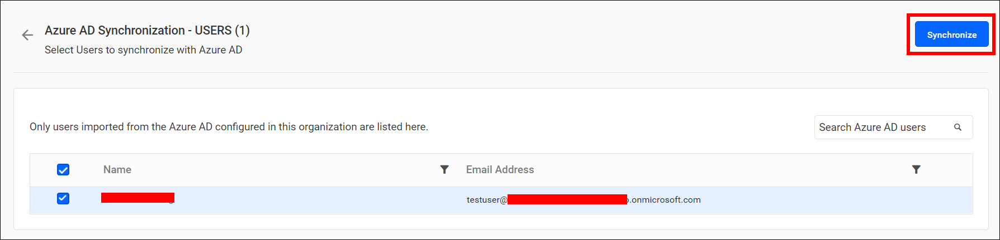
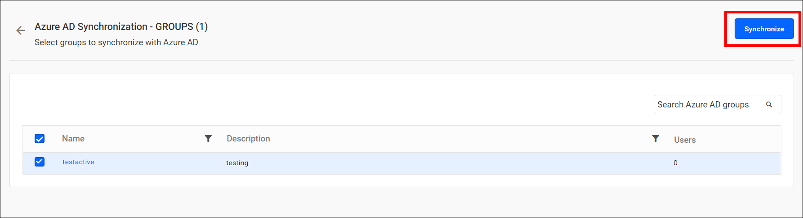
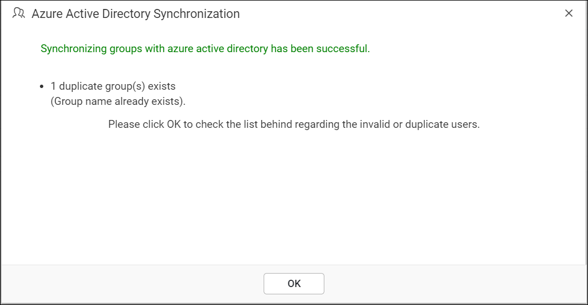

# Can you limit user or group synchronization in Bold Reports®?

No. Bold Reports® cannot limit Microsoft Entra ID (formerly Azure AD), Windows AD, and database user synchronization by count, such as 100 users. However, you can control whose details are synchronized.

## How do I synchronize only specific users?

Bold Reports® lets you control the synchronization of specific users with Microsoft Entra ID, Windows AD, and Database Users synchronization. During synchronization, Bold Reports® lists the imported users. From this list, choose the users you need and click the `Synchronize` button at the top.

The following screenshot shows the `Synchronize` button above the list of imported users.

To learn more, see [synchronize users](https://help.boldreports.com/enterprise-reporting/administrator-guide/manage-users/users/synchronize/synchronize-existing-database-users/#synchronize-users).

## How do I synchronize only specific groups?

Bold Reports® lets you control the synchronization of specific groups with Microsoft Entra ID and Windows AD group synchronization. During synchronization, Bold Reports® lists the imported groups. From this list, choose the groups you need and click the `Synchronize` button at the top.

The following screenshot shows the `Synchronize` button above the list of imported groups.

To learn more, see [synchronize groups](https://help.boldreports.com/enterprise-reporting/administrator-guide/manage-users/groups/synchronize/synchronize-azure-active-directory-groups/#synchronize-groups).

## Does group synchronization also synchronize the group members?

With the group synchronization option, the Bold Reports® server does not synchronize the users who are added to the group.

However, the server imports new users from the Microsoft Entra ID group to the Bold Reports® Report Server only when they are not already on the Report Server. It also removes a user from the Report Server group when that user is removed from the Azure AD group.

## What happens after synchronization completes?

After synchronization completes, Bold Reports® shows the number of groups modified, deleted, and duplicated in a success message box, as shown in the following screenshot.

To learn more, see the [synchronization procedure](https://help.boldreports.com/enterprise-reporting/administrator-guide/manage-users/groups/synchronize/synchronize-azure-active-directory-groups/#synchronization-procedure).

## Frequently asked questions

### Can I limit synchronization to a fixed number of users?

No. Bold Reports® cannot limit user synchronization by count, such as 100 users. You choose which users or groups to synchronize from the imported list instead.

### Does Report Server remove users when they leave an Azure AD group?

Yes. Report Server removes a user from the Report Server group when that user is removed from the Azure AD group.

## See also

* [Synchronization schedule settings](./../../manage-app-settings/synchronization-schedule/)
* [Microsoft Entra ID settings](./../../manage-app-settings/azure-active-directory/)
* [Active Directory settings](./../../manage-app-settings/active-directory/)
