# Configure SSL for Bold Reports® in IIS Manager

To configure SSL for Bold Reports® in IIS Manager, import your SSL certificate, then add an HTTPS binding to the Bold Reports® site.

## How do I import an SSL certificate in IIS Manager?

Import your .pfx SSL certificate into IIS Manager before you bind it to the Bold Reports® site.

1. Open IIS Manager. Click **Server Certificates**.

    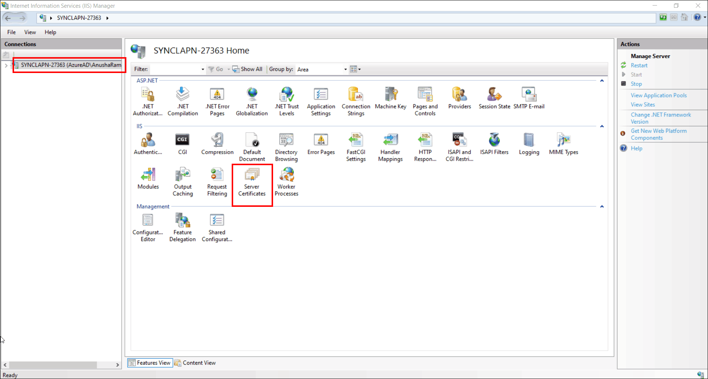

2. In the Actions panel on the right, select **import**.

   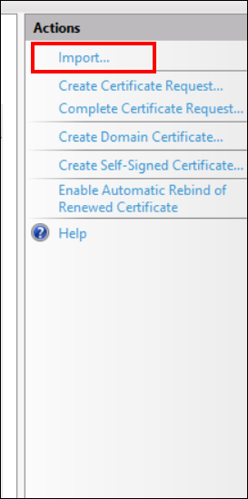

3. In the **Import Certificate** dialog box, click the browse option and select the .pfx file. Provide the required **Password**.

   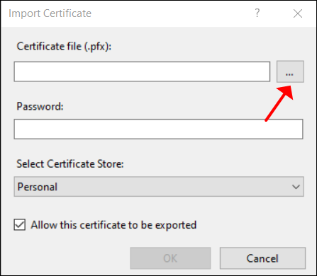

4. Click **OK**. IIS imports the SSL certificate to the server.

   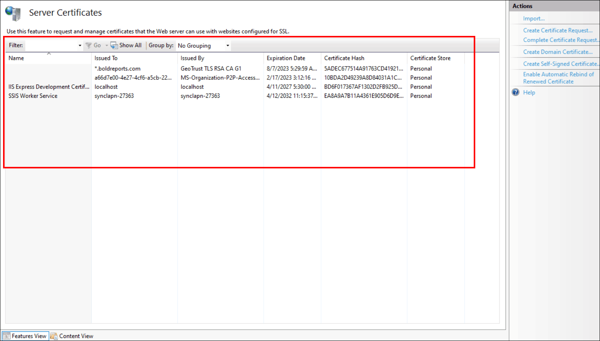

## How do I add an HTTPS site binding?

Add an HTTPS binding to the Bold Reports® Enterprise Reporting site and select the imported certificate.

1. After you install the Bold Reports® Enterprise Reporting application, open IIS Manager.

2. In IIS Manager, select **BoldReports_EnterpriseReporting**. In the Actions panel on the right, select **Bindings**.

   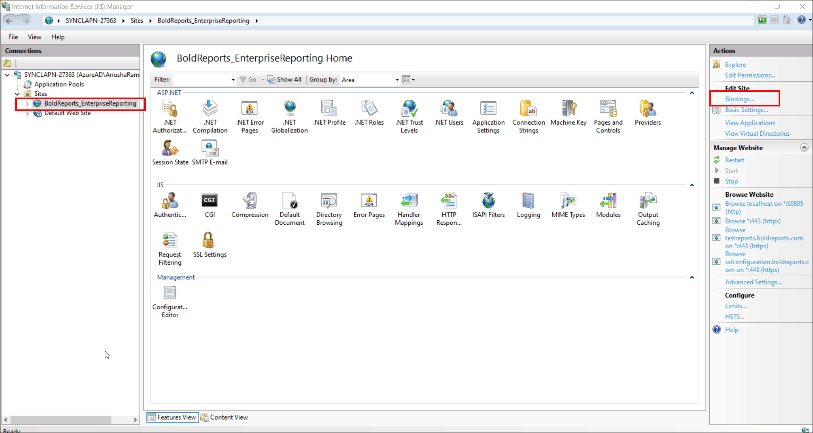

3. In the **Site Bindings** dialog box, click **Add**.

   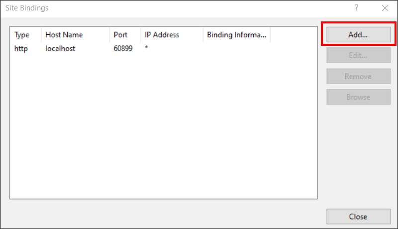

4. In the **Add Site Binding** dialog box, click the **Type** dropdown and select **https**. Select **All Unassigned** as the default IP address.

   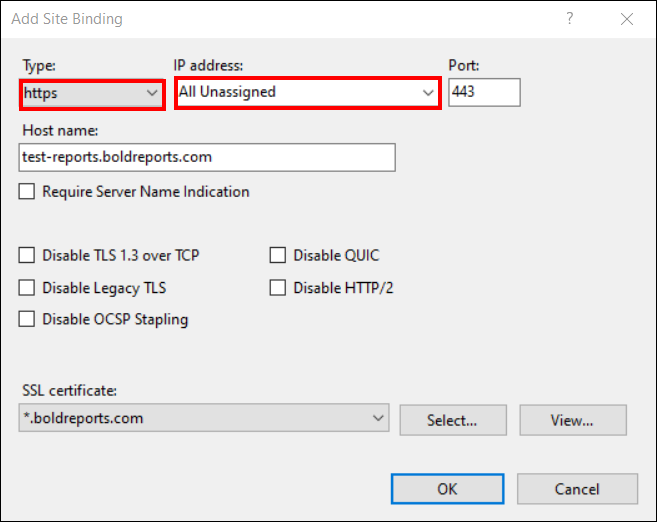

5. In **Host Name**, provide the **sub-domain name** with the **Domain name** that the certificate is issued to.
   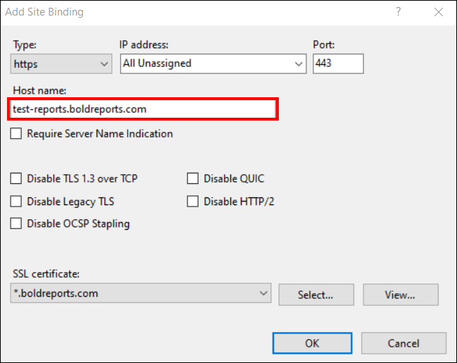
   >**Note**: **sub-domain name** is your choice.

6. In the **SSL Certificate** dropdown, select the certificate you require.

   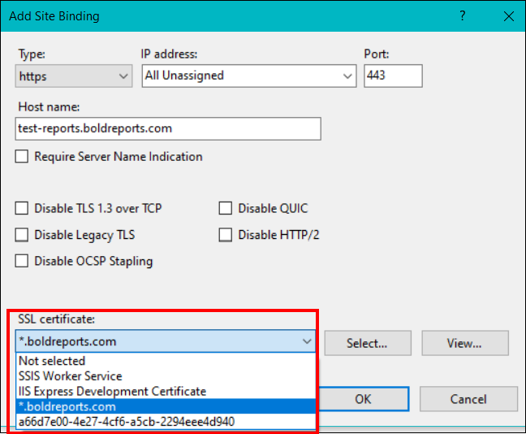

7. Click **OK**.

8. Restart the application. Your Bold Reports® Enterprise Reporting application in Windows is now configured with the SSL certificate.

   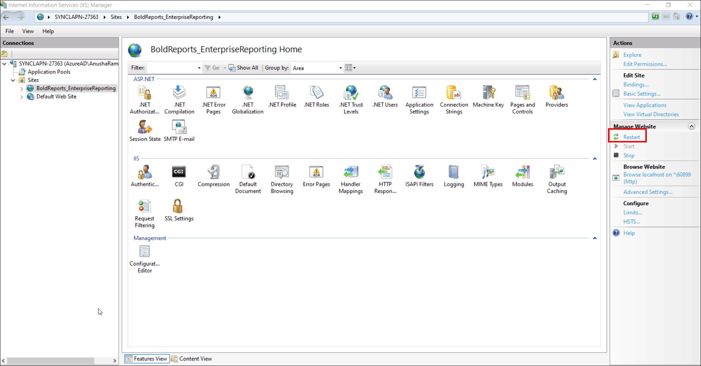

9. Browse the application.

   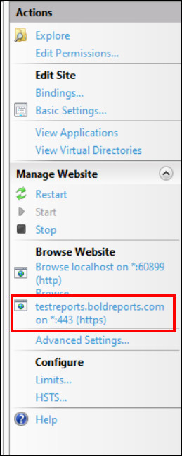

> To change the binding information in the Bold Reports® Enterprise Reporting application, see [how to change the binding](../../../deployment/deploy-on-windows/installation-and-deployment/#how-to-change-the-binding-in-the-bold-reports-enterprise-reporting).

## Frequently asked questions

### Which certificate file format do I import?

Import a .pfx file in the **Import Certificate** dialog box and provide its **Password**.

### What host name do I enter for the HTTPS binding?

Enter the **sub-domain name** with the **Domain name** that the certificate is issued to. The sub-domain name is your choice.

## See also

* [Change the binding in Bold Reports®](./../how-to-change-the-binding-in-the-bold-reports/)
* [Switch Report Server from IIS Express to IIS](./../switch-the-installed-bold-reports-report-server-iis-express-application-to-iis/)
* [Map a domain name before startup](./../map-a-domain-name-to-bold-reports-site-before-startup/)
