# Create a Bold Reports® Azure App Service using the ARM template up to v2.x

You can deploy Bold Reports® Report Server to Azure as an App Service with an Azure Resource Manager (ARM) template, and then configure it from the startup wizard.

> If you already have Report Server Azure App Service with Syncfusion® Report Platform Report Server or Bold Reports® v1.x Report Server, then refer to the Syncfusion® Report Server migration or upgrade v1.x for your startup.

## How do I deploy Report Server to Azure with the ARM template?

Follow these steps to create the Bold Reports® Report Server in Azure as an App Service with the ARM template:

1. Log in to the [Azure portal](https://portal.azure.com/).

2. Click **Create resource** from the top menu.
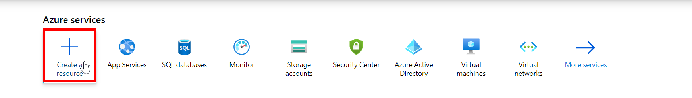

3. Search `Template deployment` in the marketplace and select **Template deployment**.
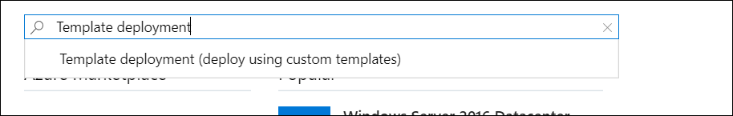

4. Click **Create**.
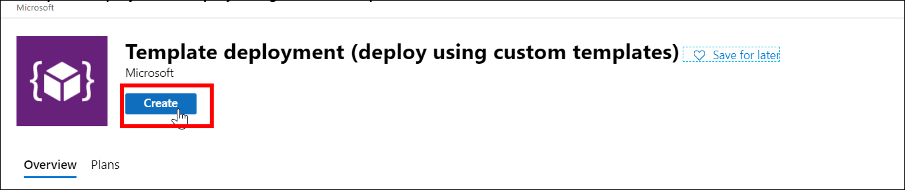

5. Select **Build your own template in the editor** in the Custom Deployment window.
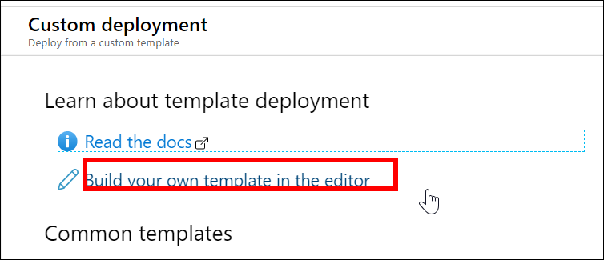

6. [Download the ARM template file](https://raw.githubusercontent.com/boldreports/bold-reports-azure/master/armtemplates/v2.4.19/BoldReportsAppServiceTemplate.json).

7. Copy all the contents of the template file and replace them in the Edit template window. Then, click **Save**.
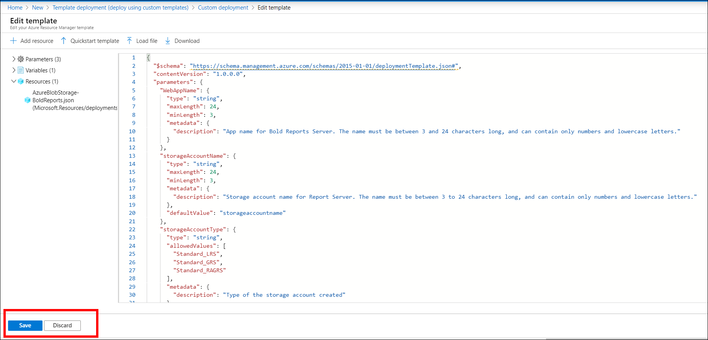

8. Fill in the following details to complete the deployment steps:
    * **Subscription**: Choose the subscription that you have with Azure. Learn how to [create a Windows Azure subscription](https://blogs.msdn.microsoft.com/arunrakwal/2012/04/09/create-windows-azure-subscription/).

    * **Resource group**: A logical group in Azure that groups your resources, like web app, storage account, and network. Learn more about [Azure resource groups](https://docs.microsoft.com/en-us/azure/azure-resource-manager/resource-group-overview#resource-groups).

    * **Location**: Choose the location to deploy the app. **East US** is the recommended location.

    * **Web App name**: The name of the Report Server that you want in the URL. Because it becomes the URL, it must be globally unique. If the name already exists, the deployment fails, and you must start again with another name.

    * **Storage account name**: Mandatory for Blob storage. It must also be unique, like the Web App name. Learn more about [Azure storage accounts](https://docs.microsoft.com/en-us/azure/storage/storage-introduction).

    * **Storage account type**: Optional if you chose file storage in storage type, and mandatory for Blob storage. Learn more about [storage account replication types](https://docs.microsoft.com/en-us/azure/storage/storage-introduction#replication-for-durability-and-high-availability).

   > **Note:** Web App name and Storage account name must be in lowercase only.

9. Select the agreement check box and click **Purchase** to deploy the Bold Reports® On-Premises Edition Web App.
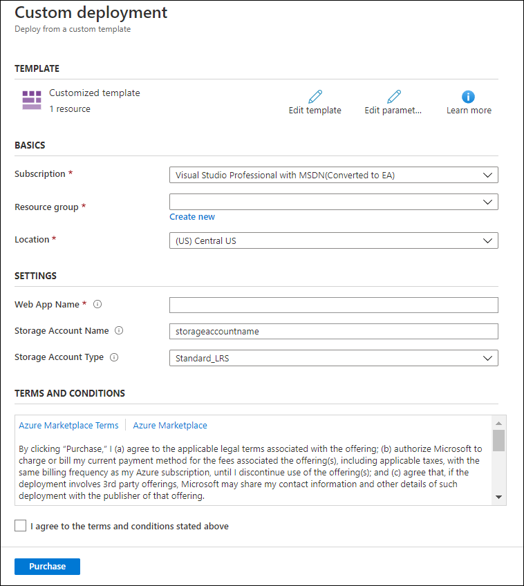

   The Bold Reports® Multi-tenant App Service (Web App) deployment starts.

   > **Note:** Deployment process will take around 15 minutes to complete.

10. After the deployment succeeds, go to your Web App and search `App Service Editor`. Then, click `GO` as shown in the following screenshot.

    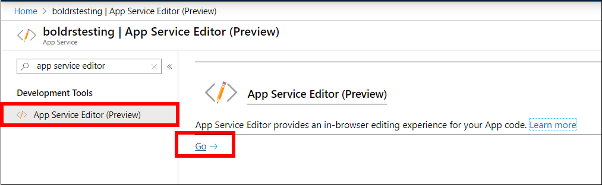

11. Copy your Web App URL. Update the xml node `InternalAppReportUrl` in the config.xml file under `wwwroot/IDP/UMS/Configuration/boldreports/config.xml`.

    The URL must be, **`InternalAppReportUrl`- `{web App URL}/reporting`**
    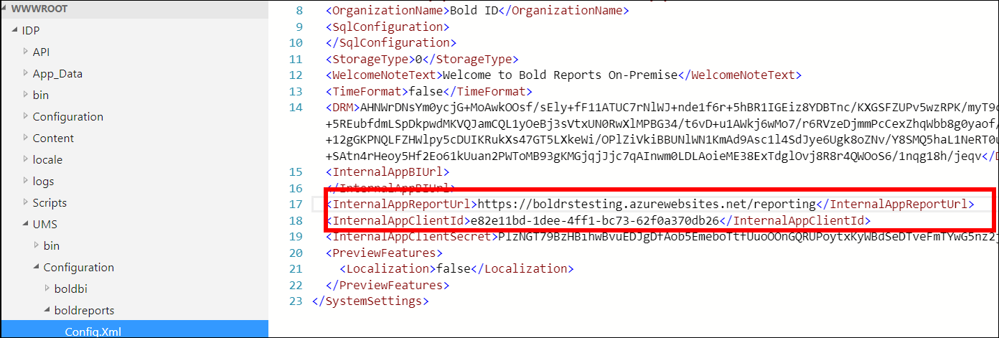

12. Copy your Web App URL. Update the xml nodes `InternalAppDataServiceUrl` and `InternalAppIdpUrl` in the config.xml file under `wwwroot/Report Server/Configuration/config.xml`.

    The URL must be, **`InternalAppDataServiceUrl` – `{web App URL}/reporting/reportservice`**

    **`InternalAppIdpUrl` – `{web App URL}/`**
   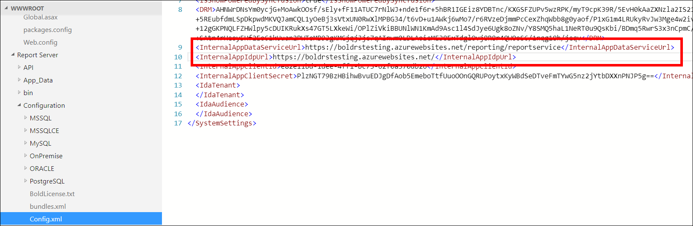

13. Stop and start your Web App, and then browse it.

## Which App Service plans does Report Server support?

Bold Reports® On-Premises Edition supports basic, standard, and premium App Service plans in Azure.

   The App Service plan for the Web App is created, which will be in `Basic – B1` by default. Learn more about [Azure App Service plans](https://docs.microsoft.com/en-us/azure/app-service/azure-web-sites-web-hosting-plans-in-depth-overview). Bold Reports® On-Premises Edition Web App does not support free or shared App Service plans.

The minimum recommended App Service plan to run the application is the basic plan.

For better performance, scale up the App Service plan from basic to standard or premium plans. The following documentation links show how to scale up and scale out the App Service plan:

Scale up: <https://docs.microsoft.com/en-us/azure/app-service-web/web-sites-scale>

Scale out: <https://docs.microsoft.com/en-us/azure/monitoring-and-diagnostics/insights-how-to-scale>

## Configure a new Bold Reports®

Configure the Bold Reports® Multi-tenant Azure App Service with these steps:

1. Click `Proceed to Setup`.
   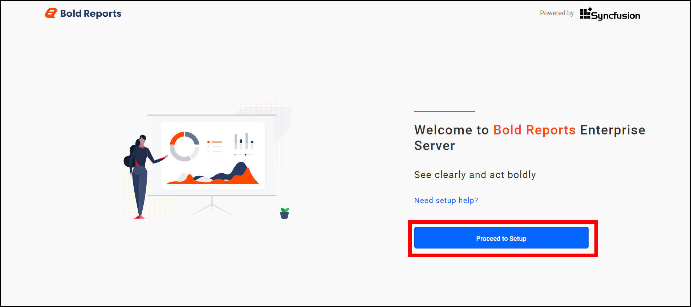

2. Provide the [user details](../../../application-startup/#new-user---system-administrator) and click `Next`. This user becomes an admin for Bold Reports®.
   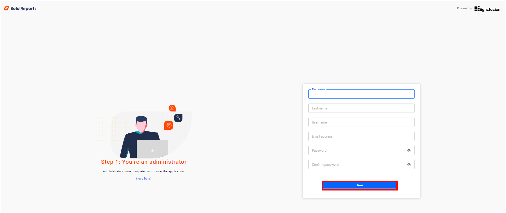
   >You can migrate Syncfusion® Report Server Azure app service (`v4.x`) or Bold Reports® Azure app service (`v1.x`) data to Bold Reports® Multi-tenant Azure App Service. To do so, use the admin email ID of Syncfusion® Report Server or Bold Reports® Server (Single Tenant) when you configure the admin details.

3. Provide your [Database details](../../../application-startup/#database-configuration) to maintain your reports, users, and their access permissions, and then click `Next`.
   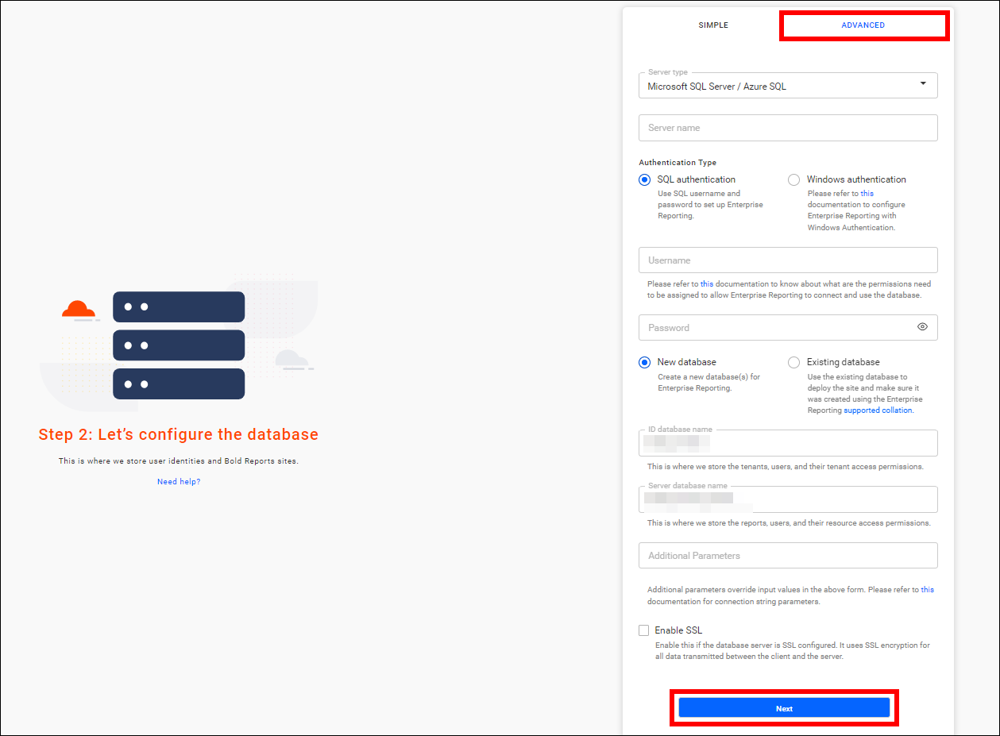

4. Select the check box to fetch the blob details pre-configured at deployment time. Report Server uses them to maintain the physical files of reports, datasets, data sources, and more. Then, click `Next`.
   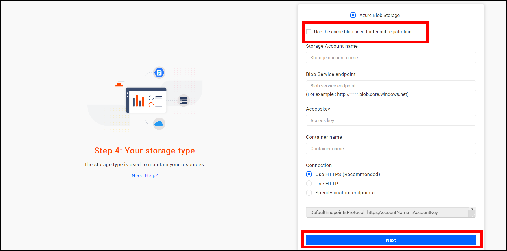

5. After the configuration is done, log in to navigate the sites or reports page.

## Frequently asked questions

### How long does the ARM template deployment take?

The deployment process takes around 15 minutes to complete.

### Can I use a free App Service plan?

No. The Bold Reports® On-Premises Edition Web App does not support free or shared App Service plans. The minimum recommended plan is the basic plan.

### Which naming rules apply to the Web App and storage account?

The Web App name and Storage account name must be in lowercase only and globally unique.

## See also

* [Migrate Report Server with its database in Azure App Service](./../migration/migrate-bold-reports-server-with-database-in-azure-app-service/)
* [Apply patches to Bold Reports® Azure App Service](./../apply-patches-to-bold-reports-azure-app-service/)
* [Azure Application Insights integration](./../azure-application-insights-integration-in-bold-reports/)
