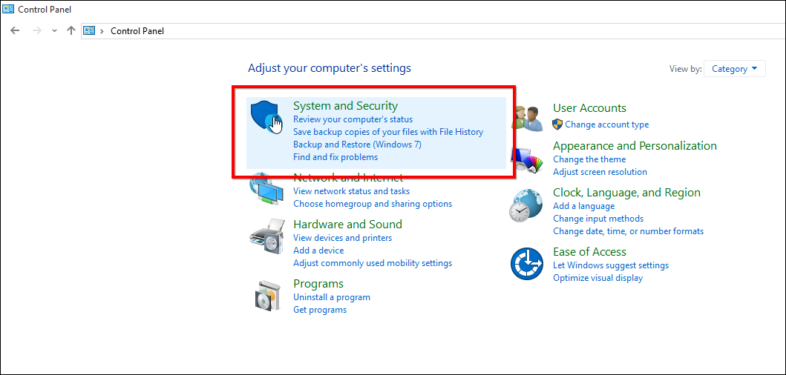
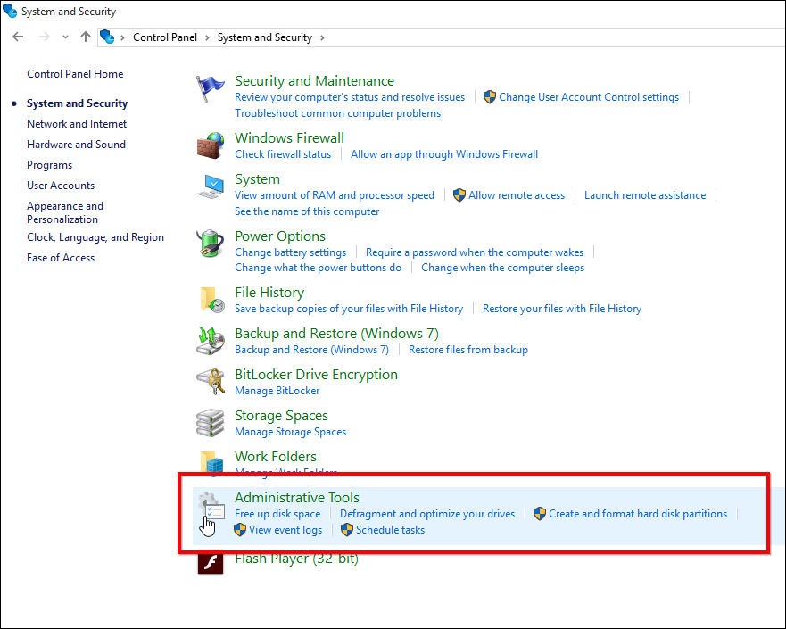
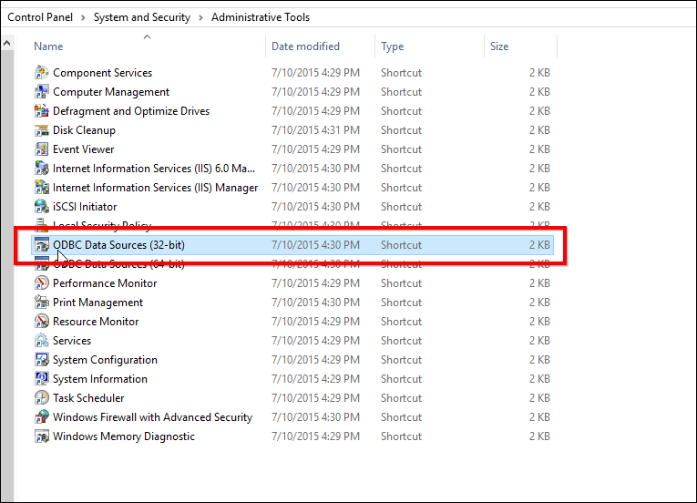
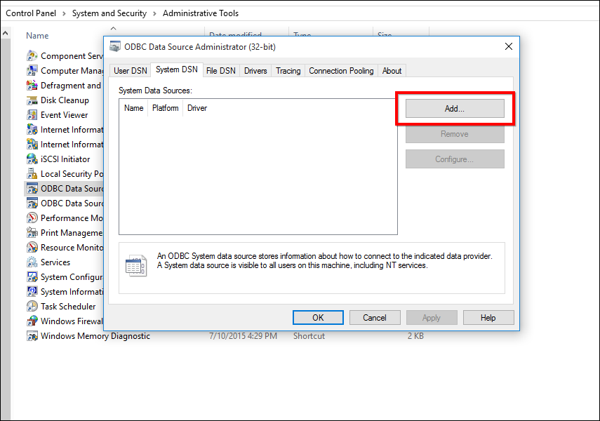
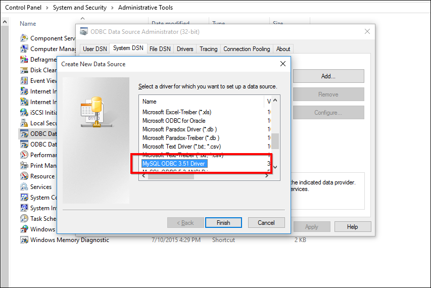
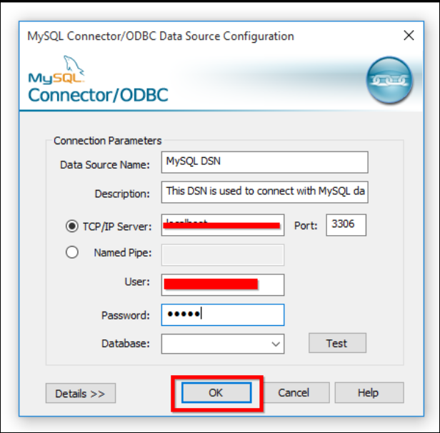
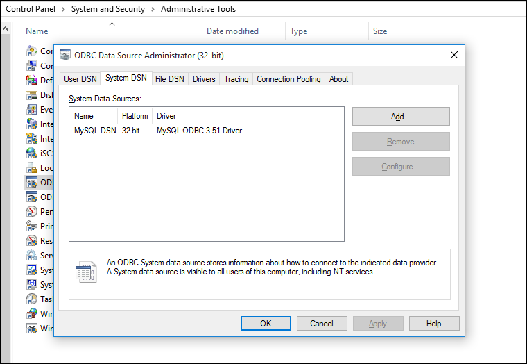

# How to create DSN for MySQL

To connect a MySQL database to Bold Reports® Enterprise Edition, create a DSN with the 32-bit MySQL ODBC driver.

## What is an ODBC DSN?

An ODBC Data Source Name (DSN) stores the information Bold Reports® needs to connect to a database on a remote database server. A system DSN provides access to multiple users, rather than only the user who created it.

## How do I install the MySQL ODBC driver?

Download and install the `32-bit Connector/ODBC driver` from the [Downloads section of the MySQL website](http://dev.mysql.com/downloads/connector/odbc/).

> **Note:** Bold Reports® is a `32-bit` application, so it will not support `64-bit ODBC` connector.

## How do I create the DSN?

After you install the MySQL ODBC driver, create a DSN for the MySQL database in the 32-bit ODBC Data Source Administration tool that Bold Reports® uses.

### Open ODBC Data Source Administration Tool

1. Open `Control Panel` and select `System and Security`.

    

2. Select `Administrative Tools` from the list of options.

    

3. Select `ODBC Data Sources (32-bit)` from the list of options.

    

### Create DSN with MySQL ODBC Driver

1. In the `ODBC Datasource Administration (32-bit)` tool, navigate to `System DSN` and click `Add` to add a new DSN.

    

2. Select the MySQL ODBC Driver from the list of drivers and click `Finish`.

    

3. The `MySQL Connector/ODBC Configuration` tool opens. Fill in the requested details:

    

    * Data Source Name: Name of the DSN that you use to connect to the MySQL database from Bold Reports® On-Premises Edition.
    * Description: Description of the DSN (Optional).
    * TCP/IP Server: Server that holds the MySQL database.
    * Port: Port number provided for the MySQL database.
    * User: Username used to connect to MySQL.
    * Password: Password of the corresponding user.

4. The `ODBC Data Source Administration (32-bit)` tool lists the created DSN.

    

## Frequently asked questions

### Can I use the 64-bit MySQL ODBC connector?

No. Bold Reports® is a `32-bit` application, so it does not support the `64-bit ODBC` connector. Install the `32-bit Connector/ODBC driver`.

### Why create a system DSN instead of a user DSN?

A system DSN provides access to multiple users, rather than only the user who created it.

## See also

* [Data source connector settings](./../../manage-app-settings/connectors-settings/)
* [Database settings](./../../manage-app-settings/database-settings/)
