# Deploy Bold Reports® server as a sub-application in Windows Environment

To deploy Bold Reports® as a sub-application in Windows, create an IIS application pool for each application and add each one as a sub-application.

## How do I create the application pools?

Bold Reports® Report Server has several applications, so you create one IIS application pool for each of them.

1. Install the Bold Reports® application. By default, it is deployed in the **C:\ Boldservices** location. Then, take a backup of boldservices.
    `Location - C:\BoldServices-Copy` 

2. Open the IIS server, right-click `Application Pools`, and click `Add Application Pool`.
   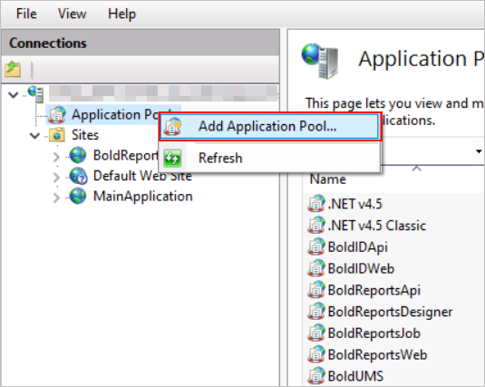

3. Provide the name **SubApp_IDPWeb** and click `OK`.
   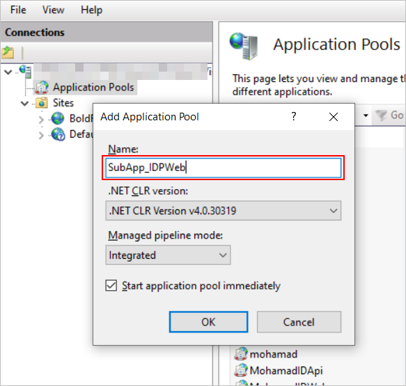
   > You can give the application pool any name you prefer. Include IDPWeb in it to differentiate it from other Bold Reports® applications.

4. Right-click the new application pool and select `Advanced Settings`.
   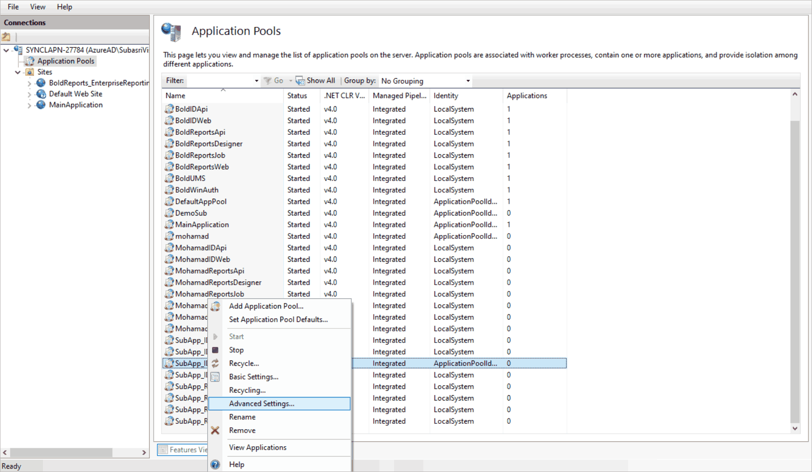

5. Click the `Enable 32-Bit Applications` property under the general category and set it to true.
   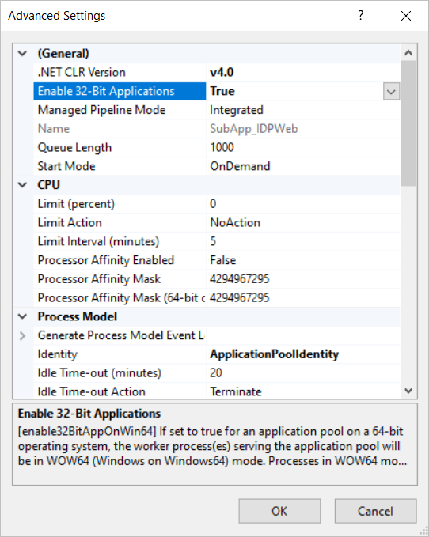

6. Click the `Start Mode` property under the general category and select the `AlwaysRunning` option.
   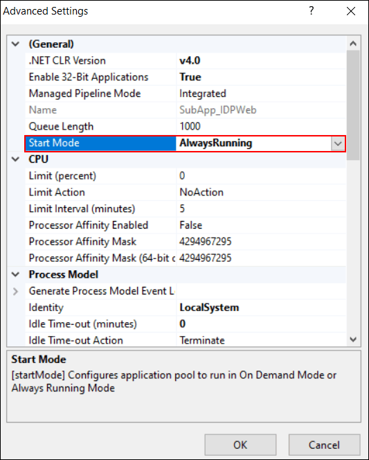

7. Click the identity property menu button under the process model category.
   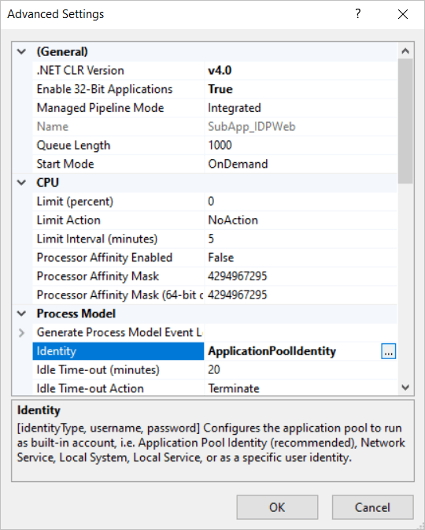

8. Select **LocalSystem** under Built-in account type and click `ok`.
   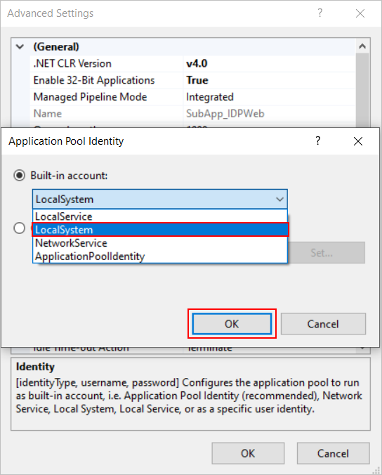

9. Click the `Idle Time-out(minutes)` property menu button under the process model category, set it to `zero`, and click `ok`.
     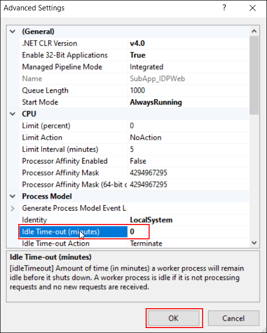

10. Create application pools for the remaining applications on the Bold Reports® server. You already created the application pool for IDP-Web in step 2. Repeat steps 2 to 9 to add application pools for the applications in the following table:

    | Application name | Application Pool Name |
    | ---------------- | --------------------- |
    | IDP - Web | SubApp_IDPWeb (We have created at step 2) |
    | IDP - API | SubApp_IDPApi |
    | IDP - UMS | SubApp_IDPUMS |
    | IDP - Windows Authentication | SubApp_IDPWinAuth |
    | Reports - Web | SubApp_ReportsWeb |
    | Reports – Api | SubApp_ReportsApi |
    | Reports - Reportservice | SubApp_ReportsDesigner |
    | Reports – Jobs | SubApp_ReportsJobs |
    | Reports - Viewer | SubApp_ReportsViewer |
    > You can give each application pool any name you prefer. Make sure each application pool name is distinct.

## How do I add Bold Reports® as a sub-application?

Add the Bold Reports® IDP web application under your main IIS application, then add the other applications beneath it.

1. Right-click your application (main application) in IIS and select **Add Application**, as shown in the following image.
   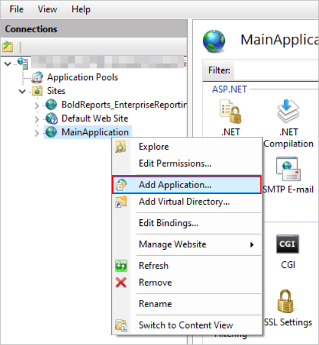

2. Fill in the Alias name, Application pool, and Physical path, and click `Ok`.
    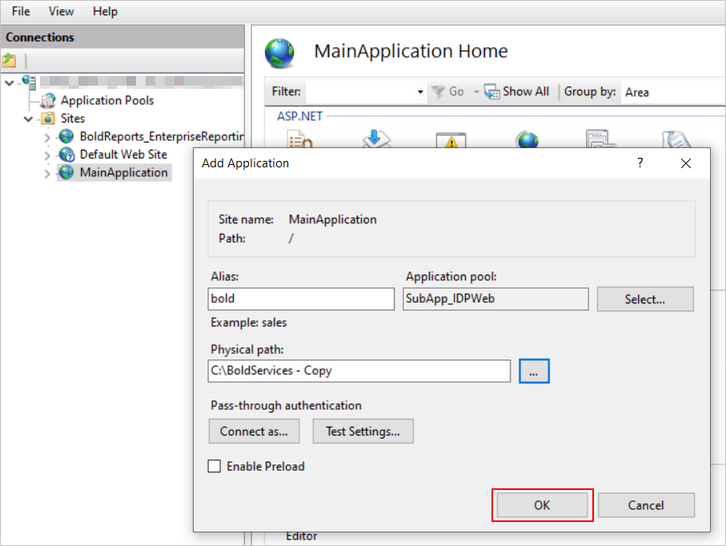
    * Alias name - Provide the name `bold` for the Bold Reports® application, which acts as a sub-application. You can choose a different name if you prefer.
    > The alias name provided in this step will be used in the URL.
    * Application pool - Select the application pool `SubApp_IDPWeb` that you created in step 2.
    * Physical path - Click Browse and go to your backup location (C:\BoldServices-Copy), then select the web folder under the IDP folder.
    > Alias name should be in lowercase.

3. Right-click the Bold Reports® sub-application name and select `Add Application`.
    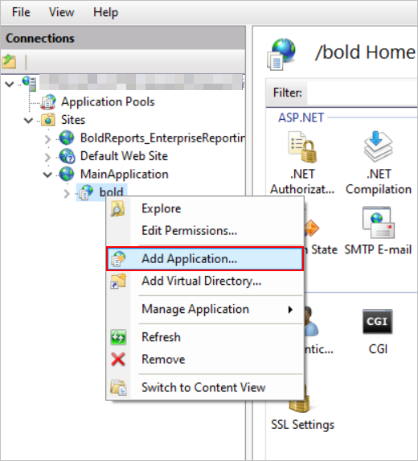

4. Provide the alias name, application pool, and physical path, and click `OK`.
    * Alias name - Provide the name `api`.
    * Application pool - Select the application pool `SubApp_IDPApi` that you created in step 5.
    * Physical path - Click Browse, go to the backup location, and choose the api folder under idp.
    `(C:\BoldServices - Copy\idp\api)`
    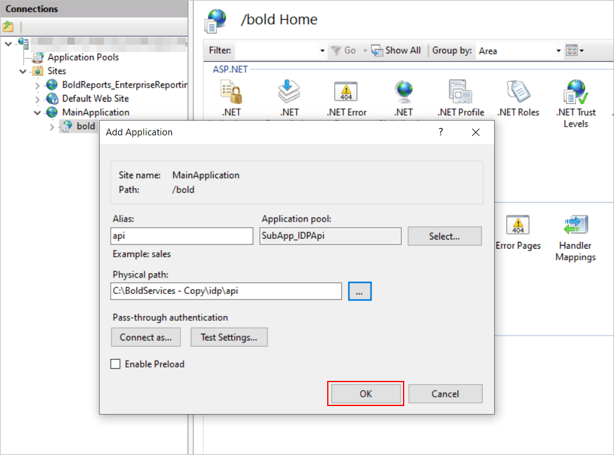

5. Add the following applications as sub-applications with the listed alias name, application pool, and physical path:

    <table>
     <tr>
     <th>Application</th>
     <th>Alias Name</th>
     <th>Application Pool</th>
     <th>Physical path</th>
     <th>Example</th>
     </tr>
     <tr>
     <td>{your application}</td>
     <td>bold   (Did at step 10)</td>
     <td>SubApp_IDPWeb</td>
     <td>{Deployed location}\idp\web</td>
     <td>C:\BoldServices - Copy\idp\web</td>
     </tr>
     <tr>
     <td rowspan="4">{your application}\bold\</td>
     <td>api   (Did at step 12)  </td>
     <td>SubApp_IDPApi</td>
     <td>{Deployed location}\idp\api</td>
     <td>C:\BoldServices - Copy\idp\api</td>
     </tr>
     <tr>
     <td>ums</td>
     <td>SubApp_IDPUMS</td>
     <td>{Deployed location}\idp\ums</td>
     <td>C:\BoldServices - Copy\idp\ums</td>
     </tr>
     <tr>
     <td>windowsauthentication</td>
     <td>SubApp_IDPWinAuth</td>
     <td>{Deployed location}\idp\winauth</td>
     <td>C:\BoldServices - Copy\idp\windowsauthentication</td>
     </tr>
     <tr>
     <td>reporting</td>
     <td>SubApp_ReportsWeb</td>
     <td>{Deployed location}\reporting\web</td>
     <td>C:\BoldServices - Copy\reporting\web</td>
     </tr>
     <tr>
     <td rowspan="4">{your application}\bold\reporting\</td>
     <td>api</td>
     <td>SubApp_ReportsApi</td>
     <td>{Deployed location}\reporting\api</td>
     <td>C:\BoldServices - Copy\reporting\api</td>
     </tr>
     <tr>
     <td>jobs</td>
     <td>SubApp_ReportsJobs</td>
     <td>{Deployed location}\reporting\jobs</td>
     <td>C:\BoldServices - Copy\reporting\jobs</td>
     </tr>
     <tr>
     <td>reportservice</td>
     <td>SubApp_ReportsDesigner</td>
     <td>{Deployed location}\reporting\reportservice</td>
     <td>C:\BoldServices - Copy\reporting\reportservice</td>
     </tr>
     <tr>
     <td>viewer</td>
     <td>SubApp_ReportsViewer</td>
     <td>{Deployed location}\reporting\viewer</td>
     <td>C:\BoldServices - Copy\reporting\viewer</td>
     </tr>
    </table>

    > **Note:** Starting from v5.x, the `viewer service` is available in the Report Server.

    > You must provide an alias name in the above table for api, ums, windowsauthentication, reporting, api, jobs, and reportservice.

6. Make sure the **Bold Reports®** application has the sub-applications, as shown in the following image.
    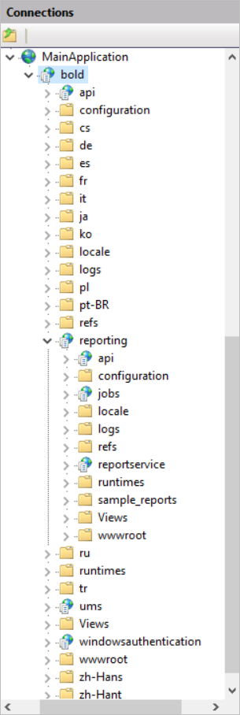

## How do I update the configuration files for the sub-application?

To run Bold Reports® as a sub-application, update the URLs in the **config.xml** and **product.json** files, then restart the application.

1. Update the **config.xml** and **product.json** files under `{DeployedLocation}\app_data\configuration\config.xml`.
    Eg. `C:BoldServices-Copy\app_data\configuration\config.xml`

2. Update the URL with the sub-app for the **Idp**, **Reports**, and **ReportsService** nodes in the config.xml file.
    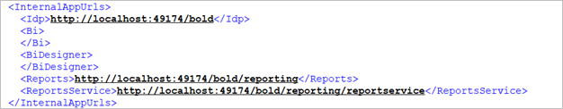

3. Update the URL with the sub-app for the **Idp**, **Reports**, and **ReportsService** keys in the product.json file.
    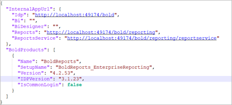

4. Restart and run the application from IIS.

## Frequently asked questions

### Does the alias name appear in the URL?

Yes. The alias name you provide for the Bold Reports® application is used in the URL, and it should be in lowercase.

### Which application pool settings do I change?

Set `Enable 32-Bit Applications` to true, `Start Mode` to `AlwaysRunning`, the identity to **LocalSystem**, and `Idle Time-out(minutes)` to `zero`.

## See also

* [Change the binding in Bold Reports®](./../how-to-change-the-binding-in-the-bold-reports/)
* [Configure SSL for Bold Reports® in IIS Manager](./../configure-ssl-for-bold-reports-in-iis-manager/)
* [Switch Report Server from IIS Express to IIS](./../switch-the-installed-bold-reports-report-server-iis-express-application-to-iis/)
