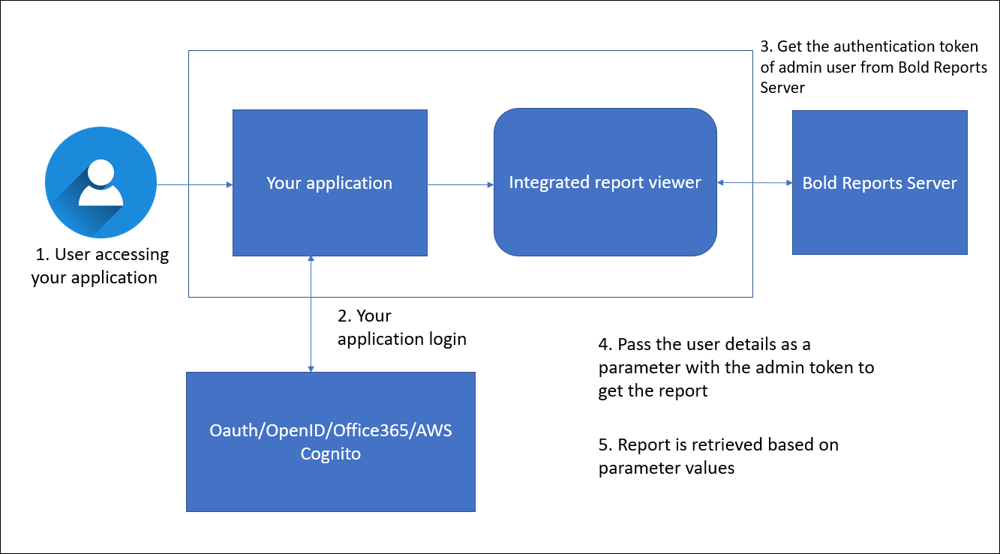
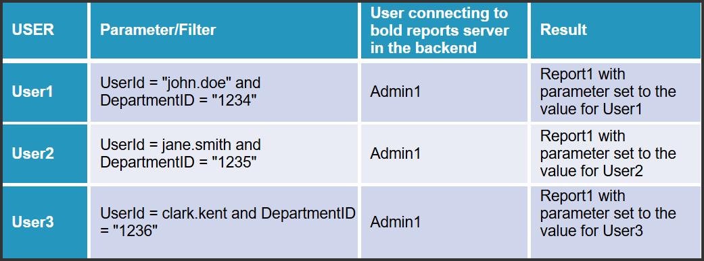

# How to embed the report with user impersonation

You can embed a report for a particular user by passing the admin authentication token and the user ID to the Bold Reports® Report Server.

## How does user impersonation work?

With Bold Reports® user impersonation, your application sends the admin authentication token and the user details to the Report Server, and the Report Server returns the report for that user. The following flowchart shows how to embed a report with user impersonation.

## How do I embed a report with user impersonation?

Follow these steps to embed a Bold Reports® report with user impersonation in your existing application:

1. Integrate the Bold Reports® Viewer with your application. Refer to the [view a report through the Report Viewer](../../../developer-guide/embed-in-application/view-report-through-report-viewer/) documentation.
2. After you integrate the viewer, get the authentication token for the admin user of the Bold Reports® Report Server. You embed reports with user impersonation by passing the admin authentication token and user details as parameters. Refer to the [Report Parameter](https://help.boldreports.com/embedded-reporting/javascript-reporting/report-viewer/report-parameters/#how-do-i-set-a-parameter-on-the-client-side) documentation.
3. The Bold Reports® Report Server handles the request and returns the report for the respective user.

   **For example**, to get the report of the user whose User ID is `john.joe`, get the token of the admin user. Then, pass the User ID of the user as a parameter in the API request. The Report Server handles the request and returns the respective user's report.

   The following image shows the user ID passed as a parameter in the request.

## Frequently asked questions

### Which token do I use for user impersonation?

Use the authentication token of the admin user of the Bold Reports® Report Server, and pass the user ID as a parameter.

### What do I need before I embed a report with user impersonation?

Integrate the Bold Reports® Viewer with your application first.

## See also

* [Report link with filter parameters](./../report-link-with-filter-parameters/)
* [Remove the ID from the report URL](./../remove-id-from-url/)
