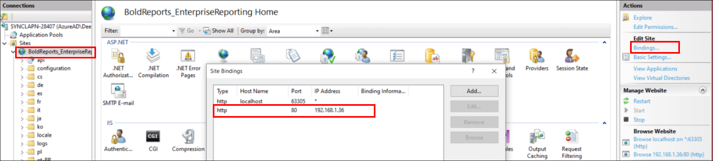
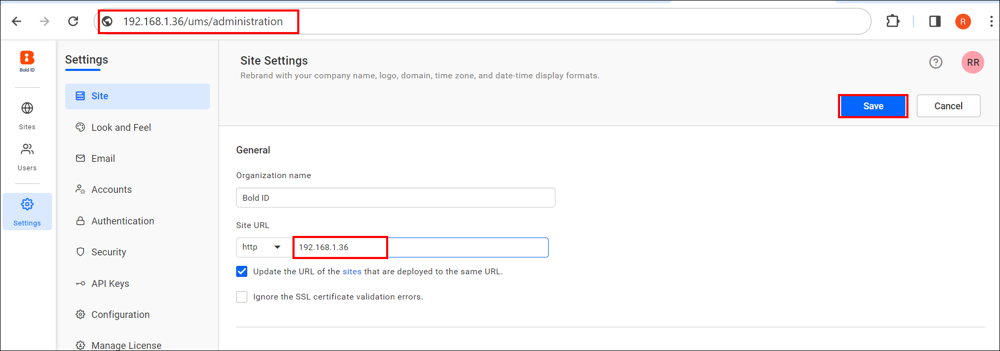
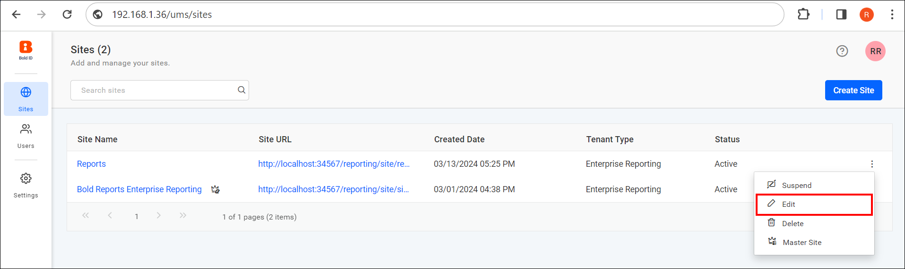
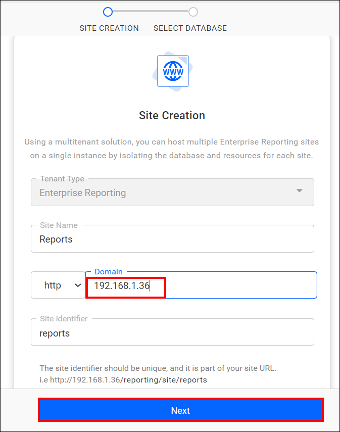
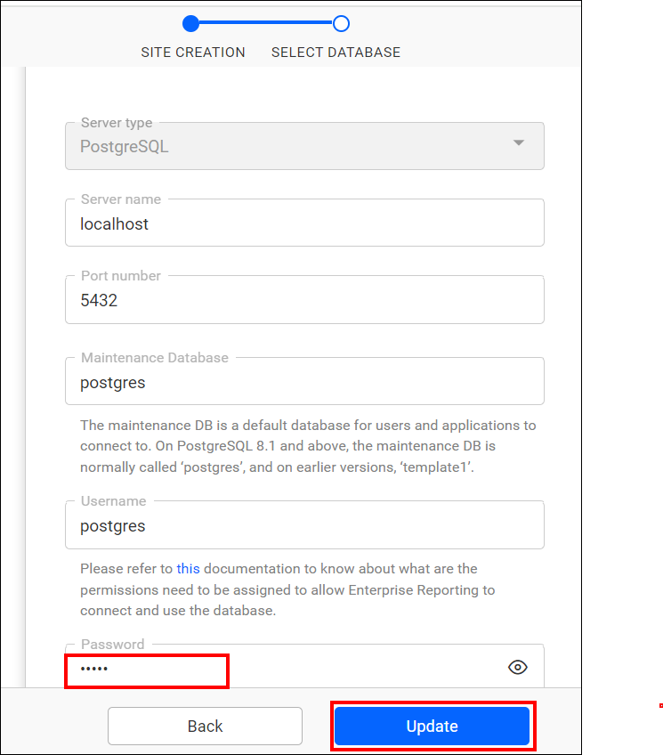
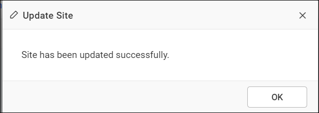
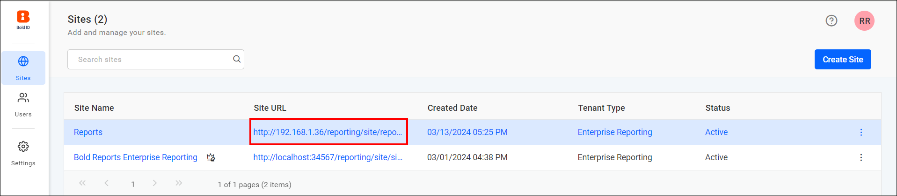

# How to Change the Binding in Bold Reports® Enterprise

To change the application binding for Bold Reports®, add a new binding in IIS and then update the binding information in the UMS application.

## How do I change the binding?

Follow these steps to change the Bold Reports® application binding information:

1. Add a new binding to Bold Reports® On-Premises Edition on IIS, as shown in the following image. For example, use the IP address `192.168.1.36`.

    

2. Navigate to the site settings page of the UMS application with the new binding, and update the binding information as shown in the following image.

    `http://192.168.1.36/ums/administration`
    

3. Navigate to the UMS site listing page with the new binding and edit the site. Then, update the binding information as shown in the following images.

    `http://192.168.1.36/ums/sites`
    
    

4. Provide the password of the database configured for the respective site.

    

5. Click Update. A success message shows that your site now runs with the updated site URL.

    

    

> **IMPORTANT:** Do not remove the existing bindings.

## What should I know before I change the binding?

Keep these points in mind when you change the Bold Reports® binding:

> **Note:** 
> * If you have a DNS, you can add a binding for the DNS instead of the IP mentioned here. 
> * The IIS Express Development Certificate cannot be used to configure SSL with an IP address or domain. If it is configured with an IP address or domain, the Bold Reports® application will not function properly. 
> * If you have a valid SSL certificate installed on the server machine for the respective domain, you can configure the bindings with `HTTPS` instead of `HTTP` when updating the new binding information.

## Frequently asked questions

### Should I remove the old binding after I add a new one?

No. Do not remove the existing bindings.

### Can I bind a DNS name instead of an IP address?

Yes. If you have a DNS, you can add a binding for the DNS instead of the IP address.

## See also

* [Configure SSL for Bold Reports® in IIS Manager](./../configure-ssl-for-bold-reports-in-iis-manager/)
* [Map a domain name before startup](./../map-a-domain-name-to-bold-reports-site-before-startup/)
* [Resolve the unavailable error after a domain name change](./../resolve-unavailable-error-when-site-fails-incase-of-domain-name-change/)
