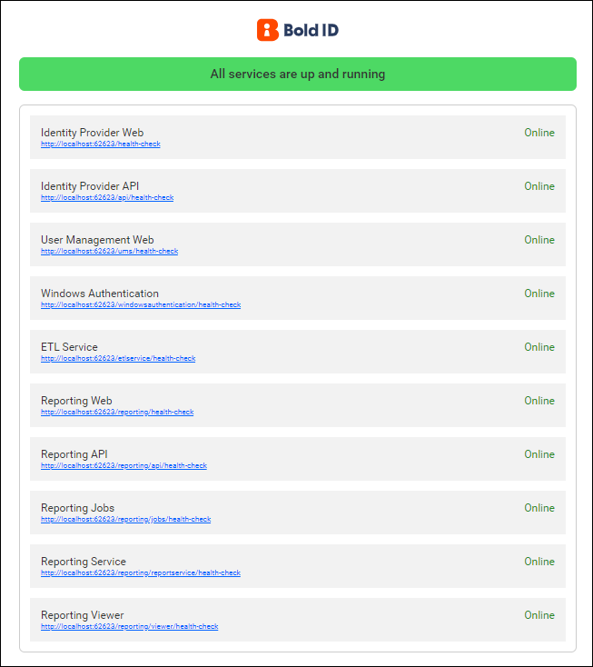

# Check the status and health of Bold Reports® services

You can check the status of all Bold Reports® services with the `/status` URL and the health of each service with its `health-check` URL. Both serve similar purposes, but they differ in implementation and scope.

## How do I check the status of all services?

A Bold Reports® status check is a lightweight process that verifies the availability and responsiveness of an application. It sends a simple request to the services and checks for a valid response. The main goal of a status check is to find whether all services are up and running or whether any service is down.

`https://{Domain_name}/status`

When you enter this URL in a web browser, a page opens with an overview of the current status of the reports services, as shown in the following screenshot.

## How do I check the health of an individual service?

Bold Reports® health checks are more comprehensive than status checks and assess the overall health and functionality of an application. They go beyond basic availability and probe various components to make sure they operate correctly. Open the URLs in the following table to assess the health and operational status of each service:

<table>
  <tr>
    <th>Services</th>
    <th>Main Application</th>
    <th>Sub Application</th>
  </tr>
  <tr>
    <td>Identity Provider Web</td>
    <td>https://{Domain_name}/health-check</td>
    <td>https://{Domain_name}/{Sub_application_name}/health-check</td>
  </tr>
  <tr>
    <td>Identity Provider API</td>
    <td>https://{Domain_name}/api/health-check</td>
    <td>https://{Domain_name}/{Sub_application_name}/api/health-check</td>
  </tr>
  <tr>
    <td>Site Management Web</td>
    <td>https://{Domain_name}/ums/health-check</td>
    <td>https://{Domain_name}/{Sub_application_name}/ums/health-check</td>
  </tr>
   <tr>
    <td>Windows Authentication</td>
    <td>https://{Domain_name}/windowsauthentication/health-check</td>
    <td>https://{Domain_name}/{Sub_application_name}/windowsauthentication/health-check</td>
  </tr>
  <tr>
    <td>Reporting Web</td>
    <td>https://{Domain_name}/reporting/health-check</td>
    <td>https://{Domain_name}/{Sub_application_name}/reporting/health-check</td>
  </tr>
   <tr>
    <td>Reporting API</td>
    <td>https://{Domain_name}/reporting/api/health-check</td>
    <td>https://{Domain_name}/{Sub_application_name}/reporting/api/health-check</td>
  </tr>
  <tr>
    <td>Reporting Jobs</td>
    <td>https://{Domain_name}/reporting/jobs/health-check</td>
    <td>https://{Domain_name}/{Sub_application_name}/reporting/jobs/health-check</td>
  </tr>
  <tr>
    <td>Report Designer Service</td>
    <td>https://{Domain_name}/reporting/reportservice/health-check</td>
    <td>https://{Domain_name}/{Sub_application_name}/reporting/reportservice/health-check</td>
 </tr>
   <tr>
    <td>Reporting Viewer</td>
    <td>https://{Domain_name}/reporting/viewer/health-check</td>
    <td>https://{Domain_name}/{Sub_application_name}/reporting/viewer/health-check</td>
  </tr>
 </table>

 > **Note:** Starting from v5.x, the `viewer service` is available in the Bold Reports® Report Server.

## What is the difference between a main application and a sub-application?

The Bold Reports® Server health-check URLs differ for a main application and a sub-application.

 **Main Application**: The application (Bold Reports® Server) that is deployed primarily at installation is called the main application. It provides the core functionality, delivering the primary features and services that users expect.

 **Sub-Application**: An application (Bold Reports® Server) deployed within another application is called a sub-application here. To learn how to deploy the Report Server as a sub application, refer to [deploy the Report Server as a sub application in Windows](../deploy-boldreports-server-as-subapplication-in-windows-environment/).

## Frequently asked questions

### What is the difference between a status check and a health check?

A status check is a lightweight check of whether all services are up. A health check is more comprehensive and probes various components of each service to make sure they operate correctly.

### Which URL shows the status of all services?

Open `https://{Domain_name}/status` in a web browser.

## See also

* [Deploy the Report Server as a sub application in Windows](../deploy-boldreports-server-as-subapplication-in-windows-environment/)
* [Customize timeout settings](../customize-timeout-settings/)
* [What resources are generated on the installed machine](../what-are-the-resources-will-be-generated-in-the-installed-machine/)
