# How to install Bold Reports® Report Server over Bold BI in Azure App Services

You can install the Bold Reports® Report Server in the Azure App Service that already hosts Bold BI. Both products then share one IDP application and use common login. Follow the steps in the sections below in order.

## How do I upload the Report Server files to the Bold BI App Service?

You upload the Bold Reports® Report Server Azure packages to the Bold BI App Service over FTP with FileZilla.

1. Log in to the [Azure Portal](https://portal.azure.com).

2. Select the Bold BI Azure App Service.

    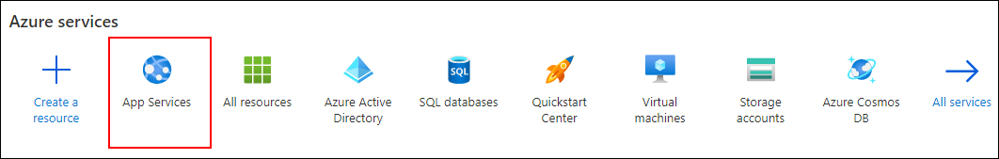

3. In the **Overview** section, click **Stop**.

    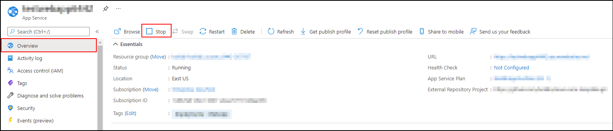

4. Click `Get Publish Profile option` to download a file.

    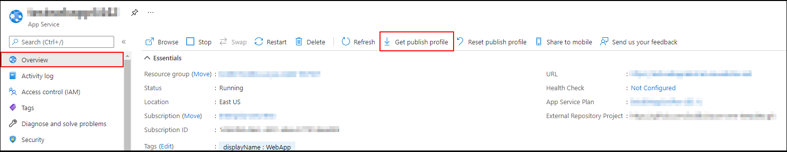

5. Open the PublishSettings file in Notepad. Note down the Publish URL, Username, and Password values.

    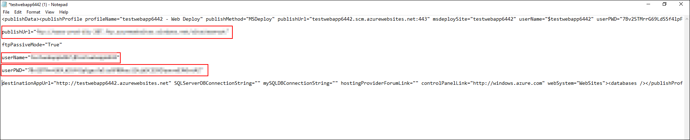

6. Download [FileZilla](https://download.filezilla-project.org/client/FileZilla_3.57.0_win64_sponsored2-setup.exe). Enter the Publish URL, Username, and Password, and click **Quickconnect**.

    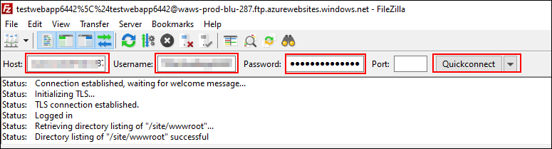

7. Download and extract the Report Server Azure packages [v3.3.23](https://github.com/boldreports/bold-reports-azure/tree/v3.3.23).

    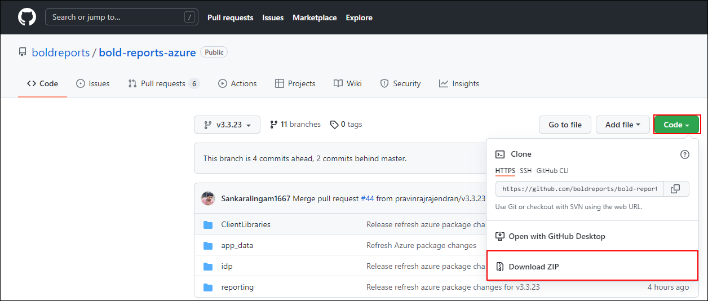

8. Enter the extracted packages file path in the local site.

    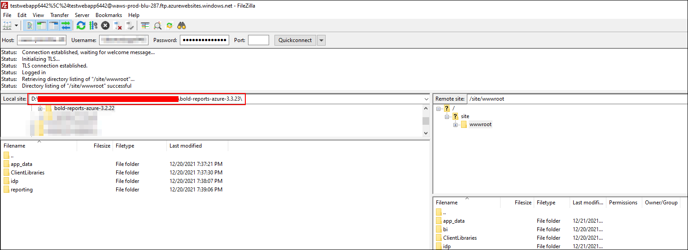

9. Drag and drop the reporting folder from the local site to the remote site.

    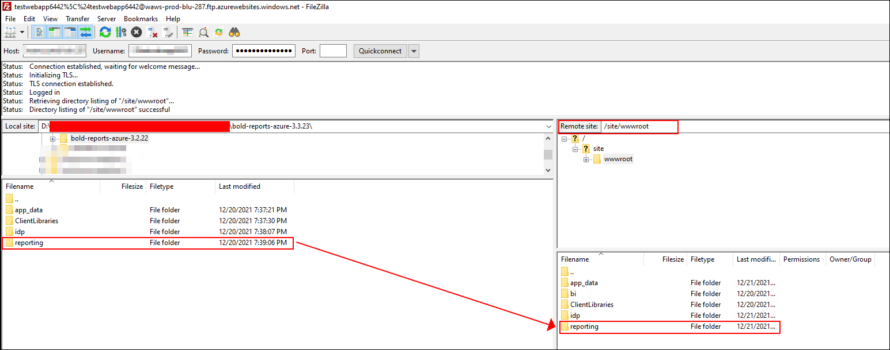

## How do I choose the IDP version for a combination deployment?

In a combination deployment, Bold BI and Bold Reports® share a common IDP application. Find the higher IDP version before you replace the IDP folder.

1. Find the higher IDP version before you replace the IDP folder, because the IDP application is common for both Bold BI and Bold Reports®.

2. Open the Version.xml file in both the download location and the Azure deployed location.
    <table>
    <tr>
    <th>Azure deployed location</th>
    <td>/site/wwwroot//idp/ums/configuration/onpremise/boldid/mssql/versioned_scripts/versions.xml</td>
    </tr>

    <tr>
    <th>Download location</th>
    <td>{Extracted_location}/ bold-reports-azure-3.3.23/idp/ums/configuration/onpremise/boldid/mssql/versioned_scripts/versions.xml</td>
    </tr>
    </table>

    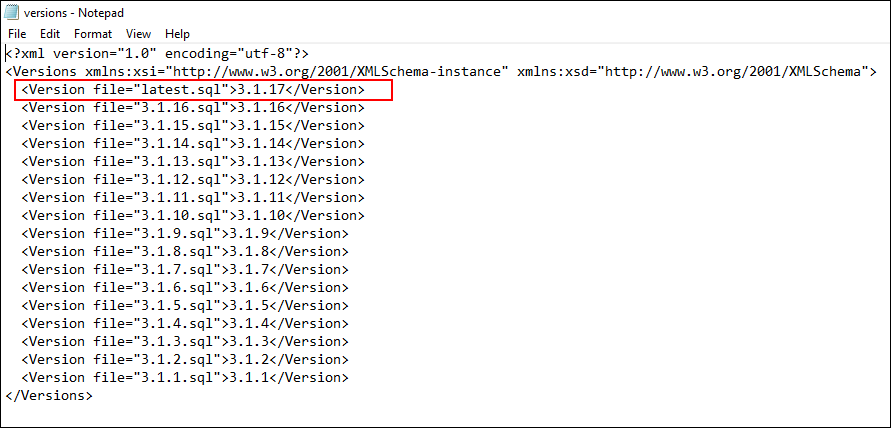

3. Compare the version.xml files and find the higher IDP version between the Azure deployed location and the extracted location.

4. If the IDP version in the Azure deployed location is higher, skip step 14 and continue from step 15.

5. If the IDP version in the extracted location is higher, move the IDP folder from the extracted location to the Azure deployed location.

    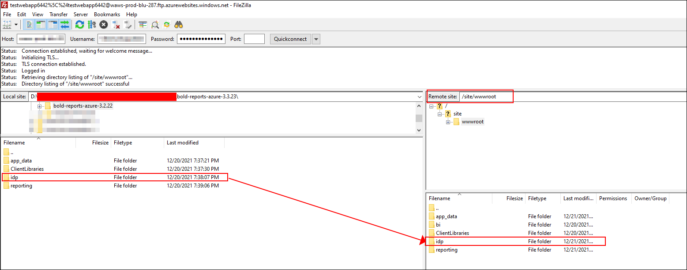

## How do I enable common login for Bold BI and Bold Reports®?

You enable common login by updating the IDP version and the `IsCommonLogin` property in the Bold Reports® product.json file and the Bold BI Config.xml file.

1. Search and select the `App Service Editor`.

    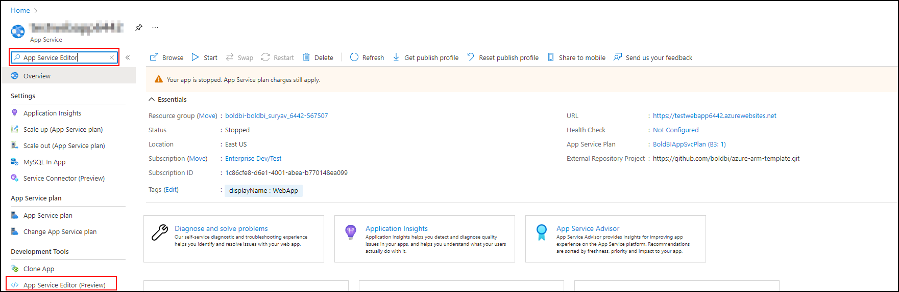

2. Click the **Go** option.

    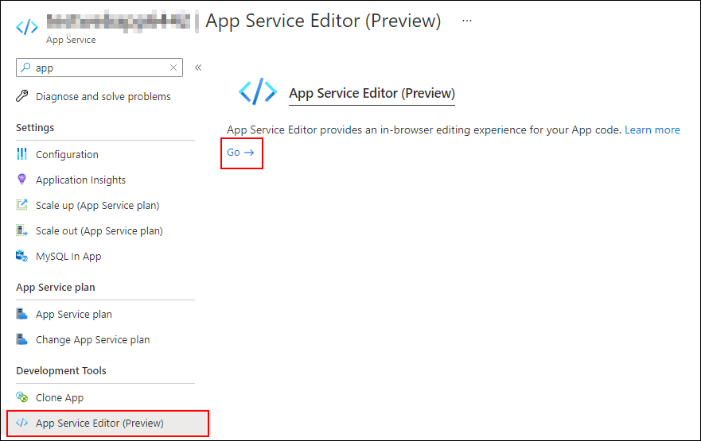

3. Confirm that the reporting folder moved to the Azure deployment location.

    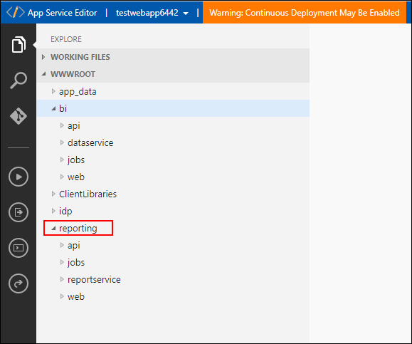

4. Go to the path wwwroot/app_data/Configuration/product.json.
     * Add an object for boldreports as shown in the screenshot.
     * Update the IDP version with the higher version you found in step 12.
     * Set the `IsCommonLogin`property to **true** for Bold BI and Bold Reports®.
     * The IDP version of Bold BI and Bold Reports® must be the same.

    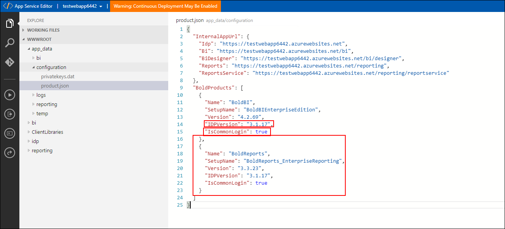

5. Go to the Bold BI Storage account.

    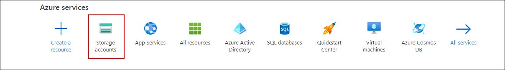

6. Click the `Containers` option and select boldbicontainer.

    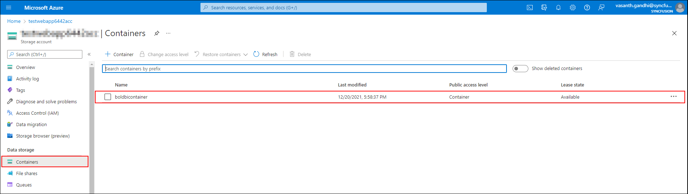

7. Go to the path boldbicontainer/boldservices/app_data/configuration and select the Config.xml file.

    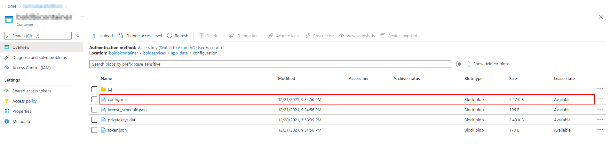

8. Click the **Edit** option and add the Bold Reports® product details in XML format.
     * Update the IDP version of both Bold BI and Bold Reports® to the higher version you found in step 12.
     * Set the `IsCommonLogin` property to **true** for both Bold BI and Bold Reports®, and click the save option.

    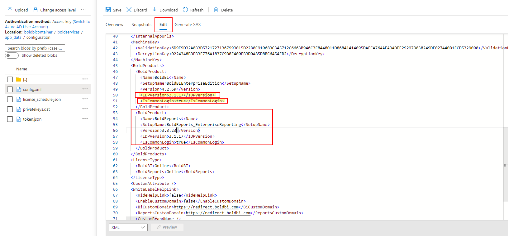

## How do I configure the Azure App Service settings?

You configure the Bold BI Azure App Service with an application setting, the .NET version, and virtual applications for the Bold Reports® Report Server.

1. Go to the Bold BI Azure App Service, select `Configuration`, and click `Application Settings`.

    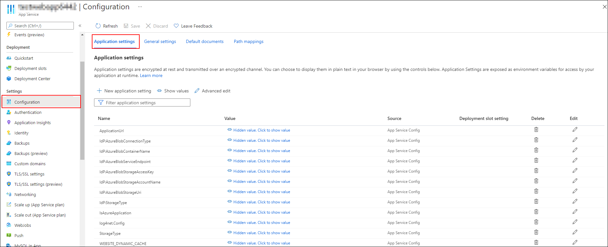

2. Confirm that the WEBSITE_LOAD_USER_PROFILE key is included in `Application Settings`. If it is missing, add the key and value below:
    <table>
    <tr>
    <th>Key</th>
    <th>Value</th>
    </tr>

    <tr>
    <td>WEBSITE_LOAD_USER_PROFILE</td>
    <td>1</td>
    </tr>
    </table>

    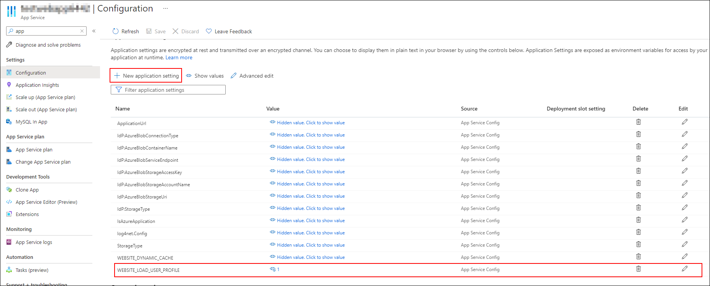

3. Click `General Settings` and set the .NET Version to **.NET 6**.

    <table>
    <tr>
    <th>Settings</th>
    <th>Value</th>
    </tr>

    <tr>
    <td>.NET version</td>
    <td>.NET 6</td>
    </tr>
    </table>

    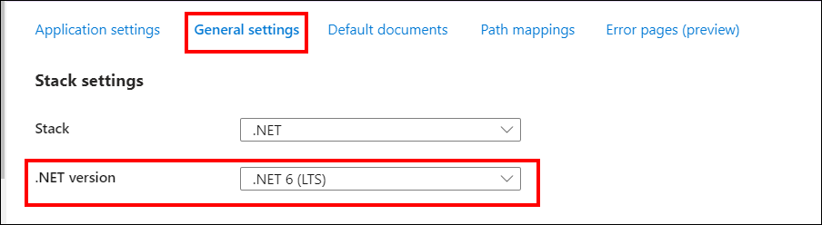

4. Go to `Path Mappings` and select `New Virtual Application`. Add the virtual paths and physical paths in the following table:
    <table>
    <tr>
    <th>Virtual Path </th>
    <th>Physical Path </th>
    </tr>

    <tr>
    <td>/reporting</td>
    <td>site\wwwroot\reporting\web</td>
    </tr>

    <tr>
    <td>/reporting/api</td>
    <td>site\wwwroot\reporting\api</td>
    </tr>

    <tr>
    <td>/reporting/jobs</td>
    <td>site\wwwroot\reporting\jobs</td>
    </tr>

    <tr>
    <td>/reporting/reportservice</td>
    <td>site\wwwroot\reporting\reportservice</td>
    </tr>
    </table>

    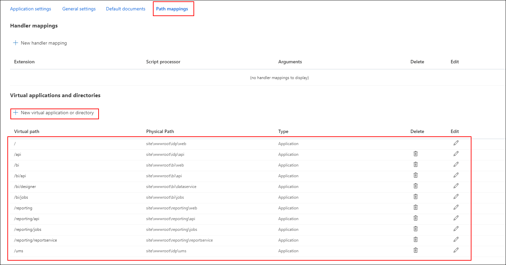

5. Start the Bold BI Azure App Service by clicking the `Start` button in the Overview section.

    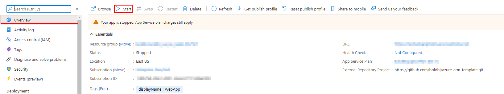

## How do I activate the license and create a Report Server site?

You activate Enterprise Reporting in the Bold ID application and then create a Bold Reports® site to launch the Report Server.

1. Log in to the Bold ID application.

    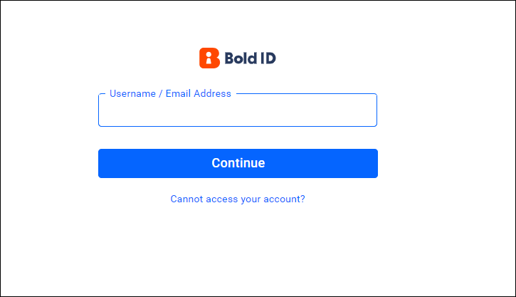

2. Go to `Manage Sites`.

    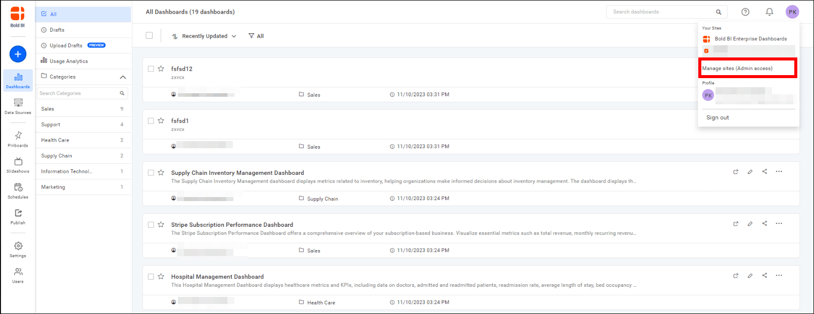

3. Click the `Settings` option in the IDP application.

    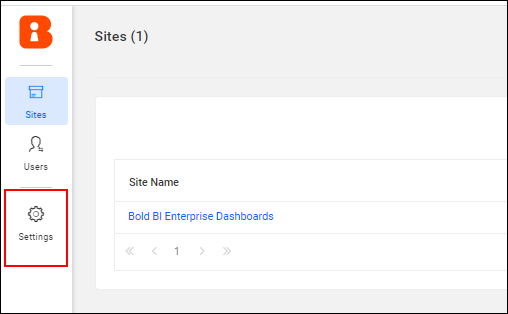

4. Go to the `Manage License` section and click `Login to activate account` under the `Enterprise Reporting` option.

    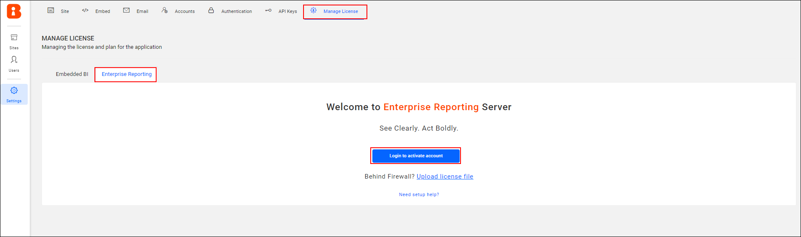

5. After the account is activated, go to the site page and create a site.

    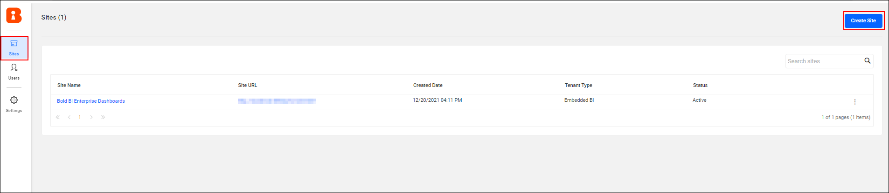

6. Create a site for Bold Reports®.

    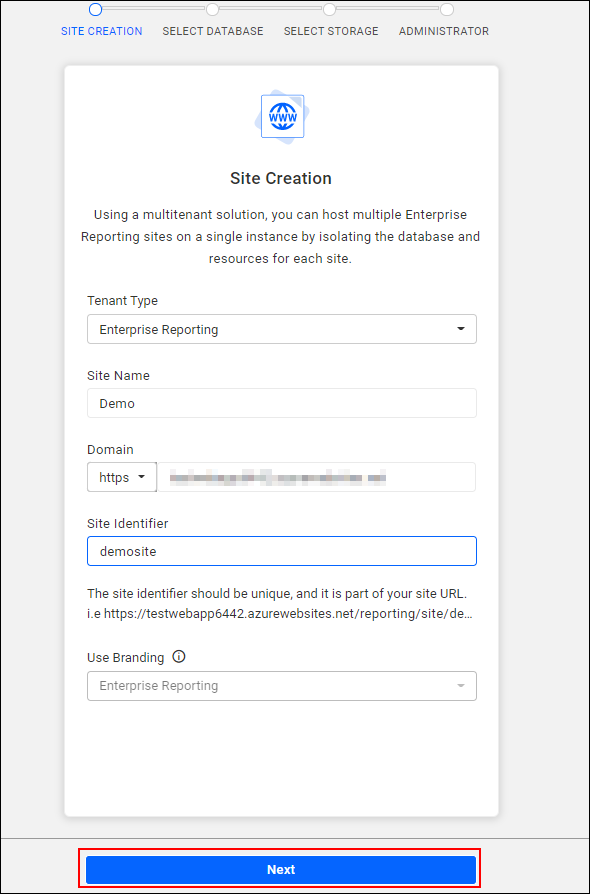

7. Enter the database credentials and click **Next**.

    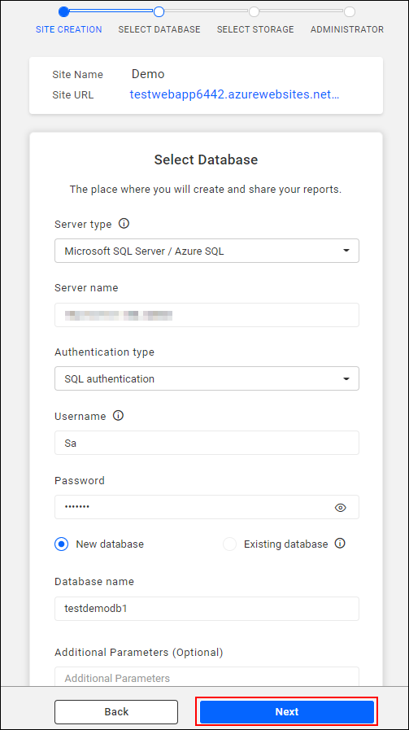
    >**Note**: If you need to use an existing database, select the existing database option.

8. Provide your Azure blob storage details. If you do not have custom blob storage, enable the `use the same blob used for tenant registration` check box to restore the default storage account details.

    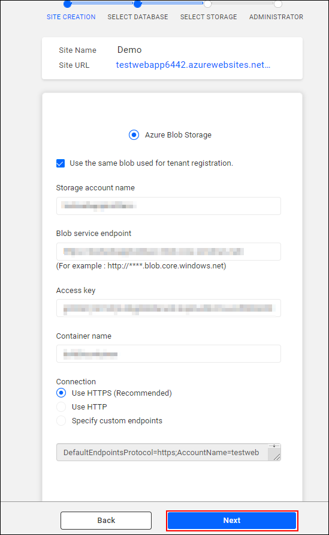

9. Select the administrator and click create and launch site.

    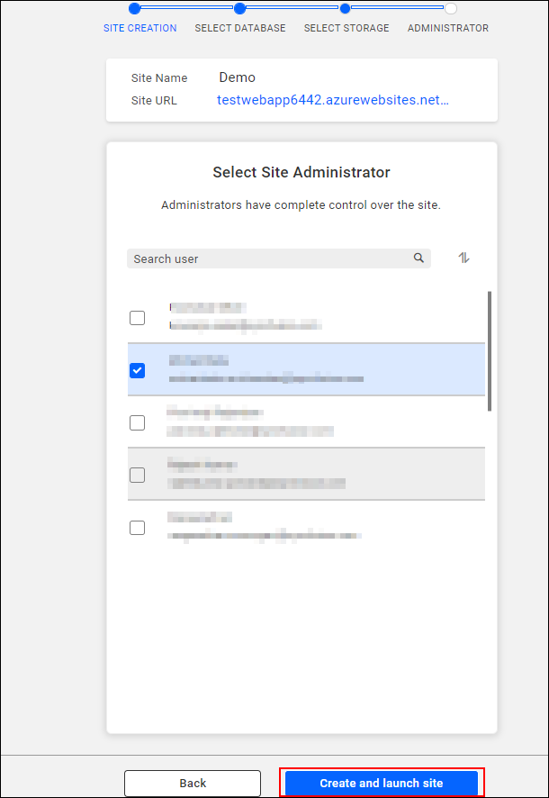

10. The site is created and the Report Server launches.

    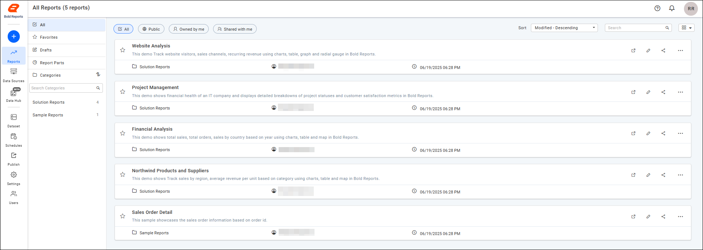

## Frequently asked questions

### Can Bold BI and Bold Reports® use different IDP versions?

No. In a combination deployment, the IDP version of Bold BI and Bold Reports® must be the same, so you use the higher IDP version for both.

### Which .NET version does the App Service need?

Set the .NET version of the Bold BI Azure App Service to .NET 6 in `General Settings`.

## See also

* [Apply patches to support common login with Bold BI](./../apply-patches-to-bold-reports-to-support-common-login-with-latest-bi/)
* [Apply patches to the Bold Reports® Azure App Service](./../apply-patches-to-bold-reports-azure-app-service/)
* [Create a Bold Reports® Azure App Service with the ARM template](./../create-a-bold-reports-azure-app-service-using-the-arm-template-up-to-v2.x/)
