# How to register an Azure application with mail-sending API permissions and restrict its access to specific mailboxes

You register an Azure app so the Bold Reports® Report Server can send email through a Microsoft Office 365 account with OAuth authentication. The app needs the required API permissions to access the email service. You can also limit its access to specific mailboxes if needed.

## How do I register an Azure application with mail-sending API permissions?

You register the app in Microsoft Entra ID (formerly Azure AD), create a client secret, and grant the Microsoft Graph `Mail.Send` permission. The Report Server email settings use the client ID, tenant ID, and client secret from these steps.

1. Go to the [Azure portal](https://portal.azure.com/#home) and select `Microsoft Entra ID`.

    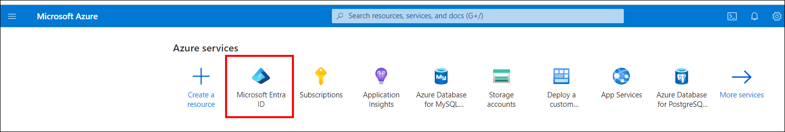

2. Click `App registrations` in the side navigation menu.

3. Click `New registration`.

    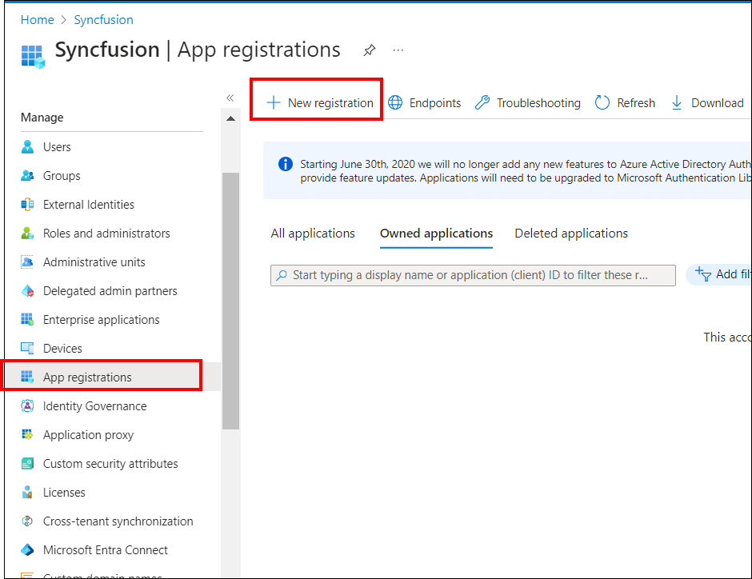

4. Enter a meaningful name for your application in the Name section.

5. Under Supported account types, choose the **Accounts in this organizational directory only** option.

6. Click `Register` to create the application.

    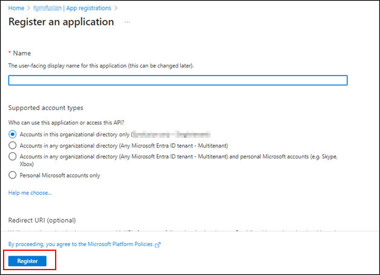

7. On the app Overview page, copy the Application (Client) ID and Directory (tenant) ID. You need them for the email settings configuration.

    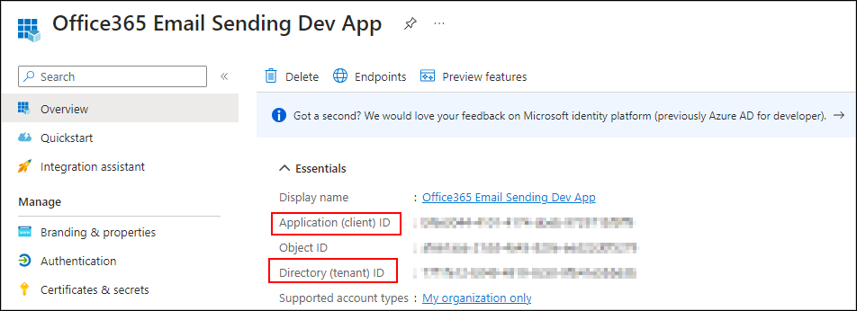

8. Click the `Certificates & Secrets` option and select `New client secret` to generate a client secret for the app.

    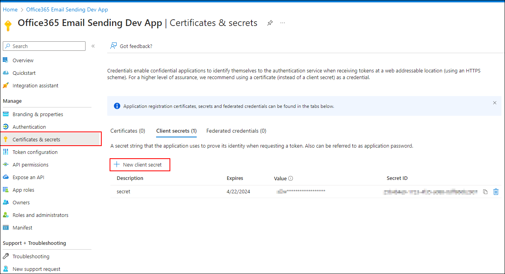

9. Add the `Description` and select the `Expires` option that fits your requirement. Click `Add`.

    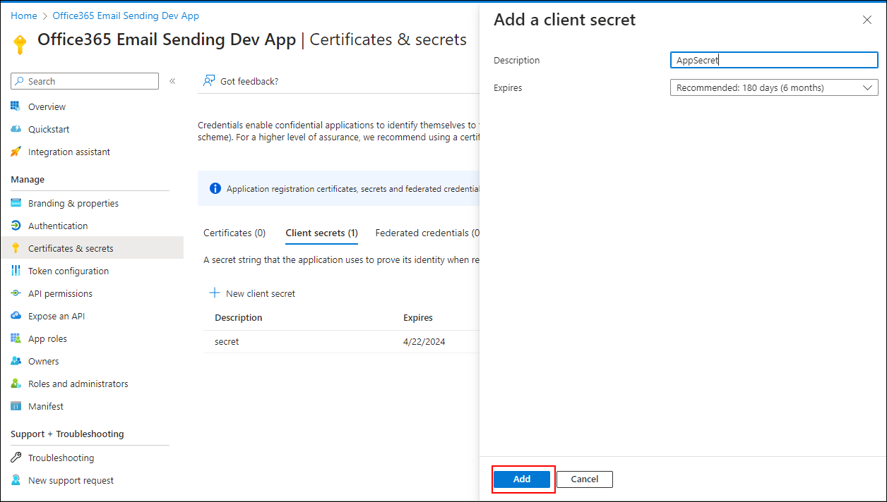

10. Copy the `value`, which is the app client secret, and store it securely. You cannot see the value again after you reload the page.

    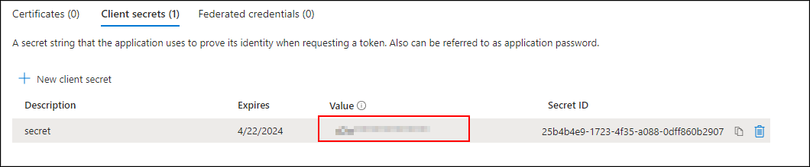

11. To add the `Mail.Send` API permission, select the `API permissions` tab and click `Add a permission`.

    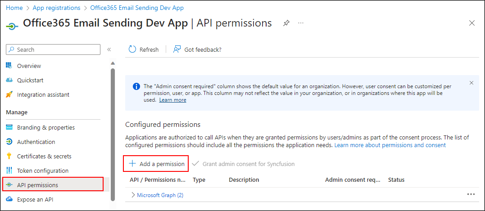

12. Select `Microsoft Graph` from the permission list.

    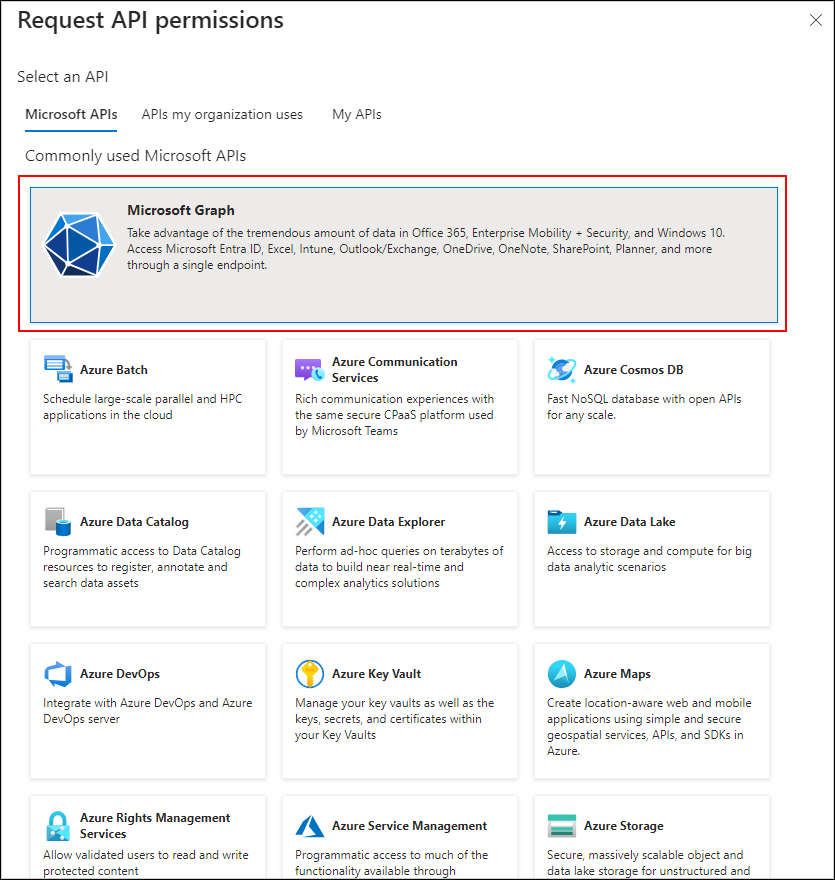

13. Choose `Application permissions` and search for Mail in the search area.

14. Select the `Mail.Send` permission from the list and click the `Add Permissions` button.

15. Provide admin consent for the `Mail.Send` permission for the Microsoft Graph API.

    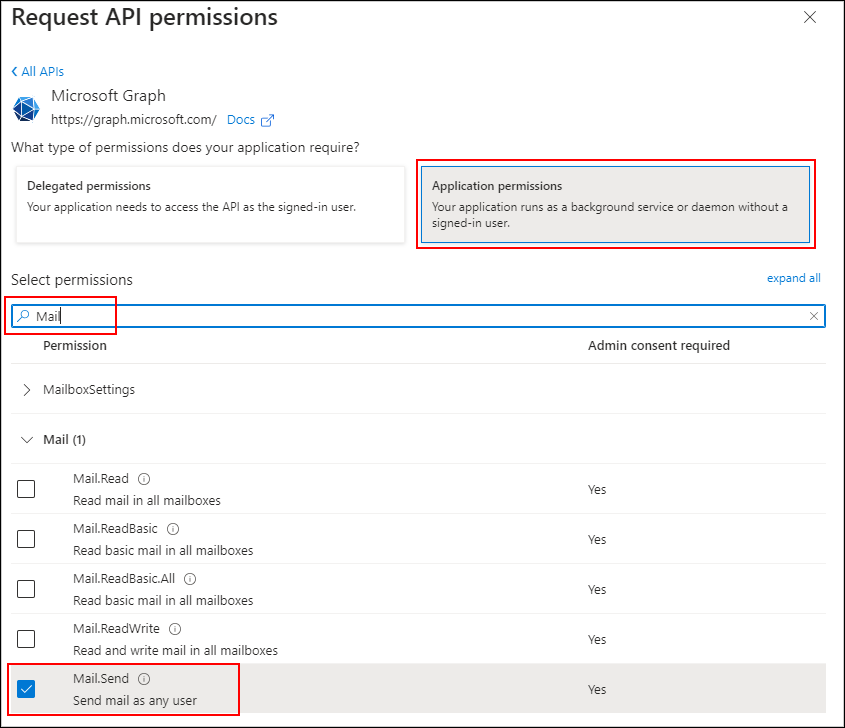

    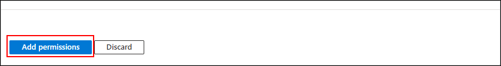

16. Confirm that the permission is listed in the permissions grid.

    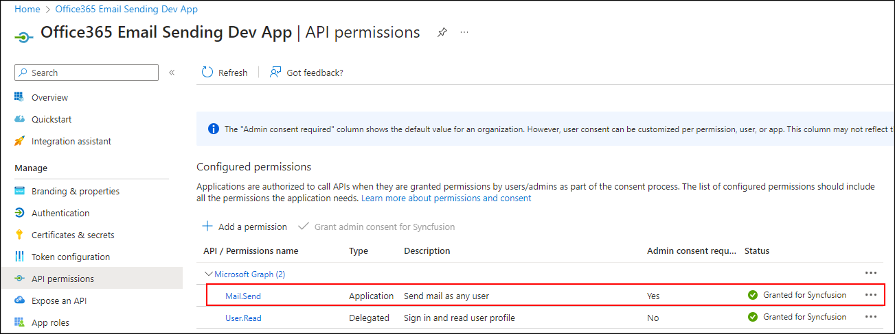

## Restricting app access to specific mailboxes

Restricting app access stops other senders from misusing the `Mail.Send` permission that Bold Reports® email sending needs. Sending email through the Microsoft Graph API with a Microsoft Office 365 account and OAuth authentication requires the 'Mail.Send' permission. Granting this permission to the entire application can let other senders misuse someone's email address.

Without restrictions, unauthorized users can send emails from the application, which is a security concern. Restrict app access with an application access policy. To configure application access policies, see [Configure ApplicationAccessPolicy in Microsoft Graph](https://learn.microsoft.com/en-us/graph/auth-limit-mailbox-access#configure-applicationaccesspolicy). After you configure the application access policy for a specific mailbox, other mailboxes cannot send emails using the app.

Sample to create an access policy: Create an access policy to restrict app access to specific mailboxes.

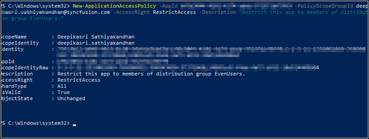

Sample to test an access policy: Test whether permission has been granted for the email address.

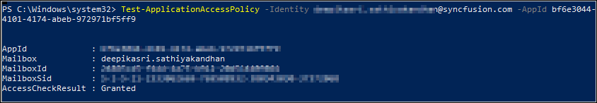

## Frequently asked questions

### Which Microsoft Graph permission does Bold Reports® need to send email?

The Azure app needs the Microsoft Graph `Mail.Send` application permission, with admin consent, for the Bold Reports® Report Server to send email through Office 365 OAuth.

### Can I see the client secret again later?

No. Copy the client secret value when you create it, because you cannot see the value again after you reload the page.

## See also

* [Configure the Gmail SMTP server in email settings](./../configure-gmail-smtp-server-in-email-settings/)
* [Set up Microsoft Entra ID for single sign-on](./../set-up-azure-active-directory/)
* [How-to guides for Bold Reports® Enterprise Reporting](./../)
