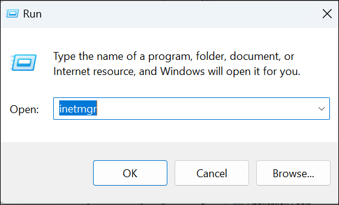
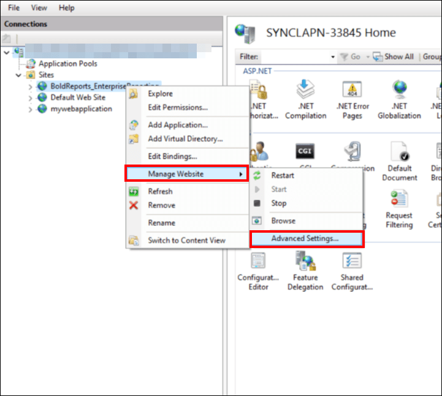
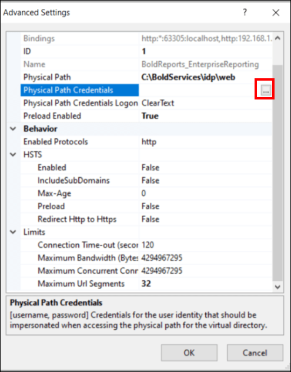
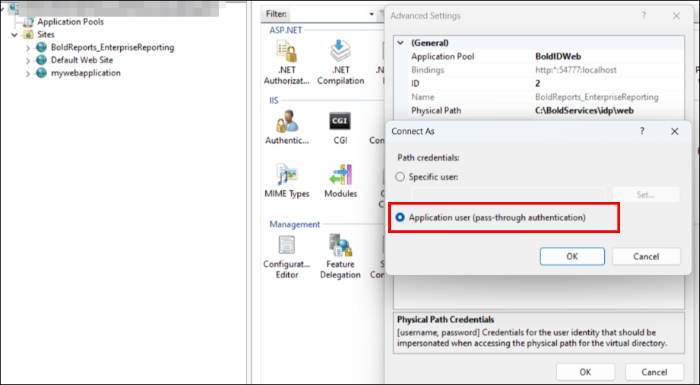
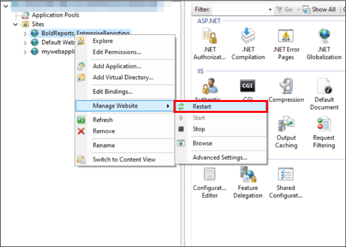

# How to resolve the HTTP Error 500.19 - Cannot login locally in Bold Reports®

You resolve the HTTP Error 500.19 - Cannot login locally by changing the Physical Path Credentials option of the hosted Bold Reports® application in IIS Manager.

## How do I fix HTTP Error 500.19 in IIS?

To fix the error, set the Bold Reports® site's `Physical Path Credentials` to `Application user (pass-through authentication)` and restart the site.

1. Open Internet Information Services (IIS) Manager by typing **inetmgr** in the Run dialog box (accessible through the Start menu).

    

2. In the navigation pane on the left, go to the `Sites` section and select your **Bold Reports®** application.

3. Right-click the **Bold Reports®** application and select `Manage Website > Advanced Settings`.

    

4. Set the `Physical Path Credentials` field to `Application user (pass-through authentication)`.

5. Click `OK` to save the path credential changes, and then click `OK` on the Advanced Settings prompt.

    The following screenshots show the `Physical Path Credentials` field and the credentials dialog.

    
    

6. Right-click your Bold Reports® site and select `Manage Website > Restart` to apply the changes.

    

7. Log in to the Bold Reports® server.

## Frequently asked questions

### Which Physical Path Credentials value fixes HTTP Error 500.19?

Set `Physical Path Credentials` to `Application user (pass-through authentication)` for the Bold Reports® application in IIS.

### Do I need to restart the site after the change?

Yes. Restart the Bold Reports® site with `Manage Website > Restart` so the changes take effect.

## See also

* [Change the binding in Bold Reports®](./../how-to-change-the-binding-in-the-bold-reports/)
* [Configure SSL for Bold Reports® in IIS Manager](./../configure-ssl-for-bold-reports-in-iis-manager/)
* [Check the status and health of Bold Reports® services](./../how-to-check-the-status-and-health-for-bold-reports-services/)
