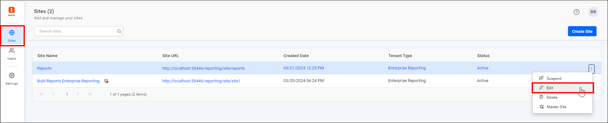
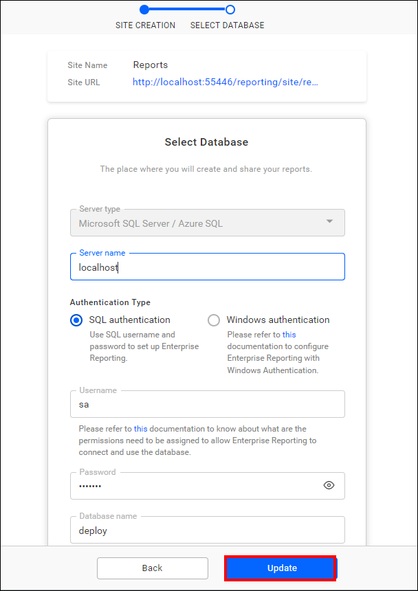

# How to reset the database of the Bold Reports® application

You reset the Bold Reports® application database by updating the database details in two places:

1. The database details for the Bold Reports® Server.
2. The database details for each Bold Reports® site.

## How do I reset the Bold Reports® application database?

To reset the Bold Reports® application database, update the Report Server database first, then update each site's database details in the site management portal.

1. Reset the database of the Bold Reports® server by following the steps in [Update Application Database](./../../../utilities/reset-application-database/).

2. After the database is updated, restart the application in IIS.

3. Log in to the site management portal using the link `{host:port}/ums/sites`.

4. Use the edit option to update the existing site's database details.
    

5. Enter the database details and click the update button.
    

    > **Note:** You can only update the server name, user name, and password in the site database details.

6. Access your site with the updated database.

## Frequently asked questions

### Which site database details can I change?

You can only update the server name, user name, and password in the Bold Reports® site database details.

### Where do I update each site's database?

Log in to the site management portal at `{host:port}/ums/sites` and use the edit option on the site.

## See also

* [Change the binding in Bold Reports®](./../how-to-change-the-binding-in-the-bold-reports/)
* [Migrate Bold Reports® to another server](./../migration/)
* [What resources are generated on the installed machine?](./../what-are-the-resources-will-be-generated-in-the-installed-machine/)
