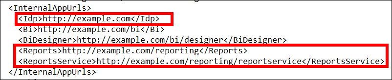

# How to map a domain name for Bold Reports® Enterprise Reporting before startup

You map a domain name to Bold Reports® Enterprise Reporting before startup by changing the Bold Reports® URL in the `Config.xml` file of the Bold Reports® On-Premises Edition. Do this before you configure the On-Premises Edition.

## How do I change the Bold Reports® URL before startup?

To change the Bold Reports® URL, update the binding values in the configuration file at the deployed location, then restart the site in IIS.

1. Go to the deployed location and update the new binding values in the following configuration file:

   >By default, Bold Reports® will be deployed on C:\BoldServices.

   * Update the **`InternalAppUrls`** value in the config file at the following location:  
**`{Deployed Location}`**\app_data\configuration\config.xml  

2. Restart the site in IIS and browse the site.
3. Configure the Bold Reports® On-Premises Edition startup by referring to the [application startup guide](../../../application-startup/).

## Frequently asked questions

### Where is Bold Reports® deployed by default?

By default, Bold Reports® is deployed on C:\BoldServices.

### Which value do I change to map the domain name?

Update the `InternalAppUrls` value in `{Deployed Location}\app_data\configuration\config.xml`.

## See also

* [Change the binding in Bold Reports®](./../how-to-change-the-binding-in-the-bold-reports/)
* [Resolve the unavailable error after a domain name change](./../resolve-unavailable-error-when-site-fails-incase-of-domain-name-change/)
* [Configure SSL for Bold Reports® in IIS Manager](./../configure-ssl-for-bold-reports-in-iis-manager/)
