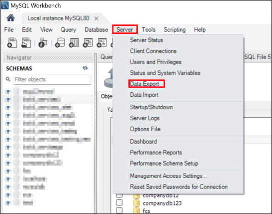
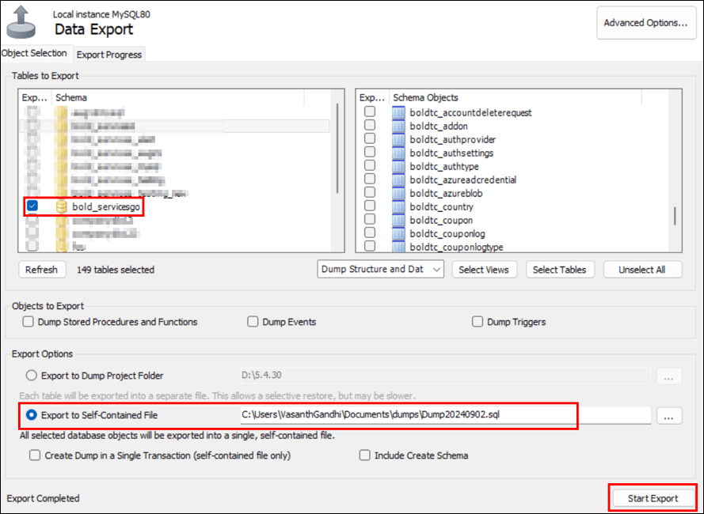
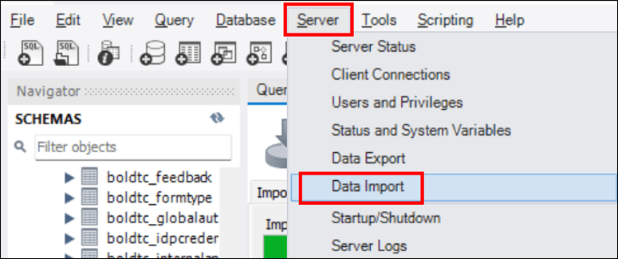
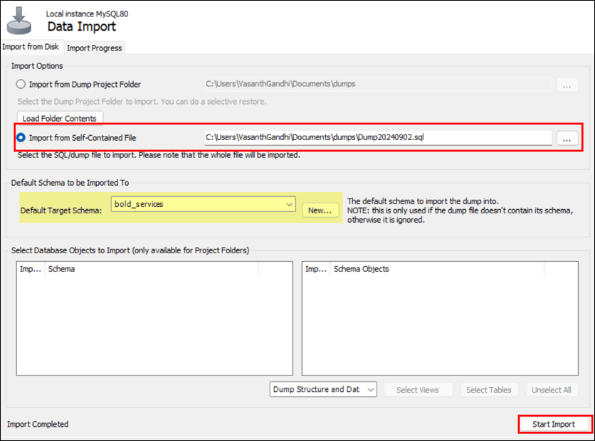
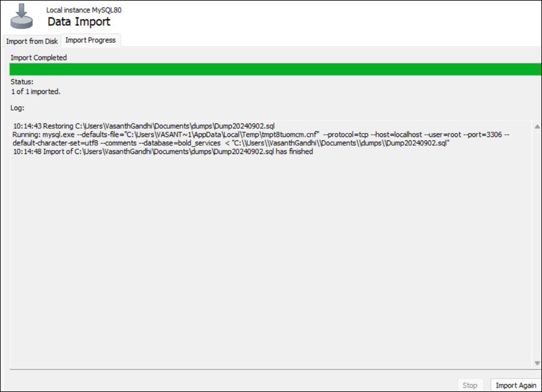
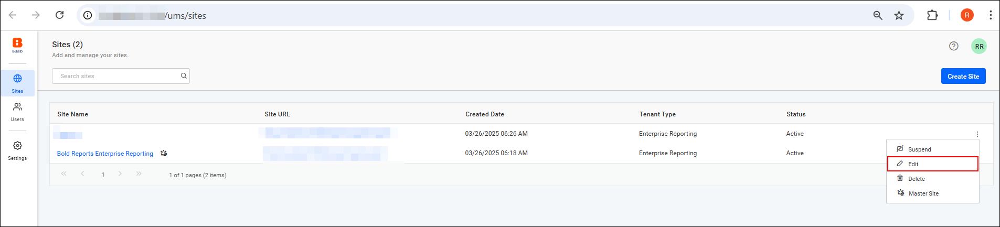
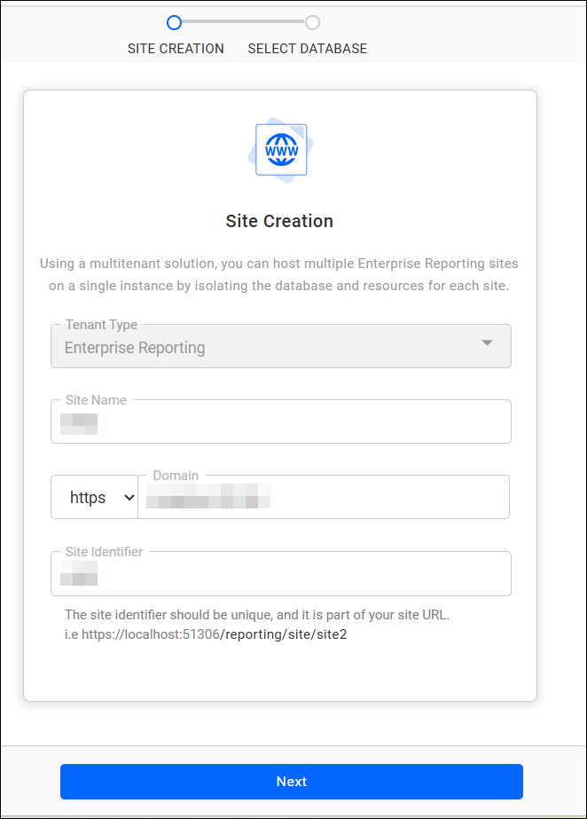
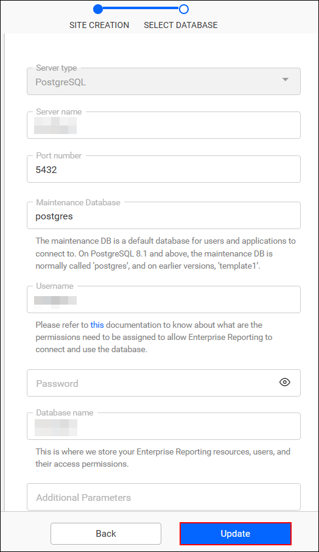

# How to Migrate the Bold Reports® Database from One Server to Another Using MySQL

You migrate the Bold Reports® metadata database to another server by backing up and restoring the databases, updating the connection strings, and restarting the services. Complete these tasks in order:

* Back Up and Restore the Metadata.

* Reset the Bold Reports® Application Connection String.

* Update the Site Metadata Connection String.

* Restart the Bold Reports® Services.

## Backup Database

To back up the Bold Reports® metadata, back up all the databases used in Bold Reports® applications with MySQL Workbench.

1. Open MySQL Workbench and connect to the database server used in Server 1.
2. Select the server and click the **Data Export** option from the menu.
   

3. Select the schema, set the export option to **Export to Self-Contained File**, and choose the backup location.
   

4. Click **Start Export**.

### Restore Database

To restore the Bold Reports® databases, copy all the backup database files with the **.sql extension** from **Server 1 to Server 2**. Then, restore the MySQL backup databases with these steps:

1. Open MySQL Workbench and connect to the new database that Server 2 will use.

2. Click the **Server** option and select **Data Import** from the menu.

   

3. Select **Import from Self-Contained File** under Import Options and choose the backup database location.

4. Create a new schema to restore the database.
   

5. Click **Start Import**.

   

For other database types, follow these guidelines to back up and restore databases:  

| **Database Type** | **Help Link**|
|-------------------|---------------------------------------------------------|
| PostgreSQL        | [Back and Restore Documentation](https://www.postgresql.org/docs/8.1/backup.html) |
| MSSQL             | [Back and Restore Documentation](https://learn.microsoft.com/en-us/sql/relational-databases/backup-restore/back-up-and-restore-of-sql-server-databases?view=sql-server-ver16) |
| MySQL             | [Back and Restore Documentation](https://dev.mysql.com/doc/refman/8.0/en/backup-and-recovery.html) |

### Reset the Bold Reports® Application Connection String

To reset the Bold Reports® application connection string, run the utility by following the [reset application database](https://help.boldreports.com/enterprise-reporting/utilities/reset-application-database/) steps.

### Update the Site Metadata Connection String

To update the Bold Reports® site metadata connection string, edit each site in the site management portal.

1. Navigate to `https://<App Base URL>/ums/sites`.

2. Edit the sites where you want to change the database connections.
   

3. Update the new database connection details and click the **Update** button.
    
    

After the update, your data is stored in the restored database.

### Restart the Bold Reports® Services

To finish the migration, restart the Bold Reports® services by following the [restart the Bold Reports® Enterprise application guide](https://help.boldreports.com/enterprise-reporting/administrator-guide/faq/how-to-restart-the-bold-reports-enterprise-application/).

## Frequently asked questions

### Which MySQL Workbench export option do I use?

Set the export option to **Export to Self-Contained File**, and import with **Import from Self-Contained File** on Server 2.

### Can I back up PostgreSQL or MSSQL databases instead?

Yes. Use the PostgreSQL or MSSQL backup and restore documentation linked in the table on this page.

## See also

* [Migrate from one server to another with a PostgreSQL database on Windows](./../migrate-server-to-another-server-using-postgresql-database-on-windows/)
* [Migrate from one server to another with a SQL database on Windows](./../migrate-server-to-another-server-using-sql-database-on-windows/)
* [Migration how-to guides](./../)
