# How to migrate Bold Reports<sup>®</sup> Report Server with database in Azure App Service

You can migrate Bold Reports<sup>®</sup> Server data from one Azure App Service to another without any data loss. The migration involves a few manual steps.

## What do I need to do before migrating?

Before you migrate the Bold Reports<sup>®</sup> Report Server, prepare the target app service and stop the source Report Server.

1. Deploy the same version of Bold Reports<sup>®</sup> on your target app service.

2. Stop the Report Server in the Azure App Service. You need to make configuration changes in the files to migrate data from app service 1 to app service 2.

Then, follow the steps below to change the configurations on the target server.

## Copy Database

To copy the Bold Reports<sup>®</sup> databases, copy all the databases used in the Bold Reports<sup>®</sup> Application from Azure App Service 1 to Azure App Service 2.

1. Go to the Azure SQL Server of Azure App Service 1.

2. Select Azure SQL Database and locate the database you want to clone.

3. Click **Copy** to copy the database.

   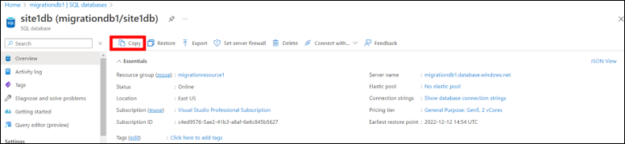

4. Enter the Azure App Service 2 database details.

    * Type in the database name [Data base name must be same as azure app service 1 database name].
    * Select the Azure App Service 2 SQL Server name.
    * Choose “Yes” if you want to host it in the elastic database pool. If not, leave the default value “No”.
    * Decide the Compute and Storage.
    * Click **Create**.

    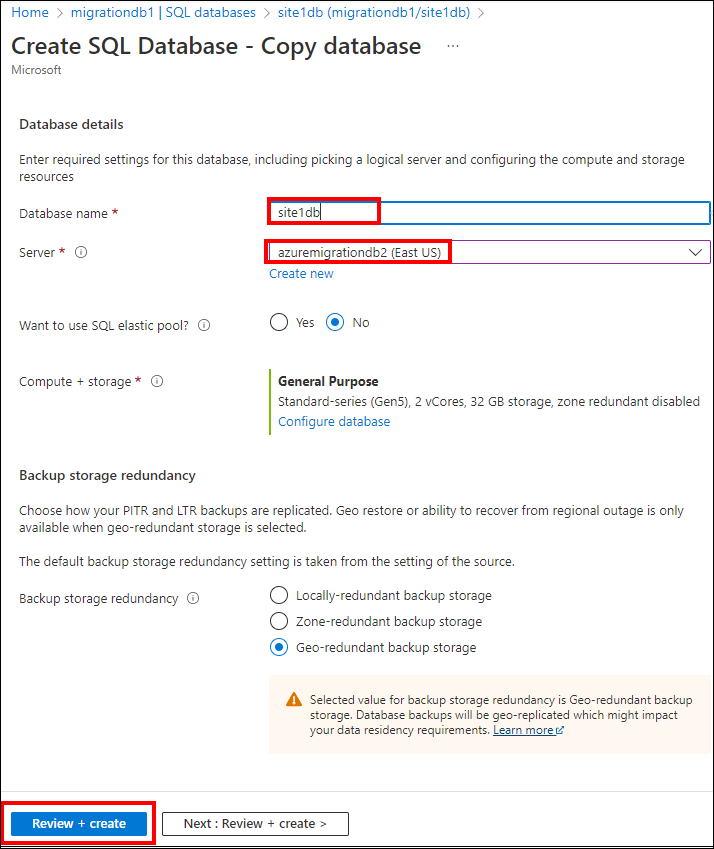

5. The database is now available in the Azure App Service 2 SQL server.

> Note : Follow the copy database steps for all the databases that the Bold Reports<sup>®</sup> server application uses.

## Update database connection string in Bold Reports<sup>®</sup>

You update the Bold Reports<sup>®</sup> database connection string in the config.xml and privatekey.dat files from the storage account. Application data is always stored in the app_data folder, which makes Bold Reports<sup>®</sup> a stateful application.

1. Go to the storage account of Azure App Service 1, which was created when you deployed Bold Reports<sup>®</sup> in Azure App Service 1, and go to the container section.

   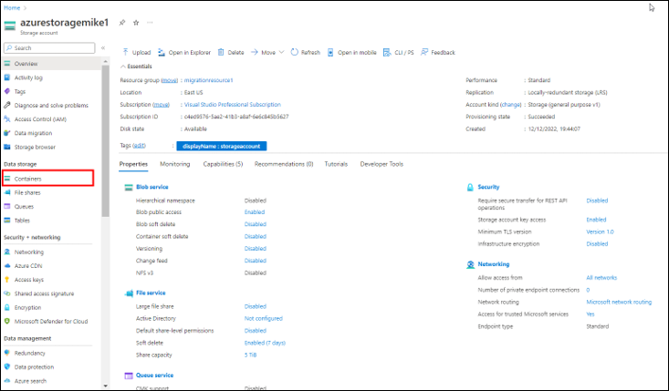

2. Navigate to the following location. **boldreportscontainer/boldservices/app_data/configuration**

   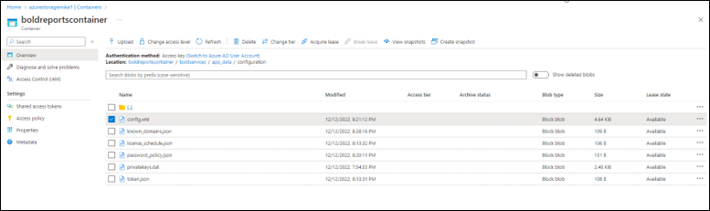

3. Download the **config.xml** and **privatekey.dat** file.

   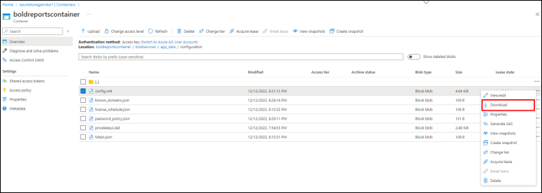

4. To change the database connection string, download the utility from [Utility](https://www.syncfusion.com/downloads/support/directtrac/general/ze/adminutils-1865244183).

5. Extract the zip folder.

6. Create a new folder **app_data\configuration** under the adminutils folder, as shown in the following screenshot.

7. Copy the config.xml and privatekeys.dat files that you downloaded earlier and paste them under **adminutils-1865244183\app_data\configuration**.

   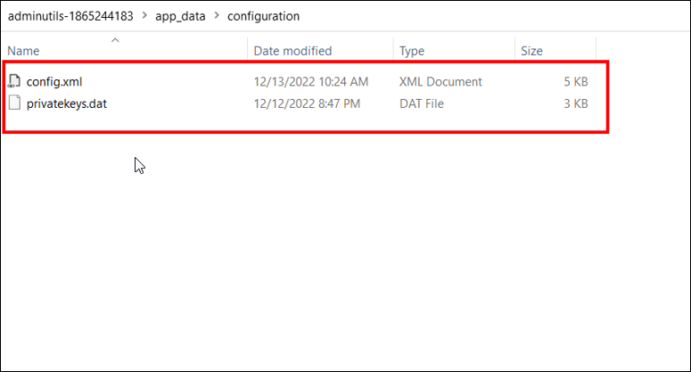

8. Navigate to the utility directory in the command prompt and run the following command:

   **Syncfusion.Server.Commands.Utility.exe dbconfig -servername "localhost" -databasename "BoldReportsMasterDatabase" -u "Admin" -p "Admin@12345" -iswindowsauthentication false -sslenabled false**

   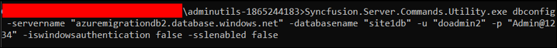

   > **Note:** Provide SQL Server details of Azure app service 2.

   **Command details**

   Servername – Server hostname/IP

   Database name -  database name (Master database name for boldreport application)

   u – server username

   p – server password

   iswindowsauthentication – Is windows authentication required (this is optional)

   sslenabled – Is encrypted connection required (this is optional)

9. After the command runs successfully, open the **config.xml** file located in **adminutils-1865244183\app_data\configuration** and update the target Azure App Service URL under InternalAppUrls.

   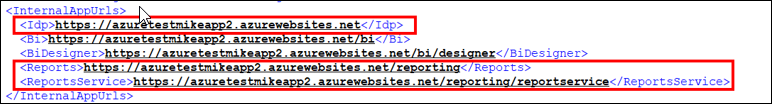

10. Update the config.xml and privatekey.dat files in the target storage account of the Azure App Service.

11. Go to the storage account of Azure App Service 2, which was created when you deployed Bold Reports<sup>®</sup> in Azure App Service 2. In the container section, navigate to **boldreportscontainer/boldservices/app_data/configuration**.

12. Delete the existing **config.xml** and **privatekey.dat** files from that location.

    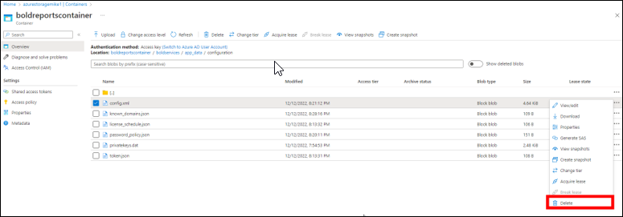

13. Click Upload, select the config.xml and privatekey.dat files from the **adminutils-1865244183\app_data\configuration** location, and upload them.

    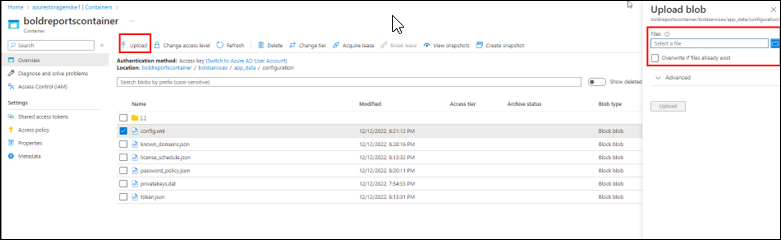

## Update storage account details and base url in sql server database of azure app service 2

To point Bold Reports<sup>®</sup> to the new environment, update the values in each database in the SQL server of Azure App Service 2 that you copied from the source SQL server. Update the values in these tables:

* [dbo].[BOLDRS_SystemSettings]

* [dbo].[BOLDTC_SystemSettings]

* [dbo].[BOLDTC_Tenant]

> **Note:** [dbo].[BOLDTC_SystemSettings] and [dbo].[BOLDTC_Tenant] tables are available only in master database.

## Queries to update the storage account details and base url

Use the following queries to update the Bold Reports<sup>®</sup> storage account details and base URL for Azure App Service 2:

**Query for updating values in [dbo].[BOLDTC_Tenant] table:**

``` sql
USE [Database_name]
UPDATE [dbo].[BOLDTC_Tenant]
   SET DNS = '<azure_app_service_url>/reporting'
```

**Query for updating values in [dbo].[BOLDTC_SystemSettings] table:**

``` sql
USE [Database_name]
UPDATE [dbo].[BOLDTC_SystemSettings]
SET SystemValue = CASE [SystemKey]
 when 'BaseUrl' then '<azure_app_service_url>'
 when 'AzureBlobStorageUri' then '<uri of target storage account>'
 when 'ConnectionString' then '<Connection string of storage account>'
 when 'BlobStorageAccountName' then '<Storage account name>'
 when 'BlobStorageAccessKey' then '<Access key of storage account>'
 End
WHERE [SystemKey] in ('BaseUrl','AzureBlobStorageUri','ConnectionString','BlobStorageAccountName', 'BlobStorageAccessKey');
```

**Query for updating values in [dbo].[BOLDRS_SystemSettings] table:**

``` sql
USE [Database_name]
UPDATE [dbo].[BOLDRS_SystemSettings]
SET Value = CASE [Key]
 when 'BaseUrl' then '<azure_app_service_url/reporting/site/<site_identifier of the site>>'
 when 'AzureBlobStorageUri' then '<uri of target storage account'
 when 'ConnectionString' then '<connecting string of storage account>'
 End
WHERE [Key] in ('BaseUrl','AzureBlobStorageUri','ConnectionString');
```

After these queries run successfully for all the databases, all data is migrated to Azure App Service 2.

## How do I update the site database connection after migration?

You update each Bold Reports<sup>®</sup> site's database connection in the UMS application after you start Azure App Service 2.

1. Start Azure App Service 2.

2. Go to the site listing page of the UMS application.

3. Click the context menu and select the edit option.

   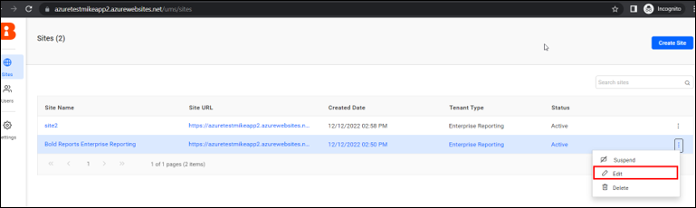

4. Proceed to the next page.
  
   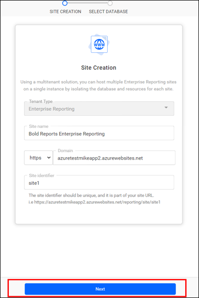

5. Change the site's database connection on this page. Modify the server name, username, and password, and update the details.

   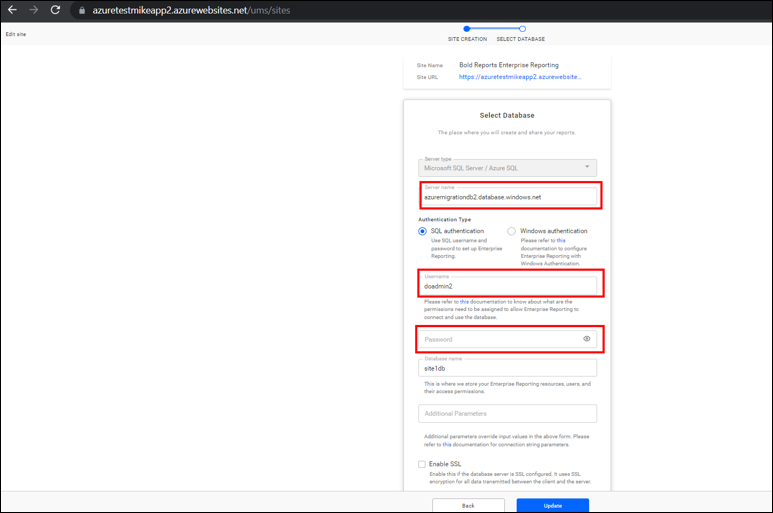

6. Repeat these steps for all your tenants.

7. Your report sites launch with your existing data.

## Frequently asked questions

### Do the source and target app services need the same Bold Reports<sup>®</sup> version?

Yes. Deploy the same version of Bold Reports<sup>®</sup> on your target app service before you migrate.

### Which tables exist only in the master database?

The [dbo].[BOLDTC_SystemSettings] and [dbo].[BOLDTC_Tenant] tables are available only in the master database.

## See also

* [Migrate from one server single tenant to multiple servers in Azure Blob Storage](./../migrate-from-one-server-single-tenant-to-multiple-server-in-azure-blob-storage/)
* [Install Report Server over Bold BI in Azure App Services](./../../how-to-install-bold-reports-server-over-bold-bi/)
* [Migration how-to guides](./../)
