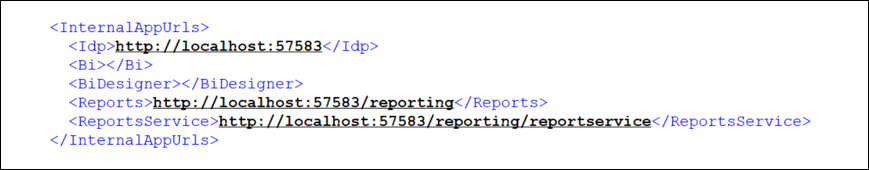
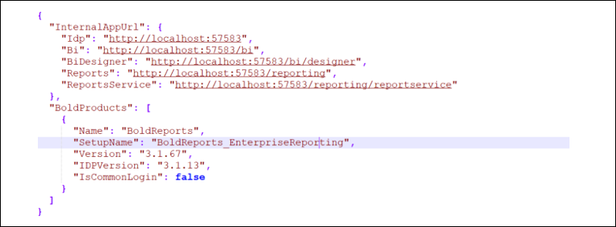
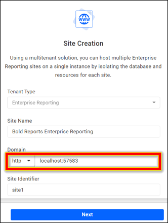
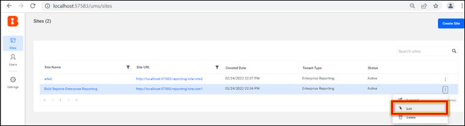
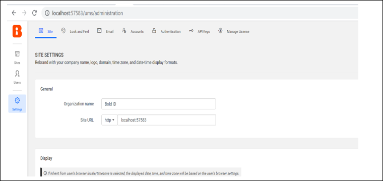
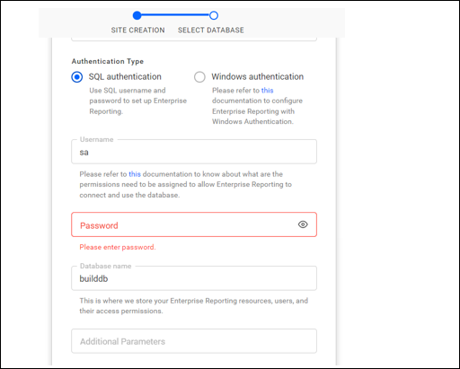

# How to migrate a Bold Reports® EC2 instance Windows Server with PostgreSQL

You can migrate Bold Reports® Server data from one EC2 instance Windows Server (staging) to another EC2 instance Windows Server (production) without any data loss.

## How do I migrate Bold Reports® between EC2 Windows Server instances?

To migrate Bold Reports® between EC2 instances, install the same build on the production server, copy the app_data folder, update the domain name, and update each site.

1. Before you start the migration, install the same version of the Bold Reports® build on your EC2 instance Windows Server target machine (production).

2. After installation, do not launch or start the application.

3. Stop the BoldReports_EnterpriseReporting application in IIS manager on Server 2. You need to make configuration changes in the files to migrate data from EC2 instance Windows Server 1 (staging) to EC2 instance Windows Server 2 (production).

4. Copy the app_data folder from the C:\BoldServices\ location on Server 1 and paste it in the same location on Server 2.

5. On Server 2, open the **config.xml** file and **product.json** file under the **(C:\BoldServices\app_data\configuration)** folder and update the Server 2 domain name.

    **Config.xml**

    

    **Product.json**

    

6. Start the **BoldReports_EnterpriseReporting** application in IIS manager.

7. On Server 2, go to the site listing page of the UMS application.

8. Go to the settings and change the Site URL to your domain name, as shown in the following screenshot.

   

9. Click the context menu of the site and select the Edit option.

   

10. Update the domain name of Server 2.

    

11. Proceed to the next page, where you can change the site's database connection. Update the password with the Server 1 database details.

    

12. Repeat steps 9 to 11 for all your sites. Your Bold Reports® sites then launch with your existing data.

## Frequently asked questions

### Should I start the application on the production server right after installation?

No. After installation, do not launch or start the application until you copy the app_data folder and update the configuration files.

### Which files do I update with the new domain name?

Update the **config.xml** and **product.json** files under C:\BoldServices\app_data\configuration on Server 2.

## See also

* [Migrate from one server to another with a PostgreSQL database on Windows](./../migrate-server-to-another-server-using-postgresql-database-on-windows/)
* [Migrate from one server to another without a database on Windows](./../migrate-server-to-another-server-without-database-on-windows/)
* [Migration how-to guides](./../)
