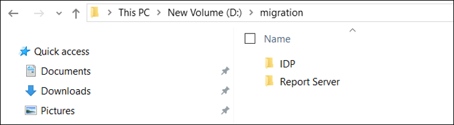
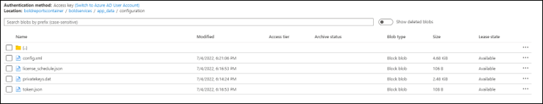
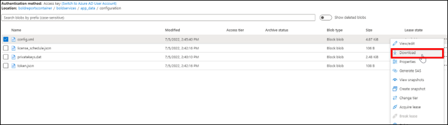
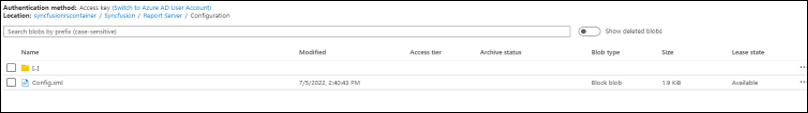
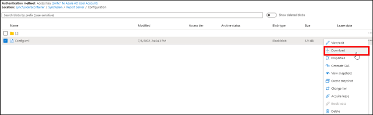
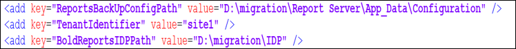
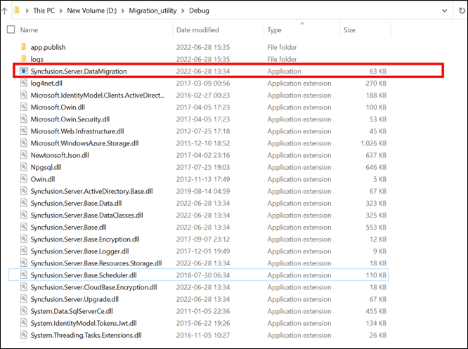
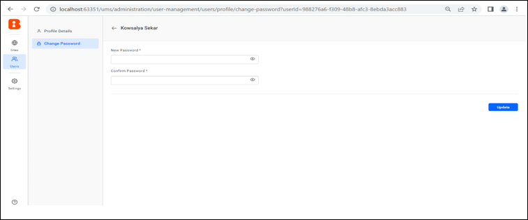

# Migrate a Syncfusion<sup>®</sup> single-tenant Report Server to a Bold Reports<sup>®</sup> multi-tenant server in Azure Blob Storage

You can move reports, data, users, and permissions from a Syncfusion<sup>®</sup> single-tenant Report Server to a Bold Reports<sup>®</sup> multi-tenant server in Azure Blob Storage. You copy the configuration files from both storage accounts to your local machine, and then run the data migration utility.

## How do I prepare the configuration files for migration?

To prepare for the Bold Reports<sup>®</sup> migration, download the configuration files of both servers from Azure Blob Storage into local IDP and Report Server folders.

1. Create an IDP folder and a Report Server folder on your local machine, as shown in the following screenshot.

   

2. Create the sub-folder structure **/App_Data/Configuration/** under the **IDP** folder.

3. Go to the storage account created when you deployed Bold Reports<sup>®</sup> (multi-tenant). In the container section, navigate to **boldreportscontainer/boldservices/app_data/configuration**.

   The following screenshot shows this location in the storage account.

   

4. Download the **config.xml** and **privatekeys.dat** files to the **IDP/App_Data/Configuration** folder.

   

5. Create the sub-folder structure **/App_Data/Configuration/** under the Report Server folder on your local machine.

6. Go to the storage account of the previous Syncfusion<sup>®</sup> Report Server (Single-Tenant). In the container section, navigate to **syncfusionrscontainer/Syncfusion<sup>®</sup>/Report Server/Configuration/**.

   

7. Download the **config.xml** file to the **Report Server/App_Data/Configuration** folder.

   

8. Run the data migration utility, as described in the next section.

## Steps to run the data migration utility

The Syncfusion<sup>®</sup> data migration utility moves your Report Server resources into Bold Reports<sup>®</sup> after you point it at the two configuration folders.

1. Download the shared Migration Utility zip folder from the [Migration Utility download](https://www.syncfusion.com/downloads/support/common/5100/ze/Migration_Utility_4f292a75.zip).

2. Extract the folder and edit the **Syncfusion.Server.DataMigration.exe.config** file.

3. Update the values of the following keys in the config file:

   ``` html
   <add key = “ReportsBackUpConfigPath” value=””/>
   <add key = ”BoldReportsIDPPath” value=”D:\migration\IDP”/>
   ```

   The following screenshot shows these keys in the config file.

   

4. Copy the Configuration path from your Report Server backup folder and paste it as the value of the **ReportsBackUpConfigPath** key.

   For example,

   ``` html
   <add key="ReportsBackUpConfigPath" value=" D:\migration\Report Server\App_Data\Configuration" />
   ```

5. Copy the IDP folder path from your backup folder and paste it as the value of the **BoldReportsIDPPath** key.

   For example,

   ``` html
   <add key=" BoldReportsIDPPath" value="D:\migration\IDP" />
   ```

6. Run **Syncfusion.Server.DataMigration.exe** from the extracted location.

   

## What does the migration utility migrate?

The Bold Reports<sup>®</sup> data migration utility migrates some resources and skips others.

> **Note:**
> * The migration tool can migrate your resources like Reports, Data Sets, Data Sources, Schedules, Users, Groups and Permissions.<br>
>
> * The utility does not migrate Admin Settings and Profile Pictures.<br>
>
> * The utility does not migrate user passwords, so you must set them manually. On the UMS page, set the password for each user, as shown in the following screenshot.<br>
> 

## Frequently asked questions

### Does the migration utility migrate user passwords?

No. The utility does not migrate user passwords, so you set each password manually on the UMS page.

### Which resources does the migration utility migrate?

The utility migrates Reports, Data Sets, Data Sources, Schedules, Users, Groups, and Permissions. It does not migrate Admin Settings and Profile Pictures.

## See also

* [Migrate Report Server using a SQL Server database on Windows](../migrate-server-to-another-server-using-sql-database-on-windows/)
* [Migrate Report Server with its database in Azure App Service](../migrate-bold-reports-server-with-database-in-azure-app-service/)
* [Migrate Report Server without a database on Windows](../migrate-server-to-another-server-without-database-on-windows/)
