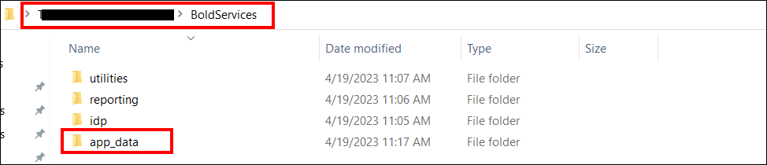
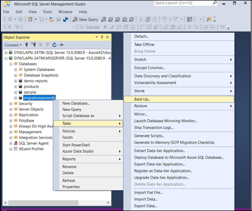
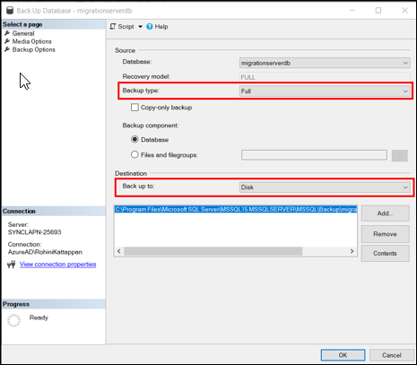
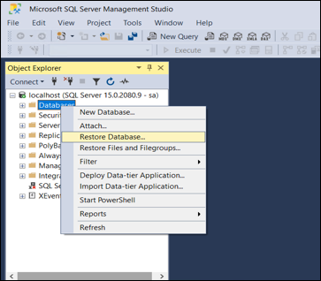
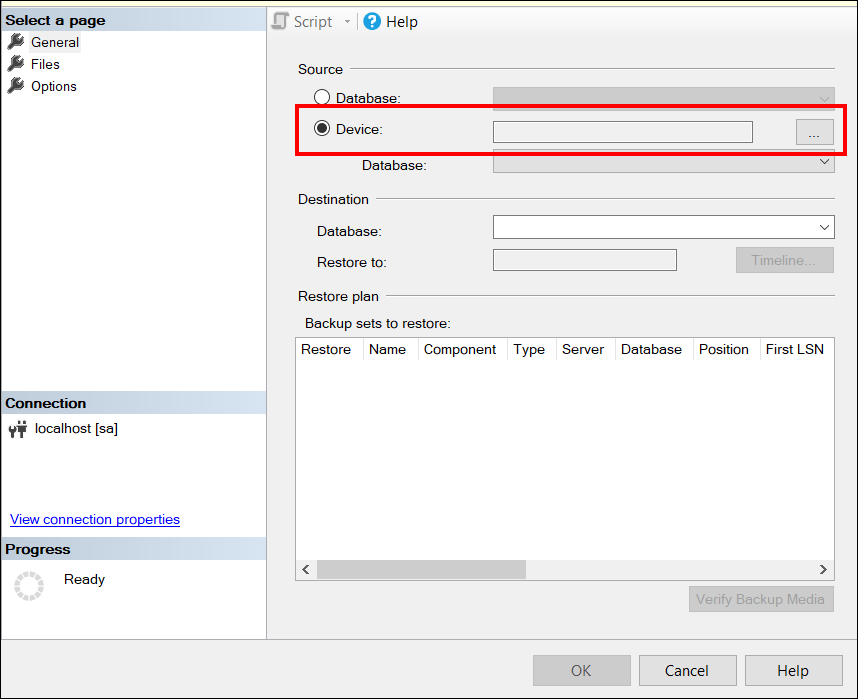
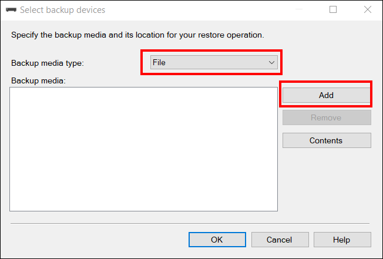
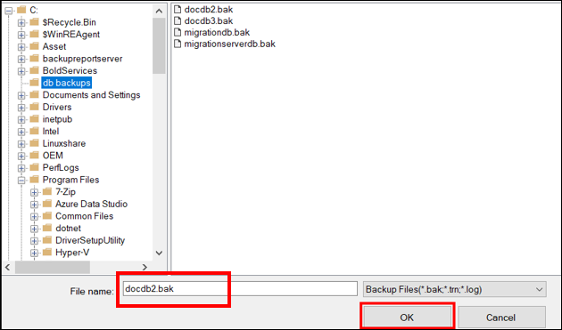
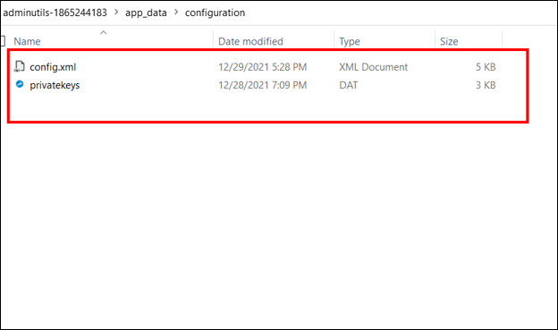
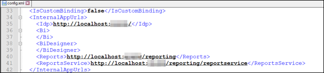
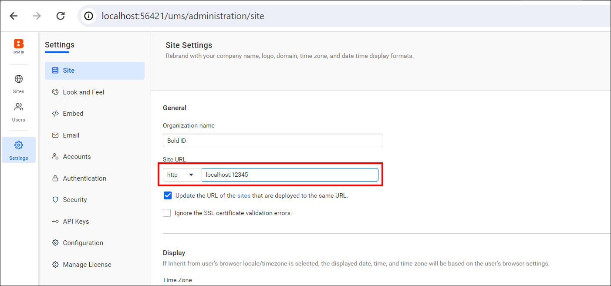

# Migrate Bold Reports® Report Server to another Windows server with a SQL Server database

You can migrate Bold Reports® Report Server data from one Windows server to another without data loss when your metadata is in SQL Server. You copy the **app\_data** folder, back up and restore the databases in SSMS, and then update the connection string.

## How do I prepare the target server?

To prepare for the Bold Reports® migration, install the same build on the target server and copy the application data from the source server.

1. Install the same version of the Bold Reports® build on your target machine before you start the migration.

2. After installation, do not launch or start the application.

3. Stop the **BoldReports_EnterpriseReporting** application in IIS manager. You must change configuration files to migrate data from Server-1 to Server-2.

4. Copy the **app\_data** folder under **Deployed location:\BoldService** from Server-1 and paste it in the same location on Server-2. Bold Reports® stores application data in the **app\_data** folder, which makes it a stateful application.
   

Follow these steps to change the configurations on the target server.

## Backup Database

Each Bold Reports® site maintains an individual metadata database. To ensure data protection for each site, you need to back up all these metadata databases used across your Bold Reports® applications. Follow the steps below to perform the backup:

1. Open SSMS and connect to the SQL Server on Server-1.

2. Expand **Databases** and select the required database.

3. Right-click the database and select **Tasks** > **Backup**.
   

4. In the **Back Up Database** window, set **Backup Type** to **Full**. Under **Destination**, set **Back up to** to **Disk**.
   

5. Select **Remove** to remove the default destination location.

6. Click **Add** to select the destination and name for the database backup file.

7. Select the folder for the backup file and enter a file name that matches the database name, with a .bak extension.

8. Click **OK** to finish the backup process.

## Restore SQL Database Using SSMS

To restore the Bold Reports® metadata on the target server, copy all backup files with the .bak extension from Server-1 to Server-2. Then, follow these steps:

1. Open SSMS and connect to your database on Server-2.

2. Right-click **Databases** and select **Restore Database**.
   

3. In the **Restore Database** window, select **Device** under the **Source** section and click **Browse**.
   

4. In the **Select Backup Device** window, set **Backup media type** to **File** and click **Add**.
   

5. Select the backup file that you want to restore and click **OK**.
   

6. The .bak file appears in the **Select Backup Device** window. Click **OK**.

## Update database connection string in Bold Reports®

To point Bold Reports® at the restored database, update the database connection string in the **config.xml** file under **C:\BoldServices\app_data\configuration**.

1. Download the utility that changes the database connection string from the [admin utility download](https://www.syncfusion.com/downloads/support/directtrac/general/ze/adminutils-1865244183).

2. Extract the zip file.

3. Create a new folder **app_data\configuration** in the utility folder, as shown in the following screenshot.

4. Copy the **config.xml** and **privatekeys.dat** files from **C:\BoldServices\app_data\configuration** and paste them under **adminutils-1865244183\app_data\configuration**.
   

5. Navigate to the utility directory in a command prompt and run the following command:

   **Syncfusion.Server.Commands.Utility.exe dbconfig -servername "localhost" -databasename "BoldReportsMasterDatabase" -u "Admin" -p "Admin@12345" -iswindowsauthentication false -sslenabled false**

   **Command details**

   Servername: Server hostname/IP

   Database name: database name (IDP)

   u: server username

   p: server password

   iswindowsauthentication: Is windows authentication required (this is optional)

   sslenabled: Is encrypted connection required (this is optional)

6. After the command runs successfully, copy the config.xml and privatekeys.dat files from **adminutils-1865244183\app_data\configuration** in the utility folder. Replace them in **Deployed location:\BoldServices\app_data\configuration** on Server-2.

7. Check and update the IP address or localhost port in the config.xml file and product.json under **BoldServices\app_data\configuration** on Server-2. If you use DNS, leave the values as they are, because they are already available when you copy the files from Server-1 to Server-2.
   

8. Bind the DNS in IIS on Server-2 that you used on Server-1. If you did not use a DNS, skip this step.

9. Start the BoldReports_EnterpriseReporting application in IIS manager.

10. Go to the site listing page of the UMS application.

11. Go to settings and change the site URL to your domain name, as shown in the following screenshot.
    

12. Your report sites now launch with your existing data.

## Frequently asked questions

### Which backup file extension does the SQL Server migration use?

The SQL Server backup files use the .bak extension. Name each file after its database.

### Do I need to bind a DNS on the new server?

Bind the DNS in IIS on Server-2 only if you used one on Server-1. Otherwise, skip that step.

## See also

* [Migrate Report Server using a PostgreSQL database on Windows](../migrate-server-to-another-server-using-postgresql-database-on-windows/)
* [Migrate Report Server without a database on Windows](../migrate-server-to-another-server-without-database-on-windows/)
* [Migrate the Report Server database using MySQL](../migrate-bold-reports-database-from-one-server-to-another-server-using-mysql/)
