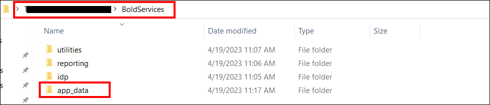
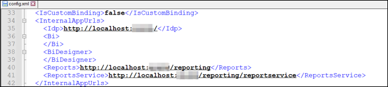
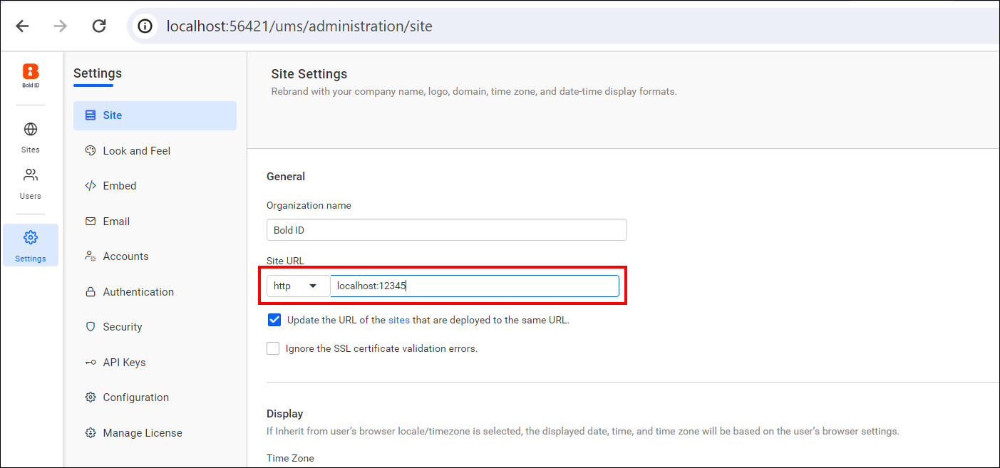

# Migrate Bold Reports® Report Server to another Windows server without a database

You can migrate Bold Reports® Report Server data from one Windows server to another without data loss by copying the **app_data** folder. You do not back up or restore a database for this migration.

## How do I migrate Report Server without a database?

To migrate Bold Reports® Report Server without a database, install the same build on the target server, copy **app_data**, and update the configuration.

1. Install the same version of the Bold Reports® build on your target machine before you start the migration.

2. After installation, do not launch or start the application.

3. Stop the **BoldReports_EnterpriseReporting** application in IIS manager on Server-2. You must change configuration files to migrate data from one server to another.

4. On Server-1, copy the complete **app_data** folder from the build installed location.
   

5. Paste the copied **app_data** folder in the same location on Server-2.
   

6. Check and update the IP address or localhost port in the **config.xml** file and **product.json** under **BoldServices\app_data\configuration** on Server-2. If you use DNS, leave the values as they are, because they are already available when you copy the files from Server-1 to Server-2.
   

7. Bind the DNS in IIS on Server-2 that you used on Server-1. If you did not use a DNS, skip this step.

8. Start the **BoldReports_EnterpriseReporting** application in IIS manager.

9. Go to the site listing page of the UMS application.

10. Go to settings and change the site URL to your domain name, as shown in the following screenshot.
    

11. Your report sites now launch with your existing data.

## Frequently asked questions

### Should I start the application on the target server before copying app_data?

No. After you install Bold Reports® on the target machine, do not launch or start the application. Stop **BoldReports_EnterpriseReporting** in IIS manager before you copy the files.

### What do I update after copying app_data?

Check and update the IP address or localhost port in **config.xml** and **product.json** on Server-2. If you use DNS, leave the values as they are.

## See also

* [Migrate Report Server using a SQL Server database on Windows](../migrate-server-to-another-server-using-sql-database-on-windows/)
* [Migrate Report Server using a PostgreSQL database on Windows](../migrate-server-to-another-server-using-postgresql-database-on-windows/)
* [Migrate Report Server with its database in Azure App Service](../migrate-bold-reports-server-with-database-in-azure-app-service/)
