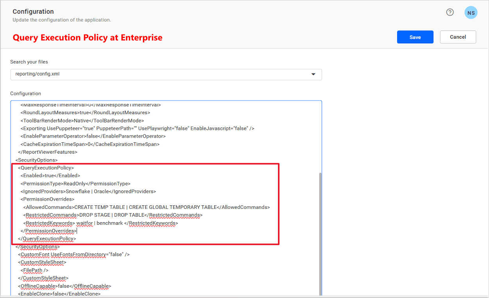

# Query Execution Policy

Query Execution Policy in **Bold Reports®** is a combination of Security Policy and Permission Policy. Together, these policies control, validate, and secure query execution within the application, protecting your data by enforcing strict server-level rules. Enabling Query Execution Policy helps administrators ensure only approved queries are run, mitigating risks of data breaches and privilege escalation.

## How Query Execution Policy Works

When enabled, Query Execution Policy validates incoming queries using both high-level permissions and granular command restrictions. Each query is checked in a specific order against a range of policy nodes to decide whether it should be executed, blocked, or flagged for review.

## How to Configure Query Execution Policy

Configuration for Query Execution Policy is performed via the **Bold Reports®** UMS Admin interface.

## Query Execution Policy

### 1. Enabled

* **Purpose:** Globally toggle Query Execution Policy validation for all incoming queries.
* **Behavior when enabled:** All configured policies are enforced. Unauthorized or non-compliant queries will be blocked with a validation message.
* **Behavior when disabled:** Server will NOT enforce any Query Execution Policy. Queries are executed as usual, without restriction.

### 2. Permission Types

* **Overview:** Defines the base set of commands and actions permitted to execute across the system.
* **Effect:** Determines whether query execution is restricted to ReadOnly, ReadWrite, or Unrestricted commands. See [Permission Types](./../query-execution-policy/permission-policy/#permission-types) for detailed breakdowns.

### 3. Ignored Providers

* **Purpose:** Specify data providers or sources that should bypass Query Execution Policy checks for special scenarios. If a data provider is listed here, both Security Policy and Permission Policy will not be enforced for those sources See [Supported Providers](#supported-providers).
* **Configuration:** Set provider names or connection identifiers to ignore in policy settings.

### 4. Permission Overrides

* Defines global command restrictions and allowances configured in UMS that apply across the Query Execution Policy. Permission overrides do not bypass Security Policy under any circumstances.
* Includes Restricted Commands, Restricted Keywords, and Allowed Commands. See [Permission Overrides](./../query-execution-policy/permission-policy/#permission-overrides) for detailed configuration options.

## Query Evaluation Order

Queries are validated in the following order, with security protections enforced first:

1. **Dangerous Commands**: Blocked immediately if the query contains any dangerous commands. See [Dangerous Commands](./../query-execution-policy/security-policy/#dangerous-patterns) for detailed breakdowns.
2. **Injection Patterns**: If the query matches a known dangerous injection pattern, it is blocked. See [Injected Patterns](./../query-execution-policy/security-policy/#injected-patterns) for detailed breakdowns.
3. **Restricted Commands**: Blocked if the query contains any restricted commands, regardless of permission type.
4. **Restricted Keywords**: Blocked if the query contains any restricted keywords.
5. **Allowed Commands**: The query is permitted if it only uses allowed commands (unless blocked for security reasons).
6. **Permission Types**: The configured Permission Type (ReadOnly, ReadWrite, Unrestricted) is evaluated last; if the command is permitted by type, it is allowed unless blocked above.

## Supported Providers

These are the supported providers for Query Execution Policy:

> **Dataconnectors:** SQL, MySQL, Oracle, PostgreSQL, SSAS, Snowflake, GoogleBigQuery, ODBC, Oledb